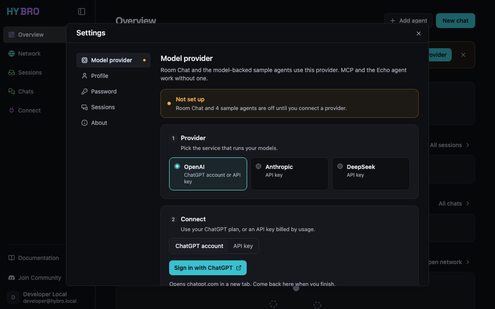
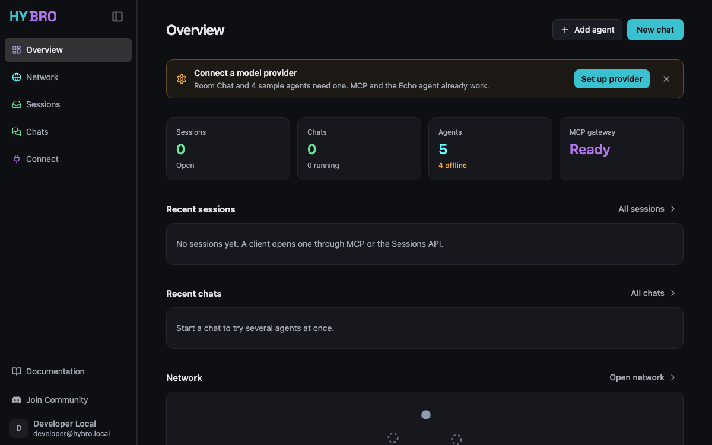
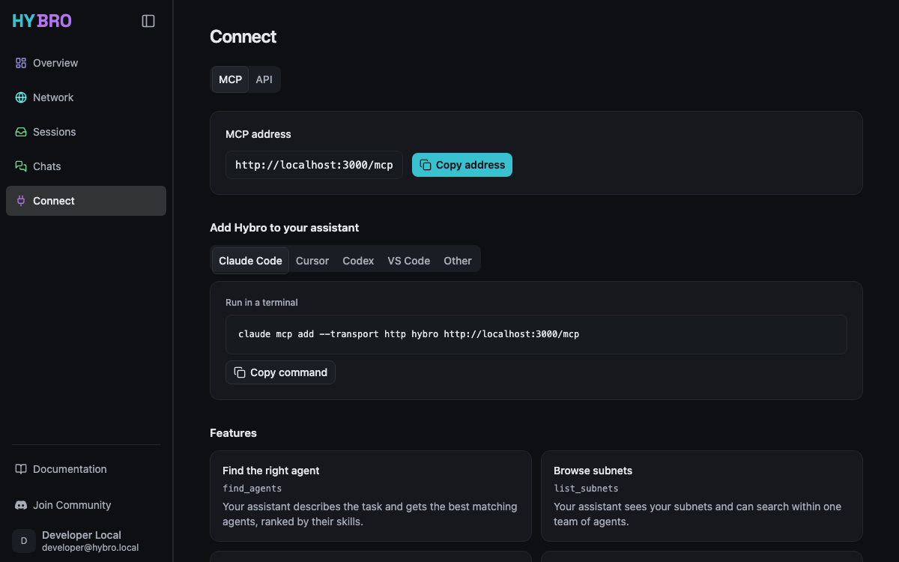

<div align="center">
  <a href="https://hybro.ai">
    <picture align="center">
      <source media="(prefers-color-scheme: dark)" srcset="assets/logo-dark.svg">
      <source media="(prefers-color-scheme: light)" srcset="assets/logo-light.svg">
      
    </picture>
  </a>

  <p>
    The open-source agent interoperability platform.<br />
  </p>

  <p>
    <a href="https://opensource.org/licenses/Apache-2.0"></a>
    <a href="https://x.com/HybroAI"></a>
    <a href="https://www.linkedin.com/company/hybroai"></a>
    <a href="https://discord.gg/2S5pCKzUmJ"></a>
  </p>
</div>

<p align="center">
 ⭐ <em>Star this repo to support the growing Hybro open-source community!</em>
</p>

Hybro AI is an open-source, hybrid multi-agent platform built for seamless agent interoperability. It serves as the core orchestration engine powering the Hybro Agent Network—enabling local and remote AI agents to communicate, collaborate, and execute complex workflows.

<p align="center">
  
</p>

## Contents

- [Overview](#overview)
- [Getting Started](#getting-started)
  1. [Prerequisites](#1-prerequisites)
  2. [Install and start](#2-install-and-start)
  3. [Open the app](#3-open-the-app)
  4. [Take a tour](#4-take-a-tour)
  5. [Connect an MCP client](#5-connect-an-mcp-client)
- [Running](#running)
- [Configuration](#configuration)
- [Development and released stacks](#development-and-released-stacks)
  - [Upgrading](#upgrading)
  - [Upgrading from 0.3](#upgrading-from-03)
  - [Uninstall](#uninstall)
- [Architecture](#architecture)
- [Contributing](#contributing)

## Overview
Hybro AI allows developers and teams to deploy, coordinate, and inspect clusters of autonomous AI agents. Powered by an async FastAPI backend and an interactive Next.js dashboard, Hybro provides real-time agent visualization, execution room management, and protocol-agnostic message routing via the Agent2Agent (A2A) standard.

### Key Features
- **Hybrid Agent Execution**: Seamlessly connect and orchestrate local on-device agents and remote cloud-hosted services.
- **Native Agent Interoperability**: Built around the open Agent2Agent (A2A) protocol for standardized inter-agent communication.
- **Multi-Agent Execution Rooms**: Group specialized agents in dedicated execution rooms to solve multi-step tasks collaboratively.
- **Real-Time Streaming & Inspection**: Live SSE message streaming, multi-agent turn timelines, and an interactive A2A Agent Inspector for testing agent capabilities.
- **One Container**: One image runs the UI, API, MCP gateway, MongoDB, and the bundled agents on one port; the model provider is set up in the browser.

## Getting Started

### 1. Prerequisites

| You need | When |
|---|---|
| Docker (Docker Desktop on macOS, Docker Engine on Linux), amd64 or arm64 | Always |
| An API key for OpenAI, DeepSeek, or Anthropic, or a ChatGPT account for OAuth | For the LLM-backed agents and Room Chat; Echo Agent and MCP work without one |
| Node.js | Only to install the CLI with npm |
| Node.js 24+ | Only to run the frontend outside of Docker |
| Python 3.12+ and MongoDB 4.2+ | Only to run the backend outside of Docker (the image embeds MongoDB 7.0) |

### 2. Install and start

Hybro runs as one container from one image. The `hybro` command is a small
shell script that starts it with Docker.

```bash
curl -fsSL https://hybro.ai/install.sh | sh
hybro
```

`install.sh` verifies the script against the release's `SHA256SUMS`, installs it
into `~/.local/bin` (or a writable `/usr/local/bin` when `~/.local/bin` is not on
`PATH`), and pulls the image. It never uses `sudo` and never edits shell
profiles; if the directory is not on `PATH`, it prints the line to add. With npm
instead: `npm install -g @hybroai/cli`. Both install the same script.

`hybro` (or `hybro start`) pulls the image for its own version, starts the
container, prints the address, and follows the logs; Ctrl-C stops Hybro.
`hybro start -d` runs it in the background.

| | Released install | Source checkout |
|---|---|---|
| Use it to | Try or use Hybro | Change Hybro |
| Command | `hybro` | `./scripts/hybro` |
| Image | `ghcr.io/hybroai/hybro:<version>`, pulled | `hybro:dev`, built from your working tree |
| App, API, and MCP | http://localhost:3000 | http://localhost:3100 |

From a checkout:

```bash
git clone https://github.com/hybroai/hybro.git
cd hybro
./scripts/hybro
```

The first build takes several minutes; later starts reuse the image until you
pass `--build`. In a checkout, use `./scripts/hybro` wherever this README shows
`hybro`. Configuration lives in `~/.hybro/` (or the absolute path in
`HYBRO_HOME`) for both.

**Set up a model provider**

Hybro starts without a model provider. Until one is set up, a banner on the
Overview and in Chats links to **Settings**, Room Chat is disabled, and the four
LLM-backed agents stay inactive; Echo Agent and MCP work at once. The
**Settings** dialog (also under your name at the bottom of the sidebar) opens on
**Model provider**, which has three steps:

1. **Provider**: OpenAI, Anthropic, or DeepSeek.
2. **Connect**: for OpenAI, sign in with your ChatGPT account or use an API key;
   Anthropic and DeepSeek take an API key.
   - **Sign in with ChatGPT** opens chatgpt.com in a new tab. After you approve,
     that tab says you can close it, and Settings shows **Connected** with the
     recommended models saved. If the browser is not on the machine running
     Hybro, the sign-in ends on a `localhost:1455` address that does not load;
     paste that address into the waiting panel instead.
   - **Check and save** verifies an API key with one small request before
     saving it to `auth.json`. The key is never shown again; **Replace key**
     sets a new one.
3. **Models**: the text model (the first is recommended) and, with an OpenAI API
   key, an optional image model and image size. **Save models** applies them.

The provider and models apply without a restart; a new image size applies after
`hybro stop` and `hybro`. The status at the top of the section shows **Not set
up**, **Waiting for sign-in**, **Connected**, or **ChatGPT sign-in expired**,
with **Sign in again** for the last.

<p align="center">
  
</p>

**Run on a server**

`hybro` listens on `127.0.0.1` by default. `--listen <address>` serves the app on
another address, for example `hybro start -d --listen 0.0.0.0 --port 443`. A
non-loopback listener requires sign-in (Clerk) and a `frontend.server_url`, or
the explicit `--insecure-no-auth` for a trusted network. MCP is served only on a
loopback listener.

### 3. Open the app

Open the address that `hybro` prints. The **Overview** page shows your chats,
the five bundled agents, and whether the MCP gateway is ready. Until a model
provider is set up, its banner links to **Settings**.

<p align="center">
  
</p>

If the page does not load, check Hybro with `hybro status` and `hybro logs`.

### 4. Take a tour

**Start a chat.** Open **Chats** and select **New chat**. Type `@` to mention an
agent, or keep **All agents** so Hybro can choose from every available agent.
Pick **Ultimate** for big tasks that need planning, or **Fast** for quick and
simple questions. Replies stream in live, and **Agent responses** shows which
agents were called.

<p align="center">
  
</p>

**Answer an agent.** When an agent needs more information or approval, the chat
shows the question and waits for you to **Send** an answer or **Reject** it.
The **Chats** badge counts chats that need input.

<p align="center">
  
</p>

**Explore the network.** **Network** shows every registered agent and the
subnets (teams) that group them. Use **Add agent** to register your own A2A
agent, or **Create subnet** to group agents.

<p align="center">
  
</p>

The bundled agents are **Echo Agent**, **Weather Agent**, **Story Agent**,
**Travel Planner Agent**, and **Image Generator Agent**. Echo Agent repeats your
message and needs no model provider, so it works right after install. The
others stay inactive, with the reason shown on their cards, until a model
provider is set up; Image Generator Agent also needs an image model. The
**Travel Planner** and **Story & Image Creator** cards on the Chats page start
a ready-made multi-agent chat.

### 5. Connect an MCP client

MCP is part of the container and shares its address: `http://localhost:3000/mcp`
for a released install, `http://localhost:3100/mcp` from a checkout. In the app,
open **Connect** (`/connect/mcp`) to copy the URL or a setup snippet for Claude
Code, Cursor, Codex, VS Code, or another assistant. The Overview **MCP gateway**
tile shows whether MCP is reachable. Add the server manually to your client;
Hybro does not automatically discover or register MCP clients.

<p align="center">
  
</p>

```json
{
  "mcpServers": {
    "hybro": { "type": "http", "url": "http://localhost:3000/mcp" }
  }
}
```

The **Streamable HTTP** URL is for clients on the machine running Hybro. If you
open the app remotely, loopback in your client still refers to that client's
machine, not the Hybro host. MCP has no authentication or user isolation, so a
non-loopback listener does not serve it. Do not expose it publicly.
See [MCP tools, health, and native startup](backend/README.md#local-mcp-access).

## Running

```bash
hybro                        # start and follow the logs; Ctrl-C stops Hybro
hybro start -d               # start in the background
hybro start --port 4000      # another host port (the default is 3000, 3100 from a checkout)
hybro status                 # running or not, with the address
hybro logs -f                # follow the logs; docker logs options pass through
hybro stop                   # stop; data stays in the volume
hybro upgrade                # newest release, its image, and any 0.3 migration
hybro version
```

From a checkout, `./scripts/hybro start --build` rebuilds `hybro:dev` from the
working tree and `--recreate` replaces a running container. Start options are
flags only; environment variables do not become a second configuration source.
Configuration changes apply after `hybro stop` and `hybro`, except the model
provider, which applies at once.

## Configuration

Configuration lives in `~/.hybro/` (or the absolute path in `HYBRO_HOME`):
`config.json` holds settings and `auth.json` holds credentials. Set up the model
provider on the **Settings** page; it applies at once. Other settings are read
at startup, so edit `config.json` and run `hybro stop && hybro`. Repository
`.env` files are not read.

See [docs/configuration.md](docs/configuration.md) for the configuration
contract, editing, model access for agents, and the backend fields.

## Development and released stacks

| | Source checkout | Released install |
|---|---|---|
| Command | `./scripts/hybro` | `hybro` |
| Image | `hybro:dev`, built on first start or with `--build` | `ghcr.io/hybroai/hybro:<version>` |
| Container | `hybro-dev` | `hybro` |
| Data volume | `hybro-dev-data` | `hybro-data` |
| Default port | 3100 | 3000 |
| Update notice and `upgrade` | `git pull`; `upgrade` only migrates 0.3 data | daily notice; `hybro upgrade` |

Both read the same `~/.hybro/config.json` and `auth.json`, so a provider saved in
one is used by the other, and both can run at once.

### Upgrading

```bash
hybro upgrade --check       # report; exits non-zero when a newer release exists
hybro upgrade
```

`hybro upgrade` downloads the newest script, checks it against `SHA256SUMS`, and
replaces itself the way it was installed (through npm for an npm install), then
pulls the new image. A running container is started again on the new image with
the same port and listener. Once a day `hybro` also prints a one-line notice
when a newer release exists; `HYBRO_NO_UPDATE_CHECK=1` turns it off. A checkout
is updated with `git pull` and `./scripts/hybro start --build --recreate`.

### Upgrading from 0.3

Hybro 0.3 ran a Compose stack whose data lives in the `hybro_mongo_data` and
`hybro_room_files` volumes (`hybro-dev_*` for a checkout). The first `hybro`
after upgrading finds them, starts nothing, and offers two choices:

```bash
hybro upgrade      # copy the 0.3 data into the new volume
hybro --fresh      # or start with an empty volume and keep the old data aside
```

npm users get there with the 0.3 command `hybro upgrade`, which installs the
0.4 script. The migration stops the 0.3 containers, checks that Docker has twice
the 0.3 data size free, copies MongoDB and room files into `hybro-data` from
read-only mounts, opens the copy, records the document count of each collection
in `/data/hybro-volume.json`, and starts Hybro. Redis data is not migrated; it
held only transient state. `config.json` and `auth.json` stay where they are.
If the 0.3 install used a custom app port, the output shows the `--port` value
that keeps it.

The 0.3 volumes are only read, never changed. An interrupted or failed migration
leaves the new volume without its completion marker; the next `hybro` notices
it and `hybro upgrade` starts the copy over. After checking your data, remove
the 0.3 containers, volumes, and images with:

```bash
hybro cleanup-old
```

**Rollback to 0.3**

1. `hybro stop`.
2. Remove `admin_user_ids` from `config.json` if you set it, because 0.3 rejects
   unknown keys. 0.3 requires a configured model provider.
3. Reinstall 0.3.0 with `npm install -g @hybroai/cli@0.3.0`, or unpack the
   `hybro-0.3.0-<platform>.tar.gz` archive from the 0.3.0 release, then run
   `hybro start`.

0.3 finds its data as it was at the migration. Rooms, sessions, and agents
created in 0.4 are not carried back.

### Uninstall

```bash
hybro stop
docker rm hybro && docker volume rm hybro-data   # deletes all Hybro data
rm "$(command -v hybro)"                          # or: npm uninstall -g @hybroai/cli
```

`~/.hybro` holds the configuration and credentials; delete it to remove those too.

How releases are published is covered in [RELEASING.md](RELEASING.md).

## Architecture
This repository is the source of truth for the product. The root `Dockerfile`
builds the single image from these components, and Caddy serves them on one
port:
- `backend/`: A FastAPI orchestration engine using MongoDB for persistence, plus the image entrypoint (`runtime_entrypoint.py`) that writes each service's configuration and starts the processes.
- `frontend/`: A Next.js 16 application for chat, local agent discovery, agent management, and inspection.
- `default_agents/`: Ready-to-use A2A agents, each running as a process in the container. The backend registers them at startup from `default_agents/agents.yaml`.
- `MCP/`: An adapter exposing two backend agent-network tools over Streamable HTTP at `/mcp`.
- `scripts/hybro`: The POSIX shell CLI that starts the container; `install.sh` installs it.

For module boundaries, data flow, and streaming, see
[backend/docs/System-Architecture.md](backend/docs/System-Architecture.md) and
[frontend/docs/System-Architecture.md](frontend/docs/System-Architecture.md).

## Contributing
We welcome contributions from the community! Whether you are fixing a bug, adding a feature, or improving documentation, please feel free to open a pull request.

See [CONTRIBUTING.md](CONTRIBUTING.md) for local development setup, tests, and
commit conventions. Maintainers publishing a release should follow
[RELEASING.md](RELEASING.md).

1. Fork the repository
2. Create a feature branch (`git checkout -b feature/amazing-feature`)
3. Commit your changes (`git commit -m 'feat: add amazing feature'`)
4. Push to the branch (`git push origin feature/amazing-feature`)
5. Open a Pull Request

## License
Apache License 2.0
