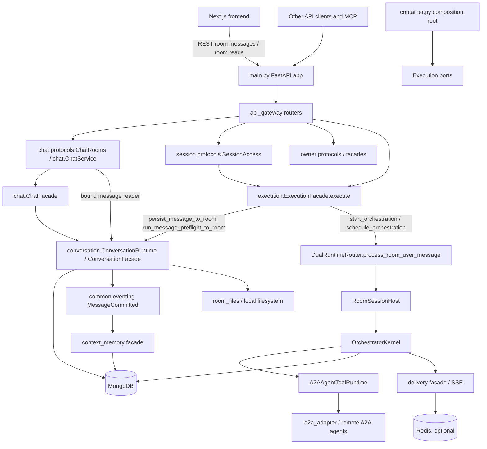

# System Architecture

This document describes the current architecture and core workflows of the
backend in this repository's `backend/` directory.

## High-Level Shape

The backend is a FastAPI monolith that coordinates:

- A web app API for rooms, agents, messages, HITL, files, sessions, and SSE.
- A2A 1.0 agent communication over synchronous and streaming transports.
  Late results arrive by `tasks/get` polling; when
  `backend.a2a_push_callback_base_url` is set, dispatch also registers a per-call
  push-notification config with Agents that advertise `pushNotifications`.
- A durable orchestrator (the canonical Run) that turns a room message into
  model turns and Agent tool calls.
- Context memory projection and compaction.
- Cross-instance SSE delivery, Execution-owned cancellation, and background
  recovery jobs.

The application entry point is `main.py`. Dependency construction is centralized
in `container.py` and `orchestrator_composition.py`; request routers live under
`api_gateway/routes`.



## Modules

| Layer | Module | Owns |
|---|---|---|
| Product | `chat` | The owner's rooms as a product: create, read settings, list, history, rename, pin, default mode, delete. |
| Product | `session` | A client's conversation with the owner's agents, opened through `POST /sessions/messages` or MCP. |
| Core | `conversation` | The conversation container: rooms, messages, membership, timeline, attachments, user-message commit and preflight, quotes, deletion, candidate scope. |
| Core | `execution` | The engine: the orchestrator kernel, the A2A tool runtime, HITL continuation, cancellation, Run lifecycle, and recovery. |
| Core | `approval` | Human-in-the-loop requests, interactions, answers, cancellation, and reconciliation. |
| Support | `agent`, `local_agents`, `delivery`, `context_memory`, `room_files`, `llm_gateway` | Agent directory, local discovery, SSE delivery, room memory, files, and model access. |
| Infrastructure | `api_gateway`, `jobs`, `dal`, `a2a_adapter`, `common`, `models` | Routes, workers, Mongo/Redis connections and generic clients, the A2A SDK boundary, and shared contracts. |

Dependency rules:

- Products depend on core modules; no core module imports `chat` or `session`,
  and `session` never imports `chat`. A conversation container records its
  owning product in `rooms.owner_product` (`chat` by default, `session` for
  session containers).
- A domain module imports another only through its package root or its
  `protocols` module. `common` and `models` import no domain module, and `dal`
  imports none outside an exact debt list. `tests/test_module_boundaries.py`
  enforces these rules and
  `tests/test_module_protocol_inventory.py` pins module-local protocols.
- Cross-module contracts live in `common`; a DTO or Protocol used by one module
  lives in that module.
- Each module's persistence lives in its own `repository/` package, and
  `container.py` builds each store directly over `mongo.collection(...)`. `dal`
  keeps connection management and the generic Mongo and Redis clients.
- `a2a_adapter` owns every production import of the A2A SDK and imports nothing
  from `execution`. The `tests/test_sdk_confinement_*.py` tests enforce the SDK
  confinement.
- A2A response ingestion and finalization are owned by `execution`; no other
  module handles A2A responses.

Each subsection below states what a package owns, the Mongo collections it
writes, the protocols it exposes to other packages, and the protocols it consumes
from them. Protocol owners and implementations are listed in the
[Protocol inventory](#protocol-inventory).

### `agent`

Owns the Agent directory: card resolution and registration, the `agents`
registry and its weighted text index, lexical matching (Mongo text search plus an
application fallback for Latin words and CJK ideographs), public-or-owner
visibility, saved agent groups, capability issues, health and liveness probes,
card inspection, routing suggestions, and the caller-bound agent-network service.
Registered Remote agents can be removed; Local agents stay under `local_agents`
discovery.

`POST /api/v1/agent/registerAgent` is unique per normalized Agent URL.
Registering a URL held by an ownerless discovery record that discovery has
marked inactive takes that record over in place (same `agent_id`, now owned by
the requester with `source=cloud`). Any other existing record returns HTTP 409
with `detail: {"code", "message"}`, where `code` is `already_registered` (the
requester owns it), `owned_by_another_provider`, or `active_local_discovery`.

#### Bundled agents

The backend registers the bundled sample agents itself (`agent.bundled`); there
is no registrar container or registrar token. `bundled_agents_manifest` has a
default in every mode: `/app/bundled_agents.yaml` in the image and the
repository's `default_agents/agents.yaml` outside a container. An explicit
empty value disables registration. Startup loads the manifest and fails on an
invalid one. After the API starts, one background task
per enabled agent waits for its Agent Card, retrying with backoff, so health and
startup never wait for an agent. It then reconciles exactly one record:

1. A record whose `bundled_name` is the manifest key.
2. Otherwise a record that is not `source=local` at the current URL or at the
   0.3 Compose URL `http://<service>:<port>`, such as one the 0.3 registrar
   created and a 0.3 migration carried over.
3. Otherwise a new record (`provider_id` = `default_agent_provider_id`).

The record keeps its `agent_id`, so room history still resolves, and gets
`source=bundled`, `bundled_name`, the current URL as `normalized_url` and stored
card `url`, and the card. The current URL is `http://127.0.0.1:<port>`; the
retired Compose-only `bundled_agents_use_service_hosts` is dropped with the
other removed fields. A `source=local` record holding that URL
is a host agent found by discovery and is never taken over; registration skips
the agent with a warning. Repeated boots converge.

Each manifest agent has `requires: none | text | image`. The record is active
only when the current Provider pair meets it; otherwise it is inactive with
`inactive_reason` `provider_not_configured` (no Provider, or `credential_invalid`)
or `image_model_not_configured`. Gating runs at registration and on every
Provider pair swap through a `ProviderRuntime` listener; a setup save waits for
it, so the save response already reflects it. Gating clears only its own
reason: an agent the health check marked unreachable stays inactive. The health
check, its retries, and on-demand liveness never reactivate a record while
`inactive_reason` is set; liveness probes `cloud` and `bundled` records. The
reactivating write is conditional (`agent_status=inactive`, no
`inactive_reason`), so a probe in flight cannot undo gating that ran meanwhile.
`AgentView.inactive_reason` carries the reason to the frontend.

- Main types: `AgentFacade` (registry), `AgentCatalogService` (the `/agent/*`
  routes), `AgentMatcher`, `AgentSelectionService`, `AgentHealthService`,
  `AgentLivenessService`, `AgentInspectionService`,
  `AgentCapabilityIssueService`, and `AgentNetworkService`. `agent.views` builds
  the flat `AgentView` and `AgentCardView` route records from `AgentInfo` and the
  stored card; they never include transport URLs or security data.
- Writes: `agents` (`agent.repository.mongo.AgentMongoRepository`),
  `agent_groups` (`agent.repository.runtime_store.AgentRuntimeStore`, which also
  serves the runtime agent reads used by membership, mention resolution, and
  call counting), and `agent_capability_issues`
  (`agent.repository.capability_issue_mongo.AgentCapabilityIssueMongoRepository`).
- Exposes: `agent.protocols` (`AgentCatalog`, `AgentNetworkAccess`,
  `AgentGroupStore`, `AgentInspection`, `AgentSuggestionService`,
  `AgentCapabilityIssueStore`) to `api_gateway`; implements `AgentRegistry`,
  `AgentMatcher`, `AgentExclusionReader`, and `AgentNetworkTargetResolver`
  (`common.protocols.agent_protocols`), `AgentCallCounter` (Execution), and
  `LocalAgentWriter` (`local_agents`).
- Consumes: `AgentCardResolver` (implemented by `a2a_adapter`), `LeaderElector`,
  and `MongoDAL`.

### `approval`

Owns human-in-the-loop state: `HITLService` (request creation, batch answers,
resume, cancellation, pending reads, terminal reconciliation; built by
`approval.factory.create_hitl_service`), the `HITLApplicationCoordinator`
(fenced application of a complete answer set), and `HITLLifecycleReconciler`.
Execution reaches it through the `approval` package root; the engine-side
continuation coordinator stays in Execution.

- Writes: `hitl_requests` (`approval.repository.HITLRequestStore`) and
  `hitl_interactions` and `hitl_resume_commands`
  (`approval.repository.HITLLifecycleStore`). Agent-message HITL projection
  goes through `ConversationMessageWriter`.
- Exposes: implements Execution's `HITLServicePort` and `room_files`'s
  `RoomStateOwner`. Its own dependency ports are in `approval.protocols`;
  `HITLPersistencePort` is bound in `container.py`.
- Consumes: `ConversationMessageWriter` (`conversation.protocols`).

### `a2a_adapter`

Isolates the A2A protocol and SDK:

- Resolves and validates Agent Cards (`card_resolver`, `card_data`), including
  A2A 0.3 cards (see [A2A protocol boundary](#a2a-protocol-boundary)).
- `message_factory` is the single conversion point between internal models and
  protobuf; `client_facade` sends, streams, cancels, and fetches tasks and
  returns the SDK-free `{"kind", "result", "error"}` envelope.
- `orchestrator_direct_client.OrchestratorDirectA2AClient` is the direct
  transport used by the orchestrator A2A runtime.
- `webhook_payloads` parses direct-stream response payloads and push-notification
  bodies; `translators` and `remote_task` normalize task status and artifacts.
- `inspection` probes cards and dry sends; `agent_card_health` serves health
  probes.
- `artifact_storage` materializes inline or remote file artifacts into
  room-owned storage through the `A2AArtifactFiles` contract.
- `docker_host_fallback` owns the request-local Docker host fallback (below).

Writes no collections directly. Exposes: implements `AgentCardResolver`,
`A2AArtifactFiles`, and Execution's `DirectA2AClient` / `DirectA2AStream`.
Consumes no other package's protocols.

Owner modules never open `httpx` or SDK clients against agent URLs; they call
adapter helpers. For backend-initiated calls the adapter may retry `localhost`,
`127.0.0.1`, `::1`, or `0.0.0.0` URLs through `host.docker.internal` after a
connection-style failure. The rewrite is request-local: registered card URLs are
never changed. The direct agent-network send disables this fallback to keep its
one-attempt contract.

### `api_gateway`

Thin HTTP adapters. `api_gateway/router.py` registers the route modules;
`dependencies.py` defines `APIGatewayDeps` (assembled once at startup and stored
on `app.state.api_gateway_deps`) and the FastAPI providers that expose it;
`errors.py` holds shared HTTP error helpers such as `require_chat_room`;
`registry.py` records route ownership metadata for every route module.
Route modules do not import runtime implementation packages, own mutable
dependency globals, or define `bind_*` functions.

- Writes no collections.
- Exposes nothing to other packages.
- Consumes: the `agent.protocols` ports, `chat.protocols.ChatRooms`,
  `session.protocols.SessionAccess` and `SessionService`,
  `execution.ports.DirectAgentMessenger`, `local_agents.protocols.LocalAgentDiscovery`,
  `llm_gateway.agent_proxy._AgentLLMProxyPort`,
  `llm_gateway.setup_api.SetupAccess`, and from `common.protocols`
  `ExecutionEngine`, `HITLManager`, `SSERouteTransport`, `RoomRouteReader`,
  `SSEStateReader`, `RoomOwnershipReader`, `AgentRegistry`, `AgentMatcher`,
  `FileStorage`, and `PreparedFileStream`.

Route groups:

- `room_routes.py`: `/rooms` create, history list, settings, rename/pin,
  pinned order, delete, active runs, timeline reads, sends, the canonical Agent
  call detail, and `POST /agent-suggestions`.
- `agent_routes.py`: registration, lookup, deletion, capability issues, card
  preview, and the local-agent discovery trigger.
- `agent_network_routes.py`: caller-visible discovery, groups, search,
  profiles, and one-shot direct A2A messaging.
- `agent_group_routes.py`: saved agent groups (`/agentGroups`).
- `session_routes.py`: `/sessions`.
- `sse_routes.py`: room SSE stream, SSE status, event replay, and message
  cancellation.
- `hitl_routes.py`: `/rooms/{conversation_id}/hitl` pending reads, batch answers, and
  interaction cancellation.
- `files_routes.py`: room file upload and content download.
- `inspection_routes.py`: Agent Card and A2A connection inspection.
- `llm_proxy_routes.py`: the bundled-agent inference proxy under
  `/internal/llm`.
- `a2a_push_routes.py`: `POST /a2a/push/{call_record_id}`, the A2A
  push-notification ingress (see [Push notifications](#push-notifications)).
- `setup_routes.py`: `/setup` browser model-provider setup (see
  [Browser setup API](#browser-setup-api)).

Frontend-facing and agent-network routes use Clerk auth when
`backend.auth_mode="clerk"`. In local `backend.auth_mode="mock"`, `main.py`
overrides every user-auth dependency, including the dual user/service dependency
used by agent registration, with the stable local developer identity.

### `chat`

`chat.service.ChatService` (process singleton `chat_service`) implements the
route contract `chat.protocols.ChatRooms`: create, read settings, list rooms and
history, rename, update pin and history fields, update the default mode, read
messages, and delete through `conversation.deletion.RoomDeletionService`. Room
message reads go through the reader `container.py` binds with
`chat_service.bind_message_reader`, which is the lifespan `ConversationRuntime`'s
timeline page read. `chat.facade.ChatFacade` holds a `ConversationFacade` for
container writes and reads the room repository for owner listings and the
default-mode flag.

- Writes: `rooms` and room-owned data, through `ConversationFacade` and
  `RoomDeletionService`.
- Exposes: `ChatRooms` to `api_gateway`.
- Consumes: `RoomRepository` (`common.protocols.repository_protocols`).

Chat history (`get_history_by_owner`) excludes containers with
`owner_product="session"`, and chat writes refuse them (see [`session`](#session)).

### `common`

Cross-cutting primitives with no domain imports:

- `common.dto`: immutable DTOs used by more than one module or on a shared wire
  contract, including `ExecutionRequest`, `AgentInfo`, `DeliveryEvent`,
  `AgentRouteResponse`, and the closed `turn_lifecycle` run-event family.
- `common.protocols`: cross-module structural interfaces for facades, shared
  repositories, delivery, execution, platform, LLM, and DAL dependencies.
- `common.eventing`: internal domain events (see
  [Internal eventing](#internal-eventing)).
- `common.config`: the configuration loader, runtime credential store, and
  setup model (see [Runtime configuration](#runtime-configuration)).
- `common.errors`: typed domain and platform errors.
- `common.observability`: process logging, correlation context, tracing, and
  metrics helpers.
- `common.middleware`: request logging, request-size, and request-concurrency
  middleware.
- `common.a2a_task_projection`: the persistence-safe public projection of A2A
  tasks, messages, parts, and artifacts shared by routes and runtime modules.
- `common.utils`: time, A2A and artifact helpers, context utilities, Mongo index
  helpers (`create_index`, `ensure_text_index`), and the logger.

`common` writes no collections and consumes no other package's protocols.

### `context_memory`

The only runtime owner of room-memory projection, canonical conversation history,
compaction, and room-memory deletion (see
[Context memory workflow](#context-memory-workflow)). `container.py` builds one
`ContextMemoryFacade` over `MemoryMongoRepository`,
`ContentStorageMongoRepository`, and the Conversation-owned `RoomHistoryReader`,
and registers `ContextMemoryEventHandler` on the internal event
bus.

- Writes: `room_memories` (`context_memory.repository.MemoryMongoRepository`)
  and `conversation_content`
  (`context_memory.repository.ContentStorageMongoRepository`).
- Exposes: implements `RoomMemoryCleanupPort` (`conversation.deletion`),
  `CompactionPort` (`jobs.compaction_sweep`), and `RoomStateOwner`
  (`room_files.service`); declares `MemoryRepository` and
  `ContentStorageRepository` in `context_memory.ports`.
- Consumes: `RoomHistoryReader`, `MongoDAL`, and `MongoCollection`.

### `conversation`

The conversation container: room and message persistence, membership,
timeline and its public projection, attachments, user-message commit and
preflight, quotes, deletion, and candidate scope.

- `ConversationFacade`: canonical room and message reads and writes, history,
  threads, ownership and lineage checks.
- `ConversationRuntime` (one instance per application lifespan, kept on
  `app.state.conversation_runtime`): implements Execution's `RoomCenterPort`
  (persist, preflight, discard, idempotent replay) and the chat message read. It
  holds the startup bindings and delegates each call to a collaborator built
  from them: `message_reads.RoomMessageReader` (one cursor page of the public
  timeline), `message_sending.RoomMessageSender` (validation, quote, attachments,
  target scope, commit, replay, and fingerprint conflicts),
  `preflight.MessagePreflight` (the orchestration envelope; `persisted_execution_mode`
  stores `direct`, `supervisor`, or `passthrough`, anything else as `direct`),
  and `target_scope.TargetScopeResolver` (routing-target sanitizing, candidate
  scope, canonical mentions, explicit target groups).
- `user_message_persistence.UserMessageCommitService`: the write lease,
  attachment claims, atomic insert, winner/loser file-reference effects, and
  synchronous `message_committed` publication.
- `mentions`: parses `<@agent_id|name>` mentions of room members, rejecting
  invalid or unauthorized targets with an `unauthorized_mention` scope error.
- `timeline_projection.RoomTimelineProjector`: projects queried timeline pages
  into safe public messages through room-scoped file-metadata and HITL readers,
  without mutating repository models.
- `deletion.RoomDeletionService`: owner validation, file-write draining, phased
  cleanup, Context Memory cleanup, orchestrator epoch deactivation and cleanup,
  and final deletion.
- `agent_call_detail.CanonicalAgentCallDetailService`: the room-authorized
  private output of one canonical Agent call (see
  [Room stream](#room-stream-and-delivery)).
- Repositories: `conversation.repository.mongo` (`RoomMongoRepository`,
  `MessageMongoRepository`), `quote_mongo.RoomQuoteMongoRepository`,
  `messages.ConversationMessageStore` (agent/user message writes, artifact
  accumulation, descendant cancellation), `rooms.ConversationRoomStore`, and
  `client_request_ids.ClientRequestIdStore`.
- Writes: `rooms` (sole writer, including the write-lease and deletion-fencing
  fields that `room_files` changes through `RoomLifecycleStore`),
  `room_user_messages`, `room_agent_messages`, `room_quotes`, and the
  `room_timeline_sort_keys_v1` document in `migration_markers`.
- Exposes: implements `RoomRepository`, `RoomHistoryReader`,
  `RoomOwnershipReader`, Execution's `RoomCenterPort`, `room_files`'s
  `RoomStateOwner` and `RoomLifecycleStore` (`RoomMongoRepository`), and
  Session's `RoomRegistry`, `RoomManagement`, and `RoomMessageStore`;
  `conversation.protocols` publishes `ConversationMessageWriter` (guarded
  agent-message writes: task state, HITL request id, pending-HITL projection,
  user answer, interaction metadata, and the orchestrator's final message) and
  `ClientRequestIdResolver`.
- Consumes: `InternalEventPublisher`, `AgentRegistry`, `MongoDAL`,
  `MongoCollection`, and the deletion ports it declares
  (`RoomMemoryCleanupPort`, `RoomEpochDeactivationPort`,
  `OrchestratorEpochCleanupPort`) implemented by `context_memory` and
  `execution`.

### `dal`

Connection management and generic clients:

- `dal.mongo`: `MongoDALImpl` and `MongoCollectionAdapter`.
- `dal.redis`: KV and Streams (with `is_connected` health and bounded connection
  timeouts), Pub/Sub, leader election (`LeaderElectorImpl`, with explicit TTL
  overrides), room distributed locking (`RoomRedisDistributedLock`, whose
  acquire returns `True`/`False`/`None` for acquired, contended, and Redis
  degraded), and the internal-eventing transport
  (`RedisInternalEventTransport`).

Writes no domain collections. Implements `MongoDAL`, `MongoCollection`,
`MongoChangeStream`, `RedisKV`, `RedisPubSub`, `LeaderElector`,
`RoomDistributedLock`, `InternalEventTransport`, and each job's `LeaderGate`.
Consumes Execution's `AsyncMongoCollection` shape.

### `delivery`

`DeliveryFacade` owns SSE delivery, the durable room event log, snapshots, and
cross-instance fan-out (see [Room stream and delivery](#room-stream-and-delivery)).

- Writes: `room_events` and `room_event_seq`
  (`delivery.room_events.MongoRoomEventStore`).
- Exposes: implements `DeliveryEventPublisher`, `SSERouteTransport`, and
  `SSEConnectionLike` (`common.protocols.delivery_protocols`) and Session's
  `ConversationEventsPort`; declares `SSETransport` and `TaskRunner` for the
  composition root.
- Consumes: `RedisKV`, `RedisPubSub`, and `MetricsCollector`.

Delivery never calls back into Execution.

### `execution`

Owns orchestration after a user message is accepted.

- `ExecutionFacade`: the route-facing engine (`ExecutionEngine`,
  `HITLManager`). `execute` replays an idempotent send, rejects a send while a
  HITL request is pending or the room has an active Run, persists the user
  message and runs its preflight through `RoomCenterPort`, then
  `start_orchestration` or `schedule_orchestration` hands it to the router.
  `cancel`, HITL batch answers, pending reads, and interaction cancellation are
  routed to the orchestrator.
- `orchestrator_routing.DualRuntimeRouter`: `process_room_user_message`
  freezes the candidate scope, resource manifest, and Agent tool catalog,
  creates the Run, and prompts the room's `RoomSessionHost`; it also routes
  cancellation, HITL answers, and observations.
- `orchestrator/`: the provider-neutral kernel (`OrchestratorKernel`,
  `RoomAgentSession`, `ContextCompiler`, `BudgetPolicy`, `GatewayModelRuntime`,
  settlement, projection, and public text/summary policies).
- `orchestrator/a2a_runtime/`: the A2A tool runtime (`A2AAgentToolRuntime`),
  frozen catalog, call ledger, observation ingress, HITL continuation,
  cancellation, recovery, and resource materialization.
- `adapters/`: profile resolution (`OrchestratorProfileResolver`), the session
  host, candidate sources, membership authorization refresh, HITL application,
  and resource adapters.
- `direct_agent.DirectAgentExecution`: the bounded one-shot agent-network send.
- `events.emit_room_processing_status`: room processing-status emission; it
  accepts string `details` and normalizes them into the typed payload before
  Delivery.
- `ports.py`: the narrow, named-parameter contracts Execution uses for its
  collaborators.
- `repository/orchestrator/`: Mongo stores for runs, events, the call ledger,
  epochs, HITL application, artifacts, and projection, plus
  `ensure_orchestrator_indexes`. `repository.active_runs.CanonicalActiveRunRoomReader`
  serves active-Run reads.
- Writes: `orchestrator_runs`, `orchestrator_run_events`,
  `orchestrator_recovery_leases`, `orchestrator_agent_tool_bindings`,
  `orchestrator_agent_calls`, `orchestrator_a2a_observations`,
  `orchestrator_a2a_observation_conflicts`, `orchestrator_room_epochs`, and
  `orchestrator_hitl_interactions`; the final assistant message reaches
  `room_agent_messages` through `ConversationMessageWriter`.
- Exposes: implements `ExecutionEngine` and `HITLManager`, and Conversation's
  `RoomEpochDeactivationPort` and `OrchestratorEpochCleanupPort`;
  `execution.ports.DirectAgentMessenger` crosses to `api_gateway`.
- Consumes: `RoomCenterPort` (Conversation), `HITLServicePort` (Approval),
  `ConversationMessageWriter`, `ClientRequestIdResolver`, `AgentRegistry`,
  `AgentExclusionReader`, `AgentNetworkTargetResolver`, `AgentCallCounter`
  (Agent), `RoomFileReader` and `RoomFileArtifactOwner` (`room_files`),
  `DirectA2AClient` (`a2a_adapter`), `LLMTurnGateway` (`llm_gateway`),
  `DeliveryEventPublisher`, `RoomOwnershipReader`, and `MongoDAL`.

### `jobs`

Leader-gated background workers, started after infrastructure and multi-worker
safety checks pass (see [Background jobs](#background-jobs)). Jobs write only
through the ports they are given. Each declares its own `LeaderGate`
(implemented by `dal.redis.lock.LeaderElectorImpl`); `compaction_sweep`
declares `CompactionPort` (implemented by `ContextMemoryFacade`).

### `llm_gateway`

Owns all LLM provider SDK access, model routing, setup, and provider
authentication. Provider adapters under `llm_gateway/providers/` (OpenAI,
DeepSeek, Anthropic, and the OpenAI Codex subscription adapter) are the only LLM
code that imports a provider SDK. `LLMGatewayImpl` resolves logical routes
through `ModelRegistryImpl`, applies retry and timeout policy from
`LLMGatewayConfig`, and exposes text, structured JSON, embedding, streaming, turn
(`stream_turn_once`), and image operations. `AgentSelectionLLMService` reranks
agent suggestions for `AgentSelectionService`. Setup (`SetupService`), OAuth
(`openai_oauth`), and the bundled-agent proxy (`agent_proxy.AgentLLMProxy`) also live here.
`ProviderRuntime` (`provider_runtime`) owns the current Provider pair and its
live reload. `setup_api.BrowserSetup` and `setup_api.OAuthLogins` serve the
browser setup routes.

- Writes no collections; setup and OAuth write `config.json` and `auth.json`
  under `HYBRO_HOME`.
- Exposes: implements `LLMTextGateway`, `LLMStructuredGateway`,
  `LLMStreamGateway`, and `LLMEmbeddingGateway`; declares `LLMTurnGateway` (used by Execution) and `_AgentLLMProxyPort` (used by
  the proxy route).
- Consumes no other package's protocols.

### `local_agents`

Owns Docker-host discovery without owning Agent persistence or execution. When
`local_agent_discovery_enabled` is set, `LocalAgentService` scans the configured
`host.docker.internal` port range at startup and every
`local_agent_discovery_interval_seconds` (120 by default), probes Agent Cards
through the `a2a_adapter` resolver, and reconciles results through the Agent
registry writer. Discovered records use `source=local` and remain public and
directly callable. The scan skips the bundled agents' manifest ports: the image
entrypoint passes them as `LOCAL_AGENT_DISCOVERY_EXCLUDED_PORTS`, so it never
rediscovers an agent the backend
registered as bundled. Scheduled discovery marks an agent inactive after
three successful cycles in which it is absent and records `inactive_since`;
every cycle then deletes ownerless `source=local` records that have been
inactive for seven days (`LOCAL_AGENT_INACTIVE_RETENTION`; records without
`inactive_since` use `updated_at`). The authenticated
`POST /api/v1/local-agents/discovery` refresh reconciles missing agents at once
and upgrades any in-flight cycle to a manual refresh. Discovery coordination and
miss counters are process-local, which fits the single-process backend.

- Writes `agents` only through `LocalAgentWriter` (implemented by
  `AgentFacade`).
- Exposes: `LocalAgentDiscovery` to `api_gateway`.
- Consumes: `AgentCardResolver`.

### `room_files`

Owns room uploads, file metadata, local content, references, download
authorization, artifact materialization, room write leases, file-deletion
fencing, storage lifecycle, and recovery (see [Room files](#room-files)).
Room-level deletion coordination belongs to `conversation.deletion`, which drives
the `room_files` deletion lifecycle through a narrow port.

- Writes: `room_files` (metadata; indexes from `room_files.ensure_room_file_indexes`)
  and file bytes under `HYBRO_FILE_DIR`. It has no `rooms` handle: write leases
  (`room_files.leases.RoomWriteLeases`), deletion fencing and phases, the active
  room owner, and stale-deletion recovery go through `RoomLifecycleStore`.
- Exposes: implements `FileStorage` and `PreparedFileStream`, and Execution's
  `RoomFileReader` and `RoomFileArtifactOwner`; declares `RoomStateOwner`,
  which `RoomFiles.delete_room_state` calls for every bound owner (Approval,
  Context Memory, and Conversation stores), and `RoomLifecycleStore`
  (`room_files.ports`), implemented by Conversation's `RoomMongoRepository`.
- Consumes: `MongoDAL` and `RoomLifecycleStore`.

### `session`

A Session is a conversation that a client of the instance owner opens with the
owner's agents (see [Sessions](#sessions)). `SessionFacade`, `BoundSessionAccess`,
`SessionWaiter`, the projection helpers, and `MongoSessionRepository` live here.

- Writes: `sessions`; containers are created through Conversation.
- Exposes: `SessionAccess` and `SessionService` to `api_gateway`; declares
  `RoomRegistry`, `RoomManagement`, `RoomMessageStore` (implemented by
  `ConversationFacade`) and `ConversationEventsPort` (implemented by
  `MongoRoomEventStore`).
- Consumes: `ExecutionEngine`, `HITLManager`, `AgentNetworkTargetResolver`,
  `RoomHistoryReader`, and `MongoDAL`.

### `models`

Pydantic request, response, and persistence models shared by routes and
runtime modules (`room`, `request`, `response`, `hitl`, `agent`, `agent_group`,
`agent_network`, `session`, `file_upload`, `quote`, `room_services_models`).
`models` imports no domain module.

### `scripts`

Operator tools, run from `backend/` as `uv run python -m scripts.<name>`:

- `check_legacy_lifecycle_readiness`: read-only counts of stored data that the
  strict readers reject (see [Deployment readiness](#deployment-readiness)).
- `delete_legacy_orchestrator_runs`: deletes schema-5 or non-canonical
  `orchestrator_runs` documents with their run events, recovery leases, Agent
  calls, and Agent tool bindings. Dry run by default; `--apply` writes. No
  archive.
- `migrate_room_timeline_sort_keys`: audits and backfills `timeline_sort_us`
  (see [Stable Room timeline pagination](#stable-room-timeline-pagination)).
- `migrate_conversation_history`: audits room-memory documents and moves their
  history to the top-level canonical `conversation_history` field. Read-only
  unless `--apply`; malformed documents block the whole apply pass.
- `check_no_legacy_imports`: fails when Python files import any of the root
  packages passed as arguments.
- `report_orphan_modules`: lists production modules no entry point reaches.
- `create_room_file_indexes.sh`: shell helper that creates the `room_files`
  indexes.

### Composition roots

`main.py`, `container.py`, and `orchestrator_composition.py` are the composition
root; no package owns startup.

- `main.py` creates the FastAPI app, configures stdout-only structured logging,
  installs request correlation/logging middleware, mounts `api_gateway.router`
  under the configured API prefix (`/api/v1` by default), serves `/health`, and
  delegates runtime assembly to `container.py`.
- `container.py` builds `MongoDAL`, Redis clients, the internal event bus,
  Delivery, the module-owned stores, facades, owner adapters, and
  `APIGatewayDeps`, binds the conversation runtime and chat service, owns index
  creation (`ensure_runtime_indexes`), and starts and stops jobs. Its typed
  dependency groups are `AgentDeps`, `RoomDeps`, `DeliveryDeps`, `EventingDeps`,
  `ExecutionDeps`, and `RedisRuntimeDeps`.
- `orchestrator_composition.create_orchestrator_runtime` builds the
  orchestrator: the Run, event, recovery-lease, call-ledger, binding, epoch,
  observation, and HITL stores, the A2A tool runtime, profiles, the session host,
  and the recovery and projection drivers.

Entry points used by `main.py`:

- `create_application_runtime(settings)`
- `startup_runtime(app, runtime)`
- `validate_runtime_bindings(app, runtime)`
- `shutdown_runtime(app, runtime)`

Startup phases:

1. Infrastructure: load the configuration snapshot and auth store; build
   `MongoDAL`, Redis, the local file-content store, stores, facades, and owner
   adapters; create indexes.
2. Runtime guard and background services: start Delivery/SSE; probe the Redis
   KV and Streams services when Redis is configured; enforce
   `check_multi_worker_safety`; start background jobs after the guard passes.
   Orchestrator composition or worker dependency failure aborts startup.
3. Serving: `validate_runtime_bindings` aggregates Execution, API gateway, and
   Conversation readiness. Each lifespan first resets the process-global room
   runtime, then reports missing store, facade, cancellation, parser,
   user-message commit, timeline, deletion, and agent-preparation bindings
   before traffic is served; a missing runtime is reported as
   `app.state.conversation_runtime` and missing bindings as
   `conversation.<name>` and `chat.<name>`. Explicitly degradable attachment and
   context capabilities do not fail startup.

Shutdown stops jobs and in-flight execution, then internal eventing, then
Delivery/SSE, cancellation, Redis, and MongoDB. Cleanup stages are
failure-isolated: the first error is preserved while later owners still receive
their close call. Startup rollback runs in reverse dependency order and bounds
every cleanup stage with owned tasks plus `asyncio.wait`; a
cancellation-resistant close is detached observably without blocking later
cleanup.

Each repository declares the indexes for the collections it owns in an
`ensure_indexes` method (`AgentMongoRepository`, `AgentRuntimeStore`,
`AgentCapabilityIssueMongoRepository`, `ContentStorageMongoRepository`,
`MemoryMongoRepository`, `RoomQuoteMongoRepository`, `RoomMongoRepository`,
`MessageMongoRepository`, and the two `approval.repository` HITL stores); the
orchestrator and room-file collections use
`execution.repository.orchestrator.indexes.ensure_orchestrator_indexes` and
`room_files.ensure_room_file_indexes`. `create_index` (critical indexes abort
startup) and `ensure_text_index` live in `common.utils.mongo_indexes`.
`container.py::ensure_runtime_indexes` calls each owner in order and reports
agent search-index readiness, which `/health` requires. Because MongoDB permits one text index per collection, a
text index whose keys or weights differ from the required shape is dropped
before its replacement is created; `/health` returns 503 if recreation fails.
On a shared database, other replicas briefly lose text search during that
recreation, so coordinate index-shape changes with a maintenance window.

### Collection ownership

| Collection | Writer |
|---|---|
| `agents` | `agent.repository.mongo.AgentMongoRepository` |
| `agent_groups` | `agent.repository.runtime_store.AgentRuntimeStore` |
| `agent_capability_issues` | `agent.repository.capability_issue_mongo.AgentCapabilityIssueMongoRepository` |
| `rooms` | `conversation.repository` (lease and deletion fields through `room_files.ports.RoomLifecycleStore`) |
| `room_user_messages`, `room_agent_messages` | `conversation.repository.mongo.MessageMongoRepository`, `conversation.repository.messages.ConversationMessageStore` |
| `room_quotes` | `conversation.repository.quote_mongo.RoomQuoteMongoRepository` |
| `migration_markers` | `conversation.repository.indexes` (timeline marker) |
| `room_memories` | `context_memory.repository.MemoryMongoRepository` |
| `conversation_content` | `context_memory.repository.ContentStorageMongoRepository` |
| `room_files` | `room_files.service.RoomFiles` |
| `hitl_requests` | `approval.repository.HITLRequestStore` |
| `hitl_interactions`, `hitl_resume_commands` | `approval.repository.HITLLifecycleStore` |
| `room_events`, `room_event_seq` | `delivery.room_events.MongoRoomEventStore` |
| `sessions` | `session.repository.mongo.MongoSessionRepository` |
| `orchestrator_runs`, `orchestrator_run_events`, `orchestrator_recovery_leases` | `execution.repository.orchestrator` (run store, event store) |
| `orchestrator_agent_tool_bindings`, `orchestrator_agent_calls`, `orchestrator_a2a_observations`, `orchestrator_a2a_observation_conflicts`, `orchestrator_room_epochs`, `orchestrator_hitl_interactions` | `execution.repository.orchestrator.stores` and `.hitl` |

Room-state deletion is per owner: `RoomFiles.delete_room_state` calls every bound
`RoomStateOwner` (`MessageMongoRepository`, `RoomQuoteMongoRepository`,
`MemoryMongoRepository`, `ContentStorageMongoRepository`, `HITLRequestStore`,
`HITLLifecycleStore`) and succeeds only if all report that no rows remain.
`orchestrator_runs`, `orchestrator_run_events`,
`orchestrator_agent_tool_bindings`, `orchestrator_agent_calls`,
`orchestrator_a2a_observations`, and `orchestrator_a2a_observation_conflicts` are
deleted per room epoch by the orchestrator epoch cleanup;
`orchestrator_room_epochs` keeps the deactivated epoch record; and
`orchestrator_hitl_interactions`, `orchestrator_recovery_leases`, `room_events`,
`room_event_seq`, `sessions`, `migration_markers`, and `agent_capability_issues`
are retained, with no deletion or TTL.

Code, DTOs, HTTP, and SSE name the conversation `conversation_id`. Mongo stores
it as `room_id` in every collection, including indexes, aggregation paths, and
nested paths such as `route.room_id`; the key is mapped at the repository
boundary. Persisted-only models (orchestrator contracts, HITL aggregates, internal
events) declare `common.dto.base.stored_conversation_id` and dump `room_id`;
models that are also returned on the wire (`Room`, room messages, quotes,
capability issues) read either key through `accepts_stored_conversation_id`, and
their writers rename the key with `to_stored_conversation_keys`. Persisted digests
hash the literal key `room_id`. Redis keys keep their `room:` and `sse:room:`
prefixes. The cross-instance SSE envelope and internal event payloads still emit
`room_id` for rolling deploys, and readers accept `conversation_id` or `room_id`.

### Contracts

#### Protocol inventory

A Protocol exists only if it crosses a module boundary or has two production
implementations; a Protocol with one consumer lives beside that consumer, and a
Protocol that only typed a `container.py` field is replaced by the concrete type.
The table lists every Protocol in production code (`tests/test_protocol_inventory_doc.py`
keeps the set of rows in sync). **Owner** is the defining module.
**Implementations** are the production objects wired where the Protocol is used:
classes that name it as a base or are passed to a parameter, field, or variable
annotated with it (found by static analysis of constructor calls and composition),
plus hand-verified entries where the wiring goes through FastAPI dependencies,
attributes, tuples, or module singletons. "Callable shape" Protocols are satisfied
by functions or callables, and "attribute shape" Protocols describe records read
by attribute. **Boundary** names the top-level packages, other than the owner's,
that consume or implement the Protocol; "composition root" is `container.py`,
`orchestrator_composition.py`, or `main.py`. "Internal" Protocols are seams whose
consumers and implementations sit in the owner's package.

When adding, removing, or renaming a public method on a Protocol, repository
port, or facade port, update the exact method inventory in
`tests/test_common_foundation.py`.

| Protocol | Owner | Implementations | Boundary |
|---|---|---|---|
| `CallResolver` | `a2a_adapter.orchestrator_direct_client` | callable shape (functions or callables) | internal to `a2a_adapter` |
| `CancelRemoteTaskFn` | `a2a_adapter.orchestrator_direct_client` | callable shape (functions or callables) | internal to `a2a_adapter` |
| `ExceptionFactory` | `a2a_adapter.orchestrator_direct_client` | callable shape (functions or callables) | internal to `a2a_adapter` |
| `FetchAgentCardFn` | `a2a_adapter.orchestrator_direct_client` | callable shape (functions or callables) | internal to `a2a_adapter` |
| `FetchRemoteTaskFn` | `a2a_adapter.orchestrator_direct_client` | callable shape (functions or callables) | internal to `a2a_adapter` |
| `SendMessageFn` | `a2a_adapter.orchestrator_direct_client` | callable shape (functions or callables) | internal to `a2a_adapter` |
| `StreamMessageFn` | `a2a_adapter.orchestrator_direct_client` | callable shape (functions or callables) | internal to `a2a_adapter` |
| `_CancellationCommand` | `a2a_adapter.orchestrator_direct_client` | attribute shape (records read by attribute) | internal to `a2a_adapter` |
| `_ContinuationCommand` | `a2a_adapter.orchestrator_direct_client` | attribute shape (records read by attribute) | internal to `a2a_adapter` |
| `_DispatchCommand` | `a2a_adapter.orchestrator_direct_client` | attribute shape (records read by attribute) | internal to `a2a_adapter` |
| `_ModelReplyCommand` | `a2a_adapter.orchestrator_direct_client` | attribute shape (records read by attribute) | internal to `a2a_adapter` |
| `AgentRepository` | `agent.facade` | `agent.repository.mongo.AgentMongoRepository` | crosses to composition root |
| `AgentHealthRepositoryPort` | `agent.health` | `agent.repository.mongo.AgentMongoRepository` | internal to `agent` |
| `AgentHealthProbe` | `agent.liveness` | `agent.health.AgentHealthService` | internal to `agent` |
| `AgentMessageMatcher` | `agent.matcher` | `agent.facade.AgentFacade` | internal to `agent` |
| `AgentCapabilityIssueStore` | `agent.protocols` | `agent.capability_issue.AgentCapabilityIssueService` | crosses to `api_gateway` |
| `AgentCatalog` | `agent.protocols` | `agent.catalog.AgentCatalogService` | crosses to `api_gateway` |
| `AgentGroupStore` | `agent.protocols` | `agent.repository.runtime_store.AgentRuntimeStore` | crosses to `api_gateway` |
| `AgentInspection` | `agent.protocols` | `agent.inspection.AgentInspectionService` | crosses to `api_gateway` |
| `AgentNetworkAccess` | `agent.protocols` | `agent.network.AgentNetworkService` | crosses to `api_gateway` |
| `AgentSuggestionService` | `agent.protocols` | `agent.selection_service.AgentSelectionService` | crosses to `api_gateway` |
| `HITLDeliveryPort` | `approval.protocols` | `approval.adapters.HITLDeliveryAdapter` | internal to `approval` |
| `HITLLifecyclePersistencePort` | `approval.protocols` | `approval.repository.hitl_lifecycle_store.HITLLifecycleStore` | internal to `approval` |
| `HITLPersistencePort` | `approval.protocols` | the `hitl_runtime_store` `SimpleNamespace` port in `container.py` | crosses to composition root |
| `HITLTerminalLifecyclePort` | `approval.protocols` | `approval.adapters.HITLTerminalLifecycleAdapter` | internal to `approval` |
| `ChatRooms` | `chat.protocols` | `chat.service.ChatService` | crosses to `api_gateway` |
| `InternalEventBus` | `common.eventing.protocols` | `common.eventing.bus.BoundedInternalEventBus` | crosses to composition root |
| `InternalEventPublisher` | `common.eventing.protocols` | `common.eventing.bus.BoundedInternalEventBus` | crosses to composition root; `conversation` |
| `InternalEventTransport` | `common.eventing.protocols` | `dal.redis.internal_eventing.RedisInternalEventTransport` | crosses to `dal` |
| `MetricsCollector` | `common.observability.metrics` | `common.observability.metrics.NoopMetricsCollector` | crosses to composition root; `delivery` |
| `AgentCardResolver` | `common.protocols.a2a_protocols` | `a2a_adapter.card_resolver.AgentCardResolverImpl` | crosses to `a2a_adapter`; `agent`; composition root; `local_agents` |
| `RoomRouteReader` | `common.protocols.a2a_protocols` | SimpleNamespace port in `container` | crosses to `api_gateway`; composition root |
| `RoomRouteRecord` | `common.protocols.a2a_protocols` | attribute shape (records read by attribute) | internal to `common` |
| `SSEStateReader` | `common.protocols.a2a_protocols` | SimpleNamespace port in `container` | crosses to `api_gateway`; composition root |
| `SSEUserMessageRecord` | `common.protocols.a2a_protocols` | attribute shape (records read by attribute) | internal to `common` |
| `AgentExclusionReader` | `common.protocols.agent_protocols` | `agent.capability_issue.CapabilityIssueExclusionReader` | crosses to `agent`; composition root; `execution` |
| `AgentMatcher` | `common.protocols.agent_protocols` | `agent.facade.AgentFacade` | crosses to `agent`; `api_gateway` |
| `AgentNetworkTargetResolver` | `common.protocols.agent_protocols` | `agent.network.AgentNetworkService` | crosses to `agent`; `execution`; `session` |
| `AgentRegistry` | `common.protocols.agent_protocols` | `agent.facade.AgentFacade` | crosses to `agent`; `api_gateway`; composition root; `conversation`; `execution` |
| `LeaderElector` | `common.protocols.dal_protocols` | `dal.redis.lock.LeaderElectorImpl` | crosses to `agent`; composition root; `dal` |
| `MongoChangeStream` | `common.protocols.dal_protocols` | the Motor change stream returned by `dal.mongo.client.MongoCollectionAdapter.watch` (third-party) | crosses to `dal` |
| `MongoCollection` | `common.protocols.dal_protocols` | `dal.mongo.client.MongoCollectionAdapter` | crosses to composition root; `context_memory`; `conversation`; `dal` |
| `MongoDAL` | `common.protocols.dal_protocols` | `dal.mongo.client.MongoDALImpl` | crosses to `agent`; composition root; `context_memory`; `conversation`; `dal`; `execution`; `room_files`; `session` |
| `RedisKV` | `common.protocols.dal_protocols` | `dal.redis.kv.RedisKVImpl` | crosses to composition root; `dal`; `delivery` |
| `RedisPubSub` | `common.protocols.dal_protocols` | `dal.redis.pubsub.RedisPubSubImpl` | crosses to composition root; `dal`; `delivery` |
| `DeliveryEventPublisher` | `common.protocols.delivery_protocols` | `delivery.event_publisher.EventPublisherImpl` | crosses to composition root; `delivery`; `execution` |
| `SSEConnectionLike` | `common.protocols.delivery_protocols` | `delivery.sse.connection.SSEConnection` | crosses to `delivery` |
| `SSERouteTransport` | `common.protocols.delivery_protocols` | `delivery.facade.DeliveryFacade` | crosses to `api_gateway`; `delivery` |
| `ExecutionEngine` | `common.protocols.execution_protocols` | `execution.facade.ExecutionFacade` | crosses to `api_gateway`; composition root; `execution`; `session` |
| `HITLManager` | `common.protocols.execution_protocols` | `execution.facade.ExecutionFacade` | crosses to `api_gateway`; composition root; `execution`; `session` |
| `RoomDistributedLock` | `common.protocols.execution_protocols` | `dal.redis.lock.RoomRedisDistributedLock` | crosses to composition root; `dal` |
| `LLMEmbeddingGateway` | `common.protocols.llm_protocols` | `llm_gateway.gateway.LLMGatewayImpl` | crosses to `llm_gateway` |
| `LLMGateway` | `common.protocols.llm_protocols` | attribute shape (records read by attribute) | no production consumer; tests pin the full gateway shape |
| `LLMStreamGateway` | `common.protocols.llm_protocols` | `llm_gateway.gateway.LLMGatewayImpl` | crosses to `llm_gateway` |
| `LLMStructuredGateway` | `common.protocols.llm_protocols` | `llm_gateway.gateway.LLMGatewayImpl` | crosses to `llm_gateway` |
| `LLMTextGateway` | `common.protocols.llm_protocols` | `llm_gateway.gateway.LLMGatewayImpl` | crosses to `llm_gateway` |
| `FileStorage` | `common.protocols.platform_protocols` | `room_files.service.RoomFiles` | crosses to `api_gateway`; composition root; `room_files` |
| `HealthCheck` | `common.protocols.platform_protocols` | `common.health_check.RuntimeHealthCheck` | crosses to composition root |
| `PreparedFileStream` | `common.protocols.platform_protocols` | `room_files.content_store._LocalPreparedStream`, `room_files.content_store._MemoryPreparedStream` | crosses to `api_gateway`; `room_files` |
| `RoomRepository` | `common.protocols.repository_protocols` | `conversation.repository.mongo.RoomMongoRepository` | crosses to `chat`; `conversation` |
| `RoomHistoryReader` | `common.protocols.room_protocols` | `conversation.facade.ConversationFacade` | crosses to composition root; `context_memory`; `conversation`; `session` |
| `RoomOwnershipReader` | `common.protocols.room_protocols` | `conversation.facade.ConversationFacade` | crosses to `api_gateway`; composition root; `conversation`; `execution` |
| `A2AArtifactFiles` | `common.utils.a2a_helpers` | the `a2a_adapter.artifact_storage` module | crosses to `a2a_adapter` |
| `MemoryContentLike` | `common.utils.context_utils` | attribute shape (records read by attribute) | internal to `common` |
| `RoomMemoryLike` | `common.utils.context_utils` | attribute shape (records read by attribute) | internal to `common` |
| `ProjectionPort` | `context_memory.events` | `context_memory.facade.ContextMemoryFacade` | internal to `context_memory` |
| `ContentStorageRepository` | `context_memory.ports` | `context_memory.repository.mongo.ContentStorageMongoRepository` | crosses to composition root |
| `MemoryRepository` | `context_memory.ports` | `context_memory.repository.mongo.MemoryMongoRepository` | crosses to composition root |
| `AttachmentMetadataReader` | `conversation.attachments` | SimpleNamespace port in `container` | crosses to composition root |
| `OrchestratorEpochCleanupPort` | `conversation.deletion` | `execution.repository.orchestrator.epoch_bindings.EpochScopedOrchestratorCleanup` | crosses to `execution` |
| `RoomDeletionLifecycle` | `conversation.deletion` | SimpleNamespace port in `container` | crosses to composition root |
| `RoomEpochDeactivationPort` | `conversation.deletion` | `execution.repository.orchestrator.stores.MongoRoomEpochStore` | crosses to `execution` |
| `RoomFileDeletionLifecycle` | `conversation.deletion` | SimpleNamespace port in `container` | crosses to composition root |
| `RoomMemoryCleanupPort` | `conversation.deletion` | `context_memory.facade.ContextMemoryFacade` | crosses to `context_memory` |
| `CanonicalAgentCallReader` | `conversation.facade` | `conversation.agent_call_detail.CanonicalAgentCallDetailService` | internal to `conversation` |
| `MessageRepository` | `conversation.facade` | `conversation.repository.mongo.MessageMongoRepository` | internal to `conversation` |
| `RoomMembershipSeedSource` | `conversation.membership` | `conversation.membership_source.RepositoryRoomMembershipSeedSource` | crosses to composition root |
| `ClientRequestIdResolver` | `conversation.protocols` | `conversation.repository.client_request_ids.ClientRequestIdStore` | crosses to `execution` |
| `ConversationMessageWriter` | `conversation.protocols` | `conversation.repository.messages.ConversationMessageStore` | crosses to `approval`; composition root; `execution` |
| `HITLProjectionReader` | `conversation.timeline_projection` | SimpleNamespace port in `container` | crosses to composition root |
| `UserMessageFileLifecycle` | `conversation.user_message_persistence` | SimpleNamespace port in `container` | crosses to composition root |
| `UserMessageWriter` | `conversation.user_message_persistence` | SimpleNamespace port in `container` | crosses to composition root |
| `RoomEventStore` | `delivery.room_events` | `delivery.room_events.MongoRoomEventStore` | internal to `delivery` |
| `SSETransport` | `delivery.types` | `delivery.sse.manager.SSETransportImpl` | crosses to composition root |
| `TaskRunner` | `delivery.types` | callable shape (functions or callables) | crosses to composition root |
| `HITLApplicationStore` | `execution.adapters.hitl` | `execution.repository.orchestrator.hitl.MongoHITLApplicationStore` | internal to `execution` |
| `InboundArtifactWriter` | `execution.adapters.resources` | `execution.repository.orchestrator.artifacts.GuardedRoomFileArtifactWriter` | internal to `execution` |
| `InlineArtifactReader` | `execution.adapters.resources` | `execution.repository.orchestrator.stores.MongoObservationInboxStore` | internal to `execution` |
| `RoomFileReader` | `execution.adapters.resources` | `room_files.service.RoomFiles` | crosses to `room_files` |
| `HITLServicePort` | `execution.facade` | `approval.service.HITLService` | crosses to `approval` |
| `RoomCenterPort` | `execution.facade` | `conversation.runtime.ConversationRuntime` | crosses to `conversation` |
| `AgentCallCounter` | `execution.orchestrator.a2a_runtime.call_counting` | `agent.facade.AgentFacade` | crosses to `agent`; composition root |
| `AgentToolCandidateSource` | `execution.orchestrator.a2a_runtime.catalog_assembler` | `execution.adapters.agent_candidates.AgentServiceCandidateSource` | internal to `execution` |
| `DirectA2AClient` | `execution.orchestrator.a2a_runtime.dispatch` | `a2a_adapter.orchestrator_direct_client.OrchestratorDirectA2AClient` | crosses to `a2a_adapter` |
| `DirectA2AStream` | `execution.orchestrator.a2a_runtime.dispatch` | `a2a_adapter.orchestrator_direct_client.DirectA2AStream` | crosses to `a2a_adapter` |
| `AuthReferenceVerificationPort` | `execution.orchestrator.a2a_runtime.hitl` | `FailingAuthReferenceVerification`, local to `orchestrator_composition.create_orchestrator_runtime` (always refuses) | crosses to composition root |
| `InvocationOutcomeCheckpointReader` | `execution.orchestrator.a2a_runtime.ingress` | `execution.orchestrator.a2a_runtime.in_memory.RunCheckpointReader` | internal to `execution` |
| `A2ADispatchPort` | `execution.orchestrator.a2a_runtime.ports` | `execution.orchestrator.a2a_runtime.dispatch.DirectA2ADispatchAdapter` | internal to `execution` |
| `AgentCallLedgerStore` | `execution.orchestrator.a2a_runtime.ports` | `execution.repository.orchestrator.stores.MongoAgentCallLedgerStore` | internal to `execution` |
| `AgentToolBindingStore` | `execution.orchestrator.a2a_runtime.ports` | `execution.repository.orchestrator.stores.MongoAgentToolBindingStore` | internal to `execution` |
| `AuthorizationRefreshPort` | `execution.orchestrator.a2a_runtime.ports` | `execution.adapters.authorization.MembershipAuthorizationRefresh` | internal to `execution` |
| `HITLApplicationPort` | `execution.orchestrator.a2a_runtime.ports` | `execution.adapters.hitl.DurableHITLApplicationPort` | internal to `execution` |
| `NormalizedObservationRecorder` | `execution.orchestrator.a2a_runtime.ports` | `execution.orchestrator.a2a_runtime.ingress.A2AObservationIngress` | internal to `execution` |
| `ObservationConflictStore` | `execution.orchestrator.a2a_runtime.ports` | `execution.repository.orchestrator.stores.MongoObservationConflictStore` | internal to `execution` |
| `ObservationInboxStore` | `execution.orchestrator.a2a_runtime.ports` | `execution.repository.orchestrator.stores.MongoObservationInboxStore` | internal to `execution` |
| `ObservationIngressAuthenticator` | `execution.orchestrator.a2a_runtime.ports` | `execution.orchestrator.a2a_runtime.ingress.RejectExternalIngressAuthenticator`, `execution.orchestrator.a2a_runtime.push.LedgerPushTokenAuthenticator` | internal to `execution` |
| `PreparedInvocationSnapshotReader` | `execution.orchestrator.a2a_runtime.ports` | `execution.orchestrator.a2a_runtime.preparation.RunPreparedInvocationSnapshotReader` | internal to `execution` |
| `ResourceMaterializerPort` | `execution.orchestrator.a2a_runtime.ports` | `execution.adapters.resources.RoomFilesResourceMaterializer` | internal to `execution` |
| `RoomEpochStore` | `execution.orchestrator.a2a_runtime.ports` | `execution.repository.orchestrator.stores.MongoRoomEpochStore` | internal to `execution` |
| `ToolObservationSink` | `execution.orchestrator.a2a_runtime.ports` | `execution.orchestrator.a2a_runtime.observations.RunAddressedToolObservationSink` | internal to `execution` |
| `AcceptedCallRecoveryRuntime` | `execution.orchestrator.a2a_runtime.preparation` | `execution.orchestrator.a2a_runtime.runtime.A2AAgentToolRuntime` | internal to `execution` |
| `IDFactory` | `execution.orchestrator.kernel` | `execution.orchestrator.kernel.UUIDFactory` | internal to `execution` |
| `CancellationSignal` | `execution.orchestrator.ports` | `execution.orchestrator.a2a_runtime.runtime._RecoveryCancellationSignal`, `execution.orchestrator.session.EventCancellationSignal` | internal to `execution` |
| `ContextCompactor` | `execution.orchestrator.ports` | none wired; `OrchestratorKernel` runs without a compactor (`context_compactor=None`) | internal to `execution` |
| `InvocationCheckpointReader` | `execution.orchestrator.ports` | `execution.orchestrator.a2a_runtime.in_memory.RunCheckpointReader` | internal to `execution` |
| `ModelRuntime` | `execution.orchestrator.ports` | `execution.orchestrator.model_runtime.GatewayModelRuntime` | internal to `execution` |
| `OrchestratorRunStore` | `execution.orchestrator.ports` | `execution.repository.orchestrator.run_store.MongoOrchestratorRunStore` | internal to `execution` |
| `ProjectionDriver` | `execution.orchestrator.ports` | `execution.orchestrator.projection.SettlingProjectionDriver` | internal to `execution` |
| `RunStoreResult` | `execution.orchestrator.ports` | `execution.repository.orchestrator.run_store.MongoRunStoreResult` | internal to `execution` |
| `ToolCatalog` | `execution.orchestrator.ports` | `execution.orchestrator.a2a_runtime.catalog.FrozenToolCatalog` | internal to `execution` |
| `ToolRuntime` | `execution.orchestrator.ports` | `execution.orchestrator.a2a_runtime.runtime.A2AAgentToolRuntime` | internal to `execution` |
| `RunFactory` | `execution.orchestrator.session` | `execution.orchestrator.session.DefaultRunFactory`, `execution.orchestrator_routing._PreparedRunFactory` | internal to `execution` |
| `RoomEnvelopeSource` | `execution.orchestrator_routing` | `execution.orchestrator_routing.RoomMessageEnvelopeResolver` | internal to `execution` |
| `A2APushNotificationReceiver` | `execution.ports` | `execution.orchestrator.a2a_runtime.push.A2APushNotificationIngress` (bound as `app.state.a2a_push_receiver`) | crosses to `api_gateway` |
| `ClientRequestIdResolver` | `execution.ports` | `execution.client_request_id.SSEClientRequestIdResolver` | internal to `execution` |
| `DirectAgentMessenger` | `execution.ports` | `execution.direct_agent.DirectAgentExecution` | crosses to `api_gateway` |
| `HITLMessageCancellationPort` | `execution.ports` | `execution.adapters.hitl.HITLMessageCancellationAdapter` | internal to `execution` |
| `TaskFactory` | `execution.ports` | callable shape (functions or callables) | internal to `execution` |
| `EpochFencedRoomArtifactOwner` | `execution.repository.orchestrator.artifacts` | `execution.repository.orchestrator.artifacts.RoomFilesEpochFencedArtifactOwner` | internal to `execution` |
| `RoomFileArtifactOwner` | `execution.repository.orchestrator.artifacts` | `room_files.service.RoomFiles` | crosses to `room_files` |
| `AsyncMongoCollection` | `execution.repository.orchestrator.stores` | the raw Motor collection (`MongoCollectionAdapter.raw_collection`, third-party) | crosses to `dal` |
| `LeaderGate` | `jobs.cleanup_orphaned_uploads` | `dal.redis.lock.LeaderElectorImpl` | crosses to `dal` |
| `CompactionPort` | `jobs.compaction_sweep` | `context_memory.facade.ContextMemoryFacade` | crosses to `context_memory` |
| `LeaderGate` | `jobs.compaction_sweep` | `dal.redis.lock.LeaderElectorImpl` | crosses to `dal` |
| `LeaderGate` | `jobs.orchestrator_workers` | `dal.redis.lock.LeaderElectorImpl` | crosses to `dal` |
| `LeaderGate` | `jobs.stale_task_checker` | `dal.redis.lock.LeaderElectorImpl` | crosses to `dal` |
| `_AgentLLMProxyPort` | `llm_gateway.agent_proxy` | `llm_gateway.agent_proxy.AgentLLMProxy` | crosses to `api_gateway` |
| `LLMProviderAdapter` | `llm_gateway.gateway` | `llm_gateway.providers.anthropic_provider.AnthropicProvider`, `llm_gateway.providers.deepseek_provider.DeepSeekProvider`, `llm_gateway.providers.openai_codex.OpenAICodexProvider`, `llm_gateway.providers.openai_provider.OpenAIProvider` | internal to `llm_gateway` |
| `LLMTurnGateway` | `llm_gateway.gateway` | `llm_gateway.gateway.LLMGatewayImpl` | crosses to `execution` |
| `SetupAccess` | `llm_gateway.setup_api` | `llm_gateway.setup_api.BrowserSetup` | crosses to `api_gateway` |
| `LocalAgentDiscovery` | `local_agents.protocols` | `local_agents.service.LocalAgentService` | crosses to `api_gateway` |
| `LocalAgentWriter` | `local_agents.protocols` | `agent.facade.AgentFacade` | crosses to `agent` |
| `FileContentStore` | `room_files.content_store` | `room_files.content_store.LocalFileContentStore` | internal to `room_files` |
| `RoomLifecycleStore` | `room_files.ports` | `conversation.repository.mongo.RoomMongoRepository` | crosses to composition root; `conversation` |
| `RoomStateOwner` | `room_files.service` | `approval.repository.hitl_lifecycle_store.HITLLifecycleStore`, `approval.repository.hitl_store.HITLRequestStore`, `context_memory.repository.mongo.ContentStorageMongoRepository`, `context_memory.repository.mongo.MemoryMongoRepository`, `conversation.repository.mongo.MessageMongoRepository`, `conversation.repository.quote_mongo.RoomQuoteMongoRepository` | crosses to `approval`; `context_memory`; `conversation` |
| `ConversationEventsPort` | `session.protocols` | `delivery.room_events.MongoRoomEventStore` | crosses to `delivery` |
| `RoomManagement` | `session.protocols` | `conversation.facade.ConversationFacade` | crosses to composition root; `conversation` |
| `RoomMessageStore` | `session.protocols` | `conversation.facade.ConversationFacade` | crosses to composition root; `conversation` |
| `RoomRegistry` | `session.protocols` | `conversation.facade.ConversationFacade` | crosses to composition root; `conversation` |
| `SessionAccess` | `session.protocols` | `session.access.BoundSessionAccess` | crosses to `api_gateway` |
| `SessionService` | `session.protocols` | `session.facade.SessionFacade` | crosses to `api_gateway` |
| `SessionStore` | `session.protocols` | `session.repository.mongo.MongoSessionRepository` | internal to `session` |

## Runtime Configuration

`common/config/loader.py` defines typed defaults and loads a cached startup
snapshot from `HYBRO_HOME/config.json` (default `~/.hybro/config.json`) through
`common/config/runtime_store.py`, which also owns the private credential store
and OAuth refresh. There is no `settings.py`, dotenv discovery, or
environment-backed application settings. JSON overrides live under `backend`
and `frontend`, alongside setup's `provider`, `models`, `version`, and Agent
`image_size`. Unknown fields and invalid types or ranges fail before services
start. `provider` and `models` are set together or not at all; a missing
`config.json` or a document without them boots the backend unconfigured (see
Model access and setup), and the UI points to Settings, Model provider. Model
routes and credentials are not backend JSON fields: setting a route field
(`loader.ROUTE_FIELDS`) or a credential (`loader.PRIVATE_FIELDS`) is rejected
with a pointer to Settings and `auth.json`. Keys in `loader.REMOVED_FIELDS` are
accepted on read, dropped, named in one startup warning, and not written back on
the next save. The 0.3 `instances` block (host ports) follows the same rule:
`RuntimeConfig` drops it on load (`had_instances`), `get_settings` warns that
ports are now `hybro start --port`, and the next save omits it. `frontend.mcp_url`
is rejected, because MCP is always `{origin}/mcp`. `auth.json` service keys
follow the same rule through `runtime_store.RETIRED_SERVICE_KEYS`
(`mongodb_password`, `webhook_signing_key`).
Credentials stay in `auth.json`; its `services` mapping holds scoped service
secrets separately from Provider credentials. Setup edits and OAuth rotations
preserve unrelated fields. The Provider selection and its credential reload
live; every other field applies after restart.

The image entrypoint (`backend/runtime_entrypoint.py`, below) is the one
projection owner: it validates `config.json`, generates missing internal tokens
without rotation, and gives each program only its scoped settings. Outside the
image (`HYBRO_CONTAINER` unset), the loader keeps host defaults and points
`bundled_agents_manifest` at the repository's `default_agents/agents.yaml`.

The raw-environment gate allows only configuration and entrypoint boundaries.
Framework metadata such as `SERVER_SOFTWARE` is not user configuration. The
allowlisted script-to-container transport is `HYBRO_LISTEN`,
`HYBRO_PUBLIC_PORT`, and `HYBRO_INSECURE_NO_AUTH`; `HYBRO_NO_UPDATE_CHECK` is a
host-side switch of the script and never reaches the container.

### Single image

The root `Dockerfile` builds one image (`ubuntu:22.04`) that runs every service
in one container under `supervisord`: `mongod` copied from `mongo:7.0` (the
build runs `mongod --version` in the final stage), Python 3.12 from
`uv python install`, Node 24 from `node:24`, the Next.js `standalone` server,
and Caddy from `caddy:2`. There are two Python environments: the backend and
MCP server from `backend/uv.lock` with the `mcp` extra
(`uv sync --frozen --no-dev --extra mcp`), and the sample agents from the
`default_agents/` uv workspace lock
(`uv sync --frozen --all-packages --no-install-workspace`; the agents are never
built as packages). Each agent runs as
`python /app/default_agents/<dir>/__main__.py` from its own directory with
`PYTHONPATH=/app/default_agents`, so its bare imports resolve to its own files
and `runtime_config.py` is shared.

| Process | Bind address |
|---|---|
| mongod (replica set `rs0`, `--wiredTigerCacheSizeGB 0.25`) | `127.0.0.1:27017` |
| backend (uvicorn, one worker) | `127.0.0.1:8000` |
| MCP server (`server.py --image`) | `127.0.0.1:8001` |
| frontend (`node server.js`) | `127.0.0.1:3000` |
| sample agents | `127.0.0.1`, manifest ports |
| Caddy | `0.0.0.0:8080`, the published port |
| ChatGPT OAuth callback listener, only while a login is pending | `0.0.0.0:1455` |

`backend/runtime_entrypoint.py` runs before the supervisor. Its root phase
reads the owner of the mounted config directory `/var/lib/hybro/runtime`: UID 0
(rootless Docker) runs the services as root, an existing UID reuses its
account, and any other UID gets a new `hybro` user. It chowns `/data` once when
its owner differs, hands the container's stdout and stderr pipes to that user,
and re-execs itself with `setpriv`. The user phase loads and validates
`config.json` (a missing file is unconfigured; an unresolvable credential still
boots into `credential_invalid`), generates missing internal credentials, and
reads the transport variables `HYBRO_LISTEN` (`loopback` or `public`; missing
means `public`), `HYBRO_PUBLIC_PORT`, and `HYBRO_INSECURE_NO_AUTH`. A public
listener starts only with `auth_mode: clerk` and `frontend.server_url`, or with
`HYBRO_INSECURE_NO_AUTH=1`, which logs a warning. It then writes each program's
command and scoped environment to a private file under `/tmp/hybro/programs`,
writes the Caddyfile and supervisor configuration, prepares MongoDB, and execs
`supervisord` with only base variables. Each program starts through
`runtime_entrypoint.py run <name>`, which applies its own environment, prefixes
its log lines with the program name, and forwards stop signals:

- frontend: `api_base_url` empty (same origin), `server_url`
  `http://localhost:<public port>` on loopback or `frontend.server_url` on a
  public listener, and the derived `mcp_disabled` (true on a public listener),
  plus the Clerk server secrets. The browser derives the MCP URL as
  `{origin}/mcp`;
- backend: `HYBRO_FRONTEND_ORIGINS` (`http://localhost:<port>` and
  `http://127.0.0.1:<port>` on loopback, `frontend.server_url` on a public
  listener) and `LOCAL_AGENT_DISCOVERY_EXCLUDED_PORTS` (the manifest ports);
- MCP: `HYBRO_MCP_CONFIG` with `api_prefix`;
- agents: `HYBRO_AGENT_CONFIG` (backend `127.0.0.1:8000`, the agent inference
  token, image size), `SERVER_HOST` and `SERVER_DOMAIN` `127.0.0.1`, and the
  manifest `SERVER_PORT`.

Only the backend receives `HYBRO_HOME` and `HYBRO_CONTAINER`. This scoping is
per process environment: every program runs as the same UID, which owns
`auth.json`, so file access to the auth store is not isolated between the backend, MCP, the frontend, Caddy, and the sample agents.

If `mongod` exits or never accepts connections during preparation, the
entrypoint stops with the exit code and the tail of `mongod`'s output (kept in
`/tmp/hybro/mongod-prepare.log`). A stop signal during preparation shuts the
temporary `mongod` down. Every supervised program has `killasgroup=true`, so a
launcher killed after its stop timeout takes its child with it.

The image sets `HYBRO_CONTAINER=image`. `loader.py` then defaults `mongodb_url`
to `mongodb://127.0.0.1:27017/hybro?replicaSet=rs0`, `redis_url` to empty,
`hybro_file_dir` to `/data/files`, enables discovery with the manifest ports
excluded (bundled agents on container loopback and host agents on the same port
share a URL key), sets `bundled_agents_manifest` to `/app/bundled_agents.yaml`
and `oauth_callback_host` to `0.0.0.0`, and takes `frontend_origins` from the
entrypoint. Service hosts stay off, so bundled agent URLs are
`http://127.0.0.1:<port>`. A `mongodb_url` in `config.json` or `auth.json` wins
and skips the embedded `mongod`.

Caddy routes one port by path: `{api_prefix}` and `{api_prefix}/*` and
`/health` to the backend, `/mcp` and `/mcp/*` to MCP (omitted on a public
listener), and everything else to the frontend. On a loopback listener it
answers any `Host` other than `localhost`, `127.0.0.1`, or `::1` (any port)
with 421, which blocks DNS rebinding against the unauthenticated local API.

On a fresh data volume the entrypoint starts `mongod`, initiates `rs0` with
member `127.0.0.1:27017`, waits for primary, and stops it. Data whose stored
config names another host, such as `mongo:27017` from the 0.3 Compose stack,
gets a forced `replSetReconfig` to `127.0.0.1:27017`. In the supervisor,
`mongod` has the highest priority, so it starts first and stops last
(`stopwaitsecs` 30); every other program is in one group that stops together
before it (10 seconds each). Run the container with `--stop-timeout 60`.
`scripts/image_smoke.py` checks a running image through its port; the
`Image CI` job builds the image, runs it with an empty config directory, and
then runs `scripts/image_ci_cases.sh` for the UID 0 and existing-UID cases and
a forced reconfig from data whose replica set names `mongo:27017`.

### Shell CLI

`scripts/hybro` is one POSIX `sh` file and the only host entry point: the
checkout runs it in place, the npm package `@hybroai/cli` ships it as
`bin/hybro` (copied by the release workflow), and `install.sh` installs it from
the release assets after checking `SHA256SUMS`. It contains
`HYBRO_VERSION="<x.y.z>" # x-release-please-version`, which Release Please
updates and the release workflow compares with the tag.

- **Mode.** The script resolves its own path through symlinks (`readlink`
  without `-f`). When the parent of its directory has `backend/` and
  `Dockerfile`, it is a checkout: image `hybro:dev` (built when missing or with
  `--build`), container `hybro-dev`, volume `hybro-dev-data`, port 3100.
  Otherwise: image `ghcr.io/hybroai/hybro:$HYBRO_VERSION`, container `hybro`,
  volume `hybro-data`, port 3000. A resolved path under `node_modules` means
  the npm channel for `upgrade`.
- **Start.** Docker check, 0.3 layout check, flag validation, image, then
  `docker run -d` with the volume at `/data`, `HYBRO_HOME` (created 0700 first)
  at `/var/lib/hybro/runtime`, `-p <bind>:<port>:8080`, `HYBRO_LISTEN`,
  `HYBRO_PUBLIC_PORT`, optional `HYBRO_INSECURE_NO_AUTH=1`,
  `--add-host host.docker.internal:host-gateway`, `--stop-timeout 60`, and
  `-p 127.0.0.1:1455:1455` for the OAuth callback. When 1455 is taken, it runs
  again without it and the ChatGPT login uses the paste flow. A stopped
  container of the same name is removed first; a running one only prints its
  address. Without `-d` the script follows the logs and stops the container on
  Ctrl-C. `--listen` takes an IP address: `127.0.0.1`, `localhost`, and `::1`
  are loopback, anything else is public. Start options are flags only.
- **Update notice.** Release mode reads the latest release tag at most once a
  day (three-second timeout, cached in `$HYBRO_HOME/update-check`) and prints
  one line when it is newer. `HYBRO_NO_UPDATE_CHECK=1` turns it off.
- **Upgrade.** A newer release's script is downloaded to a temporary file in
  the install directory, verified against `SHA256SUMS`, and moved over the
  installed file, or installed with `npm install -g @hybroai/cli@<version>`;
  the new script then continues with `upgrade --continue`. It pulls its image,
  migrates 0.3 data when found, and re-runs a running container on the new
  image with the port, `HYBRO_LISTEN`, and `HYBRO_INSECURE_NO_AUTH` read from
  `docker inspect`. In a checkout, `upgrade` only migrates.
- **Tests.** `scripts/test_hybro_cli.py` runs the script and `install.sh` under
  sh, dash, and busybox sh against stub `docker`, `curl`, and `npm` (the
  `Shell CLI CI` job, with shellcheck).

#### 0.3 migration

The target volume holds `/data/hybro-volume.json` with `"complete": true`,
written last and atomically: by `volume_migration.py` after a migration, or by
the entrypoint on a volume's first start (`created: fresh`). The source is the
0.3 Compose project, `hybro` for a release and `hybro-dev` for a checkout, with
volumes `<project>_mongo_data`, `<project>_room_files`, and
`<project>_redis_data`.

- **Detection** (every start and `upgrade`). A missing target volume with a
  source volume or a container labelled `com.docker.compose.project=<project>`
  is an old layout. A target volume without the marker while a source volume
  exists is an unfinished migration; the marker is probed with
  `docker run --rm --entrypoint test` on the target image, and a Docker error is
  never read as a missing marker. Either case prints the choices
  (`hybro upgrade`, `hybro --fresh`) and starts nothing. `--fresh` starts
  anyway and removes an unfinished target volume.
- **Migration.** Stop and remove the source containers (abort on failure),
  remove an unfinished target volume, create the target, then run
  `volume_migration.py <release|dev>` in a one-off container of the new image
  with the source volumes at `/source/db` and `/source/files` read-only and
  `HYBRO_HOME` read-only. It requires free space of twice the source size,
  copies with `cp -a`, opens the copy through `prepare_mongodb` (the same
  replica set repointing as a normal start), counts the documents of each
  collection in the `hybro` database, reads the old
  `instances.<release|dev>.ports.frontend`, and writes the marker with the
  counts. Any failure removes the target volume; source volumes are never
  written. The script then starts the container, whose boot registration
  reconciles the 0.3 sample agent records in place, and prints the
  `cleanup-old` and `--port` hints. Redis data is not migrated.
- **cleanup-old** lists the source containers, volumes, and 0.3 images
  (`ghcr.io/hybroai/hybro-*`, or `hybro-dev-*` for a checkout), refuses while
  the target volume is missing or unfinished, asks for confirmation (`--yes`
  skips it), and removes them.
- **CI.** `scripts/migration_ci.sh` (the `Migration CI` job) builds fixture
  volumes with a `mongo:27017` replica set, rooms, agents, and room files,
  checks the old-layout and unfinished-migration notices, runs
  `./scripts/hybro upgrade`, and checks the counts, agent IDs, the room file,
  the rewritten bundled agent URL, and `cleanup-old`. The unfinished case is
  simulated with a copied volume without a marker.

### Model access and setup

The setup selection (Provider, authentication, text model, optional image model)
is held by `llm_gateway.provider_runtime.ProviderRuntime`, the single owner of
the current Provider pair (selection plus resolved credential). It is in one of
three states: `configured`, `unconfigured` (no `provider`/`models`), or
`credential_invalid` (a selection whose credential is missing or does not match).
Boot loads it synchronously: invalid JSON or an ineligible model still fails
startup, but an unconfigured or credential-invalid state boots normally.
Every model call, and a 10-second background timer started by `container.py`,
compare a stat signature of `config.json` and `auth.json` (inode, size,
`mtime_ns`, mode) with the held pair and reload on a change; a content digest decides
whether the pair actually changed. A save from another process sharing
`HYBRO_HOME` therefore applies without a restart. A reload that finds invalid
files keeps serving the last valid pair, records `last_error`
(`config_invalid`, `config_unreadable`, or `oauth_refresh_failed`), and logs once
per broken file signature. Each gateway call takes one `ProviderPair` and uses
only it; adapters are cached per pair, and `ModelRegistryImpl` reads its routes
from the current pair, so a concurrent swap never mixes Providers, models, or
credentials within one call. Without a working pair, every model call raises
`ProviderNotConfigured` with code `provider_not_configured` or
`credential_invalid`; the API maps it to HTTP 409 with `{"detail", "code"}`,
whose message directs the user to "open Settings, Model provider" (the
frontend settings section that calls the Browser setup API).
OpenAI, DeepSeek, Anthropic, and the OpenAI Codex subscription adapter
are gateway-internal. Embeddings use the OpenAI route, reusing a stored OpenAI
API key when that is the selected authentication. Gemini-only credentials fail
fast as unsupported. DeepSeek schema calls use a schema-bearing prompt with its
`json_object` mode, and DeepSeek thinking is disabled by default unless a frozen
profile selects it.

The gateway-local `runtime_home` resolver reads `HYBRO_HOME` (absolute path),
defaulting to `~/.hybro`. The private directory has mode `0700`; config and
stored credentials use `0600`. Before prompting, setup tightens an existing owned
real directory to `0700` through a no-follow directory FD, device/inode identity
comparison, `fstat`, and `fchmod`; symlinks, non-directories, and other owners
are refused. Runtime reads and writes never repair modes. Credential-bearing reads
and writes share a directory lock; save rolls back captured I/O failures but is
not a crash-atomic two-file transaction. Verification requires a completed
nonempty text reply. Failures expose bounded stage/category, numeric HTTP status,
and allowlisted provider codes; raw provider bodies and exception chains stay
private, and error bodies are bounded to 64 KiB.

OpenAI OAuth uses a five-minute browser PKCE/state flow with the registered
`http://localhost:1455/auth/callback` redirect and a listener
(`openai_oauth.CallbackListener`) bound only to `127.0.0.1`; the CLI's URL
opener falls back to printing the URL, and the browser setup API adds a pasted
redirect fallback (see [Browser setup API](#browser-setup-api)). No device flow
exists. The implementation is adapted from pi-ai under the MIT
notice in `llm_gateway/oauth_notice.py`. Every OAuth text attempt re-reads
config/auth/account under the shared lock and refreshes at five minutes
remaining; once refresh starts, the refresh-and-save section completes before
caller cancellation propagates. Rotations atomically replace only auth.
The refresh compares only the Provider, models, and account with the caller's
pair, so an edit to a restart-only field does not break it; a selection or
account change fails that call closed, and the next call uses the new pair.

The subscription adapter posts Responses SSE only to
`https://chatgpt.com/backend-api/codex/responses`; token exchange and refresh use
only `https://auth.openai.com/oauth/token`. Neither accepts `OPENAI_BASE_URL`,
redirects, or ambient proxies. OAuth offers the ten pi-ai 0.73.1 catalog IDs from
GPT-5.1 through GPT-5.5 (default GPT-5.5); the selected model's access is verified
once. Codex user content uses explicit `input_text` arrays; assistant history uses
complete `output_text` items with unique request-local message IDs; original
function call IDs are unchanged. A terminal response closes the stream
immediately; failed or contradictory events never become success; truncated
function arguments remain partial. Codex rejects `max_output_tokens`, so local
requests accept 1..32768 and cap emitted UTF-8 bytes at four times that bound,
reporting `length` with actual usage. Request/SSE byte limits and a 600-second
attempt deadline bound local resources. The adapter performs one attempt.

Only OpenAI API-key setup offers image models: `gpt-image-2.5-flare` and
`gpt-image-2.5-sunburst`. `generate_image` supports
generation and reference-image editing with bounded validated image bytes and
one Provider attempt. Setup validates the image selection locally without a
billable call.

### Browser setup API

The frontend's Settings dialog ("Model provider" section) and its banners are
the client of these routes. `api_gateway/routes/setup_routes.py` is a thin adapter over
`llm_gateway.setup_api.SetupAccess`, implemented by `BrowserSetup` and bound on
`app.state.setup_access` by `container.py`. All routes are under
`{api_prefix}/setup`:

| Route | Behavior |
|---|---|
| `GET /status` | Refreshes the `ProviderRuntime`, then returns the state (`configured`, `unconfigured`, `credential_invalid`), Provider, auth method, text and image model, image size, and `last_error` code. Never returns credentials. |
| `GET /models?provider=&auth=` | Eligible text and image model IDs from the catalog; `text[0]` is the recommendation. |
| `POST /api-key` | Provider, key, text model, optional image model. Verifies once, saves, reloads. A `null` key reuses the saved key when it belongs to that Provider, to change models only; otherwise 409 `key_required`. |
| `POST /oauth/start` | Starts one ChatGPT login: login ID, authorization URL, whether the callback listener is bound, and expiry. |
| `GET /oauth/{login_id}` | Login state: `pending`, `authenticated`, `failed`, or `expired`. |
| `POST /oauth/complete` | Login ID and the pasted redirect address, for when the browser could not reach the listener. |
| `DELETE /oauth/{login_id}` | Cancels the login and releases the listener (204). |
| `POST /oauth/models` | Text model (and an image model, which OAuth has none of) with a finished login ID, or without one to reuse a saved OAuth credential valid for more than five minutes. Verifies, saves, reloads. |
| `PUT /image-size` | Saves the image size; the response says a restart is required, because agents read it at startup. |

A save runs `SetupService.save_verified` inside the event loop: it checks
catalog eligibility, sends one verification text request with the submitted
credential, and saves through `RuntimeConfigStore.save` in a worker thread,
guarded by the stored credential read before verification. It then reloads
the `ProviderRuntime`, so the saving request and every later model call see the
new pair. The API key travels only in the request body and the stored
`auth.json`; it is never logged or echoed. Request validation failures return
422 with code `invalid_request` and no rejected input, unlike FastAPI's default
422 body, which repeats it. Other failures return HTTP 400/403/404/409 or 503
with `{"detail", "code"}` (`SetupErrorBody`): `invalid_selection`,
`verification_failed` (with the same bounded diagnostic the CLI prints),
`config_conflict`, `credential_unreadable`, `login_pending` (with the pending
`login_id`),
`login_not_found`, `login_not_ready`, `login_expired`, `login_required`,
`key_required`,
`invalid_callback`, `forbidden`, and `setup_unavailable`.

An `auth.json` that is not valid JSON or does not have mode 0600 cannot be
replaced by a save, because the store reads it to keep its service credentials
and to detect concurrent changes. The status keeps serving the last valid pair
with `last_error: config_invalid` (the file signature includes the mode, so a
`chmod` is noticed), and a save returns 409 `credential_unreadable` asking the
user to fix the file. Deleting `auth.json` also works (the state becomes
`credential_invalid` and a save repairs it), but drops the stored service
credentials until the CLI regenerates them on the next start.

`OAuthLogins` keeps at most one login, in process memory. A second
`oauth/start` while one is pending returns 409 with its ID; a finished, failed,
or expired login is replaced. While a login is pending, the callback listener
binds `oauth_callback_host:1455` (`127.0.0.1`; `0.0.0.0` in the single image,
because Docker forwards a published port to the container's interface, not its
loopback) for at most five minutes; if the port is taken the login
still starts with `listener: false`. `hybro` publishes `127.0.0.1:1455` when the
host port is free; otherwise the container runs without it, the browser cannot
reach the listener even when `listener` is true, and the paste fallback is the
working path. The first valid callback, or a pasted
address, exchanges the code; the listener then closes. A pasted address must be
exactly `http://localhost:1455` (no user info); its path and query go through
the same strict `callback_code` state check. The listener answers each request
with one self-contained HTML page (inline CSS, no external requests,
`Content-Type: text/html; charset=utf-8`, `Cache-Control: no-store`): 200
"Signed in with ChatGPT" for the accepted callback, 400 "Sign-in cancelled" for
a denial, and 400 "This sign-in link has expired" for any other request,
including a wrong state or a replay. A finished login keeps its
credential for five more minutes, until models are saved or it is canceled.
The backend runs one worker, so pending logins are not shared across processes.

Authorization: in `mock` auth mode the routes are open, matching the
single-user local trust model. In `clerk` mode `GET /status` is open to any
signed-in user, because it never carries credentials and every user's banners
and Room Chat gating depend on it; every other route requires a signed-in user
whose ID is in `backend.admin_user_ids`. The list is empty by default, which
disables browser changes until an operator sets it in `config.json`. Headless
setup remains possible by writing `config.json` and `auth.json` directly; the
`ProviderRuntime` picks up the change without a restart.

### Bundled-agent inference proxy

Bundled agents keep their OpenAI/LangChain SDKs, local tool loops, task
handling, HITL, and A2A responses. Their SDK base URL is
`http://127.0.0.1:8000/api/v1/internal/llm`. The supported POST endpoints are
`/chat/completions` (JSON or SSE), `/images/generations` (JSON), and
`/images/edits` (one multipart reference image). Only the fields bundled agents
use are supported; unsupported fields fail locally.

`container.py` binds `AgentLLMProxy` to the same `LLMGatewayImpl` used by backend
callers; `_AgentLLMProxyPort` is the route seam. A text request selects one
Provider pair and text model (`select_text`) and uses it for the output ceiling,
the chunk model label, and the turn (`stream_turn_selected`), so the configured
model overrides SDK model labels and a concurrent save cannot mix two models.
Images call `generate_image`. Without a working Provider pair the proxy returns
HTTP 409 with code `provider_not_configured` or `credential_invalid`; a stream
that loses its pair mid-turn emits an SSE error frame with the same code. Agents
read a validated `HYBRO_AGENT_CONFIG` snapshot with the internal endpoint,
inference token, and image size; no Provider key, OAuth token, auth file, or
runtime mount reaches an Agent. The backend checks this
inference-only Bearer token before parsing bodies, even in mock-auth mode.
The image entrypoint generates missing service credentials without rotating
existing ones. The retired `default_agent_registrar_token` is accepted in `auth.json`
and dropped on the next credential rewrite.

`/api/v1/internal/llm` is an operational network boundary: the token proves a
bundled Agent, never a human. Caddy forwards the whole API prefix, so the route
is reachable on the published port; deployments behind a public ingress must
deny `/api/v1/internal/llm` there. Per worker, at most four calls run concurrently; text has a
120-second deadline and images 300 seconds. Body limits are 1 MiB text, 128 KiB
image generation, and 10 MiB multipart (8 MiB reference image). SSE failure
emits an SDK-recognized error, not `[DONE]`. `client_request_id` and correlation
headers are carried in `X-Client-Request-ID`, with a unique per-call turn suffix.

## API Surface

### Saved agent groups

Saved Team creation accepts an optional owner-scoped `preset_key`. The gateway
maps it to a deterministic `group_id`, returns an existing Team for repeated
requests, and recovers the winning row when concurrent inserts race. A critical
unique index on `agent_groups.group_id` makes this atomic across processes and
tabs; creation without a preset key keeps random IDs.

### Agent-network API

`GET /api/v1/agents/discovery`, `GET /api/v1/agents/groups`,
`GET /api/v1/agents/search`, `GET /api/v1/agents/{agent_id}/profile`, and
`POST /api/v1/agents/messages` are authenticated. Their `get_agent_network`
dependency resolves `get_current_user` and binds a network service to that user.
Clerk-mode requests without a valid session receive `401`; mock mode uses
`user_local_developer`. Discovery and sends use the public-or-owner visibility
query, and saved groups require matching ownership. Private foreign targets
return `404` without exposing status or Card. Mock-auth deployments still need a
trusted-network boundary; Card credential stripping does not sanitize arbitrary
metadata secrets.

Discovery reads the complete caller-visible active inventory (`exhaust=True`); it
neither probes endpoints nor refreshes Cards. Other visible-inventory callers keep
the DAL's default 1000-row cap, and an explicit positive `limit` stays bounded.

| `group_id` | Discovery scope |
| --- | --- |
| Omitted or `all_agents` | All active public agents and the caller's own active private agents. |
| Saved group ID | Active, visible agents in a saved group owned by the caller. These are the same saved groups/Teams managed by the frontend. |
| Saved group with no active members | `{"agents":[]}`; no fallback to the full inventory. |
| Unknown group ID | HTTP `404`. |
| Another owner's group ID | HTTP `403`, before inspecting its membership. |
| `room_team` | HTTP `422`; room membership requires a room and is not a network scope. |

Each discovery item is `{"agent_id": "...", "agent_card": {...}}`. The Card
keeps an allowlist of stored fields (`name`, `description`, `version`,
`protocolVersion`, `provider`, `documentationUrl`, `iconUrl`, `capabilities`,
`defaultInputModes`, `defaultOutputModes`, `skills` without per-skill
`security`). Endpoint URLs, interfaces, security schemes and requirements,
signatures, and `authentication` are omitted; routing still reads the stored raw
Card. Activity is stored registry state, not proof of reachability.

- `GET /agents/groups` lists the caller's saved groups (subnets in the UI and
  MCP) with `agent_count`, the number of active, visible members.
- `GET /agents/search?query=&group_id=&limit=` ranks through
  `AgentMatcher.match_agents` with visibility enforced and the selected group's
  members as `filter_ids`, using the same group scope rules as discovery. Ranking
  is lexical (Mongo text score with the application fallback) over the complete
  visible active candidate set and excludes agents on the matcher's exclusion
  list. `query` is 1-500 characters; `limit` is 1-20, default 5.
- `GET /agents/{agent_id}/profile` returns a consumer profile for any visible
  agent, including inactive ones with their `status`; missing or invisible agents
  return `404`.

Search matches and profiles project the stored Card (name, description, skills,
default modes, and the caller's groups containing the agent; profiles add
version, provider organization, streaming, and skill examples and modes) and omit
URLs, interfaces, security schemes, and credentials. None of these routes probes
agents or refreshes Cards.

Sending accepts `agent_id`, a `message`, and optional `group_id` and
`client_request_id` (generated when missing). The service reloads the target
through the visibility query and checks active status, saved-group ownership, and
group membership. The message uses Hybro's common A2A request model: `role`
defaults to `user` (the only accepted role), `messageId` is generated when
omitted, and `parts` must be nonempty, for example
`[{"kind":"text","text":"Hello"}]`. `contextId`, `taskId`, metadata, and
text/data/file parts pass through; a room-only file ID is not a wire file payload.

The response is `{"agent_id":"...","client_request_id":"...","result":{...}}`.
`result` preserves the adapter's ProtoJSON Message or Task plus its top-level
`kind` discriminator; it is not the room projection. A2A 1.0 result enums use
`ROLE_AGENT` and `TASK_STATE_COMPLETED`, and text parts use `{"text":"..."}`. A
nonterminal or failed Task is still HTTP `200`; clients inspect
`result.status.state`. See the
[backend README examples](../README.md#agent-network-api).

| HTTP status | Meaning |
| --- | --- |
| `401` | Missing or invalid authentication in Clerk mode. |
| `403` | Selected saved group belongs to another user. |
| `404` | Selected group does not exist, or target agent is missing/not visible. |
| `409` | Visible target agent is inactive or outside the selected saved group. |
| `413` | Total request body exceeds 6 MiB. |
| `422` | Invalid request/message, or unsupported `room_team` scope. |
| `429` | Four direct-send requests are already admitted on this backend worker. |
| `502` | Upstream transport/protocol failure or an invalid A2A Message/Task response. |
| `504` | The send deadline or upstream timeout expired. |

Domain errors use `{"detail":{"code":"...","message":"...",...}}`; send errors
include `agent_id` and `client_request_id`. Authentication and middleware errors
use a string `detail`; schema failures use FastAPI's validation format.

Each call has a 600-second deadline covering target resolution and the single
blocking send. There are no retries (including Docker-host fallback) and no
idempotency: `client_request_id` is correlation only, and repeating IDs may repeat
remote effects. Timeout or client cancellation ends the local wait without a
remote cancellation. Middleware caps the body at 6 MiB before parsing, including
streamed bodies, and a per-worker admission counter permits four concurrent
requests, rejecting overflow with `429`; admission is released on ASGI exit.

For continuation, callers keep the remote `contextId` and, for a Task, its `id`
as the next `message.taskId`, and send a new message with a new `messageId`. The
remote agent decides which continuations are valid; Hybro binds no IDs to a
caller, keeps no history, and offers no polling, cancel, webhook, or SSE
endpoints on this surface. No Room, Run, memory, or LLM orchestration is created
(use `/sessions` for that).

```text
agent_network_routes
  -> get_agent_network -> get_current_user + agent.protocols.AgentNetworkAccess
     -> caller-bound agent.network.AgentNetworkService
        -> registry + matcher + saved-group store
  -> get_direct_agent_execution -> execution.ports.DirectAgentMessenger
     -> execution.direct_agent.DirectAgentExecution
        -> common.protocols.AgentNetworkTargetResolver.resolve_target
        -> a2a_adapter.client_facade.send_message -> remote agent
```

| Protocol / method | Owner and implementation | Contract |
| --- | --- | --- |
| `AgentRegistry.list_active_agents(agent_ids=None)` | `common.protocols.agent_protocols`; `agent.AgentFacade` | Returns `list[AgentInfo]` for the full active inventory or the active intersection with explicit IDs, without owner/visibility filtering. |
| `AgentRepository.list_active_agents(agent_ids=None)` | `agent.facade`; `agent.repository.mongo.AgentMongoRepository` | Queries `agent_status="active"` with an optional `agent_id` membership filter and exhausts the cursor. `[]` selects no agents; `None` selects all active agents. |
| `AgentRegistry.list_visible_agents(user_id=None, active_only=False, query=None, limit=0, exhaust=False)` | `common.protocols.agent_protocols`; `agent.AgentFacade` | Uses the public-or-owner visibility query. Defaults retain the DAL's 1000-row cap; network discovery explicitly requests exhaustion. Positive limits take precedence over exhaustion. Network access always supplies its authenticated user ID. |
| `AgentRepository.list_visible(..., limit=0, exhaust=False)` | `agent.facade`; `agent.repository.mongo.AgentMongoRepository` | Applies visibility and scope before reading. With no positive limit, only explicit `exhaust=True` removes the DAL default cap. |
| `AgentNetworkTargetResolver.resolve_target(agent_id, group_id=None)` | `common.protocols.agent_protocols`; `agent.network.AgentNetworkService` | Fresh caller-visible target and owned-group validation returning `AgentInfo`; the narrow dependency used by direct Execution and Session. |
| `AgentNetworkAccess.discover` / inherited `resolve_target` | Module-local `agent.protocols`; `agent.network.AgentNetworkService` | Extends `AgentNetworkTargetResolver` with caller-visible stored-card discovery; `get_agent_network` binds the authenticated user. |
| `DirectAgentMessenger.send` | Module-local `execution.ports`; `execution.direct_agent.DirectAgentExecution` | One bounded A2A send returning the network response DTO; injected through `get_direct_agent_execution`. |

### Local MCP adapter

The repository-root `MCP/server.py` is a standalone API client, not another
execution owner. It serves Streamable HTTP on `127.0.0.1:8001`, which Caddy
publishes as `/mcp` on the app's port, and exposes seven tools: `list_subnets` (`agents/groups`), `find_agents`
(`agents/search`), `get_agent` (`agents/{agent_id}/profile`), `discover_agents`
(`agents/discovery`), `send_message` (`sessions/messages`), `check_session`
(`sessions/{id}`), and `close_session` (`sessions/{id}/close`). Tool arguments
call saved groups subnets (`subnet_id`) and translate to `group_id`;
`list_subnets` strips the app's `[hybro-use-case:<id>]` preset tag. It runs
from the backend environment with the `mcp` extra of `backend/pyproject.toml`
(one lockfile, `backend/uv.lock`), installed in the image's backend
environment.

Image mode (`--image`) requires `HYBRO_MCP_CONFIG` (only `api_prefix`) and keeps
loopback for the backend and its own listener. Caddy omits the `/mcp` route on a
public listener, and the frontend then reports MCP as disabled. Native
startup keeps fixed loopback endpoints and `/api/v1`. Host/Origin DNS-rebinding checks stay enabled.
The adapter keeps one async HTTP client, uses stateless MCP transport with JSON
responses, and does not import the backend runtime or access persistence.

`send_message` takes plain `text` (at most 10,000 characters), `agent_id`, and
optionally `session_id`, `subnet_id`, `client_request_id` (minted when absent),
and `client_label` ("MCP client" when opening a session without one). It returns
the backend receipt with a `next_action`; a `failed` receipt is a tool error and
`include_raw` adds the backend response. A retry must reuse the
`client_request_id`; the adapter never retries. `check_session` returns the
client view with a `next_action` per state, and `close_session` returns
`session_id` and `status`. Every tool publishes an output schema; HTTP and
transport failures become tool errors that keep the backend body, with a
`409`/`404` hint keyed on the backend error code.

The adapter is for same-host clients: no MCP authentication, user isolation,
auth-store access, retry loop, or orchestration. It relies on the backend's
mock-auth identity, so Clerk-mode requests return `401` tool errors. Its
610-second local deadline covers the backend session wait. Its `GET /health`
probes `agents/discovery` with a two-second deadline and returns only
`service: "hybro-mcp"` and `status: "ready" | "unavailable" | "unsupported_auth"`;
The frontend's `GET /hybro-mcp` route returns the sanitized status, which the
Overview MCP tile shows. See the [local MCP instructions](../README.md#local-mcp-access). The
`MCP CI (local adapter)` job runs
`uv run --project backend --frozen --extra mcp --extra dev --no-env-file pytest MCP/tests`
from the root.

## Core Workflow: Frontend Room Message

1. The frontend opens `GET /api/v1/sse/room/{conversation_id}/stream`.
2. It posts to `POST /api/v1/rooms/{conversation_id}/messages` with `message`,
   `client_request_id`, optional attachments or inline file IDs, and the
   execution contract (`mode`, `agent_scope`).
3. `api_gateway.routes.room_routes.send_message` verifies room ownership,
   validates the contract, persists a changed mode as the room default, builds
   an `ExecutionRequest`, calls `ExecutionFacade.execute`, and on a successful
   new message calls `ExecutionFacade.schedule_orchestration`, which spawns an
   in-process asyncio task; `cancel_inflight_tasks` interrupts these tasks at
   graceful shutdown without terminalizing their durable Runs.
4. `ExecutionFacade.execute`:
   - computes the versioned request fingerprint and looks up the normalized
     `(conversation_id, client_request_id)` key before any pending-HITL or active-Run
     rejection;
   - returns the existing `message_id` without dispatch metadata for a valid
     replay, or a body-level `409` for a fingerprint conflict;
   - for a new key, rejects the send while a HITL request is pending or the room
     has a non-terminal Run;
   - persists through `RoomCenterPort.persist_message_to_room`, emits preflight
     `processing` only when this request won the insert, runs
     `run_message_preflight_to_room`, and emits a terminal preflight status when
     preflight completes before orchestration starts.
5. `ConversationRuntime.persist_message_to_room` validates the request and
   size, resolves attachments, loads the room and target scope (crossing the
   persist/preflight boundary as a named `ResolvedRoutingScope`), materializes a
   quote, and commits through `UserMessageCommitService`. Only `created=True`
   continues to preflight; a concurrent losing insert deletes only its new quote,
   and the commit service releases only the loser's claims.
   `run_message_preflight_to_room` stores the orchestration envelope (mode,
   candidate agents, mentions) on the user message.
6. `start_orchestration` (awaited) or `schedule_orchestration` (background)
   passes the request and the persisted user message id to
   `DualRuntimeRouter.process_room_user_message`, which freezes the candidate
   scope, resource manifest (including up to 20 earlier attachments and Agent
   artifacts from the current Room epoch), and Agent tool catalog, loads up to
   ten recent canonical history turns from `room_memories` (4,000 characters
   each), creates the canonical Run, and prompts the room's `RoomSessionHost`.
7. `OrchestratorKernel` runs the bounded model/tool loop; the final assistant
   message reaches the room through the projection outbox (see
   [Orchestrator](#orchestrator)).

`MessageMongoRepository` is the authority for unique-index arbitration, and
`ConversationFacade` is the serializer and writer; the commit service owns only
effect ordering and compensation. Event publication follows the insert and is not
a transactional outbox: a publisher failure propagates without rolling back the
message or committed file references.

### Execution contract

`POST /rooms/{conversation_id}/messages` requires a request-scoped contract:

```json
{
  "mode": "direct | supervisor",
  "agent_scope": { "source": "room_default | all_agents" }
}
```

`agent_scope` is a discriminated union: `mention` carries a non-empty
`agent_ids` array and `saved_group` carries only `group_id`; each variant rejects
extra keys. The route reads only `message`, `client_request_id`, `mode`,
`agent_scope`, and `attachments` from the body, so no other targeting field
reaches Execution. Room, all-Agent, and saved-group membership are expanded
and authorized by the backend; clients never send expanded members. Mention IDs
define the candidate scope, and naming an Agent also reaches the orchestrator as
a platform-authored note on the user turn (`[Explicitly addressed by the user:
<names>]`); the stored `<@agent-id|AgentName>` token is never given to the model.

`ExecutionRequest.mode` accepts `direct`, `supervisor`, and `passthrough`, mapped
by `MODE_PROFILE_MAP` to the `fast`, `ultimate`, and `passthrough` profiles. The
chat route accepts only `direct` and `supervisor`; only Session produces
`passthrough`. The resolved mode is persisted on the user message. Before handing
a valid, authorized send to Execution, the gateway compares its mode with
`room.extend_info.use_supervisor` and, when they differ, atomically sets only
that flag; a missing flag means `supervisor`. The most recent send attempt that
changes the selector therefore becomes the room default, including a replay or an
attempt later rejected by Execution. The request fingerprint hashes
`mode + agent_scope`, so retries must reuse the same contract.

At A2A call acceptance, `MembershipAuthorizationRefresh` re-checks live agent
visibility. Per-turn explicit scopes (`mention`, `explicit_selection`,
`all_active_agents`) do not require room membership; roster-derived scopes
(`room_member`, `saved_group_member`) do. The scope kind is the required
`authorization_kind` copied onto each Agent tool binding from the Run's required
`candidate_scope.authorization_basis`.

### Room message send idempotency

The persistence key is `(room_id, client_request_id.strip())`; the API requires a
non-empty key of at most 128 characters. Every user-message write requires
non-empty string `message_id` and `room_id`; request IDs are normalized and
validated on a copy before insertion.

User-message rows store private `idempotency_fingerprint` and
`idempotency_fingerprint_version` fields. Version 1 is SHA-256 over canonical JSON
(`sort_keys=True`, compact separators, UTF-8) of the authenticated sender,
message/parent semantics, attachment file IDs, structured quote inputs, mode,
target/group fields, mentions, selections, and candidate scope. Unordered Agent ID
sets are sorted; empty mention sets normalize to absence, while an empty
selected-Agent set stays an explicit empty selection. Candidate group ID is
included only for effective `saved_group` scope. The runtime discards
client-supplied run/claim/task fields and forces user-message identity.
Client-supplied `extend_info` is discarded. The structured `message.quote` is
the only way to send a quote: `materialize_quote` validates the source, persists
the `room_quotes` record, and then writes the display fields `quoted_text`,
`quoted_sender_name`, and `quote_id` into `extend_info`. Client-supplied values
of those three keys are dropped before that. Source rules: kind `agent` or
`synthesis` needs an agent message and `user_turn` a user message in the same
room; a canonical Agent Card ID is checked against its call record (see Agent
Cards and private details); kind `unknown` with any other ID is stored without a
source check. Any invalid source returns 400 `Invalid quote source` (or
`Invalid quote source type` for a same-room message of the wrong type). A
request carrying client display keys without a structured quote (a tab built
before structured quotes became mandatory) is sent without a quote and logged
at debug level, not rejected. The fingerprint keeps its `legacy_quote` key,
always `null`, so fingerprints stored before that change stay byte-identical.
Generated IDs, timestamps, resolved file metadata and URLs, and the
request-time display name are not fingerprinted.

`room_user_messages` has two critical unique indexes:
`room_user_message_id_unique` on `message_id`, and
`room_user_client_request_id_unique` on `(room_id, client_request_id)` with a
string-type partial filter. Startup runs aggregation readiness checks first;
duplicate or invalid message IDs, room IDs, or request keys stop startup with
bounded key-only samples. Startup never deletes or merges messages, and index
creation failure is fatal.

A replay with the same fingerprint returns the original `message_id` with no
`dispatch_root_message_id`, so it does not publish, preflight, emit SSE, or
schedule orchestration. A different fingerprint returns body-level `409`; a
stored row with the key but no fingerprint takes the same path. This is
persistent uniqueness plus retry-side-effect control, not crash-point
exactly-once: a process failure after insertion but before commit-event
publication, preflight, or Run creation can leave work for existing recovery or
operator repair, and replay does not repeat those effects.

### Room history

`GET /api/v1/rooms` derives ownership from the principal and returns at most 100
lightweight summaries. Pinned rooms are ordered by `pin_order`; unpinned rooms by
`last_activity_at`. `PATCH /api/v1/rooms/{conversation_id}` updates the title or pin
state, `PUT /api/v1/rooms/pinned-order` validates ownership before persisting a
complete order, and `DELETE /api/v1/rooms/{conversation_id}` runs room deletion. User and
newly saved agent messages advance `last_activity_at` with a monotonic `$max`;
streaming status, task, and artifact updates do not rewrite the room. The read is
a projected aggregation capped at 100 rows using the `owner_history_order`
index, falling back to `room_created_at` when `last_activity_at` is missing.
History status comes from one bulk active-Run query with priority
`awaiting_input`, `processing`, then `queued`; rooms without an active Run are
unbadged.

### Stable Room timeline pagination

`GET /api/v1/rooms/{conversation_id}/messages` accepts optional `limit` (default and
maximum `200`, minimum `1`) and an opaque `cursor`. The first request returns the
newest page across user and Agent collections; `next_cursor` loads older data.
Each page passes the public attachment, artifact/status, HITL, task-label,
system-message, and user `extend_info` privacy boundary and is returned in
ascending order, so clients prepend continuation pages. `has_more=false` implies
`next_cursor=null`.

The private ordering key is `(timeline_sort_us, source_rank, message_id)`:
`timeline_sort_us` is UTC epoch microseconds derived from `message_created_at`,
user rank `0`, Agent rank `1`. Cursor v1 is a room-bound base64url JSON token of
that position and the fixed `before` direction. Ownership is checked before
cursor/limit validation. Every message write sets `timeline_sort_us`; updates
cannot change `room_id`, `message_id`, `message_created_at`, or
`timeline_sort_us`. The indexes are:

- `room_user_timeline_desc` on `(room_id ASC, timeline_sort_us DESC, message_id DESC)`;
- `room_agent_timeline_desc` on `(room_id ASC, timeline_sort_us DESC, message_id DESC)`.

Startup requires the `room_timeline_sort_keys_v1` completion marker in
`migration_markers` (keyed by `_id`) for non-empty message collections, checks
integer timeline keys, and reports manual identity repair separately from
remediable timeline state. A database with both collections empty bootstraps the
zero-count marker. For a database missing keys, quiesce message writers and run:

```bash
cd backend
uv run python -m scripts.migrate_room_timeline_sort_keys          # dry-run
uv run python -m scripts.migrate_room_timeline_sort_keys --apply  # write
```

The script is batched and repeatable, never substitutes the current time, never
rewrites identity, invalidates any prior marker before applying, and writes the
marker only after a complete second audit finds zero missing keys, conflicts,
invalid timestamps, and invalid identities. Index failure is fatal; there is no
in-memory fallback. Keyset continuation fixes the page boundary at the cursor
key; a backdated insert behind the cursor may appear on a later page. There is no
snapshot isolation across requests.

## Orchestrator

The canonical orchestrator's `orchestrator_runs` aggregate is the only Run store
and the execution source of truth. `orchestrator_composition.create_orchestrator_runtime`
builds it at startup, and recovery and projection workers are mandatory.

### Runs and profiles

Every accepted orchestration request requires a nonempty `client_request_id` and
is persisted as a schema-6 Run with `lifecycle_family="canonical"`.
`OrchestratorRunState` accepts only such Runs. A Run persists an explicit
`runtime_generation` (`"orchestrator"`) fixed at creation. Every lifecycle event
awaits its listeners before the Kernel continues. A room has at most one
non-terminal Run (`orchestrator_active_room_unique_canceling`, which includes
`canceling`), which serializes processing per room.

`OrchestratorProfileResolver` resolves three profiles:

- `fast` and `ultimate`: model-driven profiles whose model routes must resolve
  at startup and are resolved again for each Run, so a live Provider change
  applies to the next Run. Both use the orchestrator system prompt in
  `execution/adapters/profiles.py` (prompt version `5`), with a fast strategy
  (shortest sufficient path, smallest set of calls) or an ultimate strategy
  (evidence-ordered dependencies and a bounded review-and-revision cycle). The
  prompt treats the listed tools as the closed Agent scope, calls each explicitly
  addressed Agent, decides whether a request needs an Agent at all, passes
  context through `*_refs` fields rather than copying payloads, batches only
  mutually independent calls, treats the highest comparable revision of a result
  as authoritative, and requires successful Agent evidence before claiming an
  external action. `request_user_input` asks the user a supervisor-originated
  question; `surface_agent_questions` forwards an Agent's typed questions.
- `passthrough`: needs no model route or prompt. The kernel advances the Run
  without model turns: it sends the user's text as `{task}` to the first tool of
  the single mentioned Agent (the frozen catalog keeps each Agent's tools in
  Agent Card skill order, so this is the card's first skill), forwards a typed
  Agent interaction through `surface_agent_questions`, and publishes the Agent's
  completed result as the final message through normal canonical finalization.
  A failed, rejected, canceled, or expired result fails the Run
  (`agent_<status>`); a scope that is not one mentioned Agent fails it before
  dispatch. Each synthetic Assistant message is appended in the checkpoint that
  opens it, so recovery resumes without a model retry. When the owner's answer
  has closed the surface call but the Agent's continuation result has not
  arrived, the Run moves to `waiting_external` instead of surfacing the answered
  questions again. Limits: zero model turns, one sequential Agent call,
  `orchestrator_passthrough_deadline_seconds` (active time only), and
  `orchestrator_passthrough_max_transport_retries_per_call`.

`ProfileConfiguration.initial_routing` and `finalization` are frozen per Run but
not consumed: production pins `explicit_agent_first` (the API pre-filters the
candidate scope) and `pass_through` (the final assistant message is delivered
unchanged). `model_select` and `synthesize` are not implemented.

The candidate scope is defined by the request: `all_agents` snapshots every
visible active Agent, `room_default` the active room members, and explicit or
saved-group selections their authorized members. Execution runs no lexical
matching before the model; it supplies every Agent Card profile in scope.
Lexical matching serves discovery and suggestion surfaces only.

### Kernel

`OrchestratorKernel` owns the provider-neutral model/tool loop, CAS checkpoints,
durable compaction summaries, atomic recoverable tool batches, two-phase tool
acceptance, suspension, correlated observation, and terminal settlement.
`RoomAgentSession` is an exactly-once lifecycle facade; `ContextCompiler` and
`BudgetPolicy` bound each turn. `GatewayModelRuntime` owns bounded retries,
hard-deadline handling, typed provider failures, and per-attempt usage and retry
accounting over the gateway's `LLMTurnGateway`. OpenAI uses native streamed tool
calls; DeepSeek uses the locally validated structured-action route. No
`ContextCompactor` is wired (`context_compactor=None`). The kernel, session,
context, and budget layer import none of A2A, Room, persistence, SSE, or provider
SDK concerns.

Canonical Assistant IDs and internal-turn IDs are checkpointed before provider
I/O. The first attempt identity is checkpointed before provider I/O; a
reschedule reserves one idempotent `provider_attempt_keys` entry keyed by the
preceding unsuccessful invocation, and Kernel reschedules and gateway-internal
attempts share the persisted `BudgetState` provider retry budget. A committed
Assistant marks a successful invocation. Context overflow records an
attempt-correlated private notice and reserves one independent compaction
allowance before closing the failed Turn; zero provider retries still permits
compaction. Exhausted provider retries fail the Run without waiting for its
deadline or exposing parked HITL. A `provider_not_configured` or
`credential_invalid` model failure fails the Run immediately with that code as
its reason, without retries. An interrupted admitted invocation counts as
unsuccessful.

An Assistant response with tool calls is commentary and executes its declared
batch, including recovery after the Assistant/batch checkpoint but before its
`message_end`; recovery uses only the exact active Assistant and requires
agreement with durable public text. An Assistant response without tool calls is
final. Before that final `message_end`, the kernel asks the A2A runtime to
terminalize every unused exact parked child call and abandon its interaction; it
records `interaction_abandoned` only when its local cancellation won, otherwise it
keeps the concurrent terminal ToolResult. It then publishes one terminal event per
Tool, flushes all ToolResults, closes every affected historical Turn, and closes
the current Turn with the final Assistant message and its complete Tool
inventory.

Public text uses bounded stateful look-behind, provider-loop time/size/semantic
coalescing, UTF-8-bounded chunks, Unicode code-point offsets, and the same
sanitized checkpoint for `message_end` and final durability. A terminal
checkpoint must equal already assembled durable deltas; a mismatch is a protocol
violation. Tool arguments and results use a deny-by-default summary registry:
production registers only frozen-catalog tools, keys each builder by catalog
identity, input-schema digest, and Tool name, exposes `task` plus explicitly
schema-marked scalar inputs, and accepts normalized string progress and results.
Accepted Tool calls persist an opaque public call ID; provider and A2A call IDs
stay private.

### A2A tool runtime

Async authorized Agent Card projection produces a frozen synchronous catalog and
private bindings. A card with one or more usable unique skills exposes one tool
per skill and no whole-Agent alias; a usable identity is an exact nonblank string
`id`, otherwise an exact nonblank string `name`. A card with no usable skill keeps
one whole-Agent tool. Malformed or duplicate entries do not change valid skill
ordering. The frozen catalog, private bindings, and model-visible tool list share
one deterministic cardinality, and the selected skill is carried privately in
`hybro.ai/a2a/selected-skill` Message metadata.

The call ledger enforces accept-before-dispatch, scoped task/context ownership,
Room-epoch fences, cancellation, and leased recovery. In-flight direct dispatch
and HITL continuation keep an active claim lease through a fenced heartbeat loop
(`_run_fenced_dispatch` / `_run_fenced_continuation`) and suspend if lease
ownership or the room epoch is lost. Terminal observations are recorded in the
inbox before renewal verification, so Agent work is not lost if the lease expired
at dispatch return. Direct and inspection evidence converges through the
immutable observation inbox before generic `ToolObservation` delivery.
Observation ingress resolves the frozen call or authoritative alias before the
inbox insert, so every inbox and conflict row carries its Room ID and epoch;
unresolvable evidence is rejected. Direct and inspection observation identities
include the typed interaction-spec digest, and re-normalizing an unchanged
observation excludes local `observed_at`, so it replays rather than conflicts.
Exact-call wake queries use the denormalized `call_record_id` under a compound
due-work index.

The durable adapter boundary translates only retryable provider persistence
failures into `RecoverableAdapterError`; checkpoint, authorization, epoch,
resource, transport, and ambiguous-effect adapters use narrow typed subclasses.
`ValueError`, `TypeError`, assertion failures, and unexpected failures stay
visible. Accepted execution converts only typed outages into recoverable
suspension or reconciliation.

Direct transport capability selection (`stream`, `sync`, or `poll`) is frozen
in the accepted dispatch snapshot, and the direct client port keeps SDK types
behind its implementation. Every direct operation resolves and validates the
Agent Card before its remote effect. Card fetch status `408`/`425`/`429`/`5xx`
and recognized network failures become a sanitized `RecoverableTransportError`;
dispatch, continuation, and cancellation return to their pre-effect state and
reuse the frozen command/message ID under `max_transport_attempts`. Background
`ready_to_dispatch` recovery reloads the exact invocation and re-enters
`A2AAgentToolRuntime.execute`, so claim, attempt, receipt, observation, backoff,
and terminal-result accounting match foreground execution. A terminal the
runtime decides itself (exhausted transport attempts, an invalid Card, a
rejected dispatch) is recorded as an executor-routed terminal observation
before the ledger CAS. Recovery discards `execute`'s return value, so ingress
delivers that observation to the suspended Run. A `401`/`403`/`404`
or invalid Card becomes the non-retryable `AgentCardContractError` and
terminalizes the call and its `ToolResult` together; for model-reply
continuation it also abandons the exact interaction. Sanitized Card exceptions
sever the provider exception chain. Stream events enter the same durable ingress
before affecting lifecycle state; deadline, cancellation, and process death close
the stream and reconcile through inspection.

Every later terminal producer closes the attached interaction through
`TerminalInteractionFinalizer` before coordinator return, terminal sink, inbox
completion, or any terminal `ToolResult`. Replay, persisted-outcome, inline
terminal, and competing-CAS-winner paths suspend on a typed closure failure and
retry the durable terminal winner without repeating the transport effect.
Activation renews and verifies the Room epoch before and after the owner effect;
inactive-epoch cleanup closes the exact prepared or attached interaction before
consuming the inbox. General recovery compares semantic state, attempts, result,
and future schedule rather than lease or version churn; orphan acceptances
schedule at their TTL, dispatch failures use bounded backoff, and one record's
outage cannot abort the recovery scan.

Inbound remote artifacts use the guarded adapter with the SSRF-pinned fetch
primitive and an epoch-fenced `RoomFilesEpochFencedArtifactOwner`, which holds
the room write lease while checking the exact Room epoch and committing, so a
recreated Room cannot receive an old artifact. Direct-client inline artifacts
(for example `FileWithBytes`) are materialized under the artifact owner write
lease `orchestrator-v3-a2a-artifact` into room file content URLs
(`/api/v1/files/{file_id}/content`) before observations are built, which enforces
the 256 KB observation limit; `BoundedResourceMaterializer` passes owned content
URLs through. The write-lease owner `orchestrator-v3-a2a-artifact` and the
`orchestrator-v3-a2a` origin-key namespace are durable data identities: they
participate in the lease owner and the SHA-256 origin-key preimage and must not
change.

Initial direct A2A messages mark model-authored instructions and durable user
evidence with versioned `hybro.ai/a2a/part-provenance` TextPart metadata.
Platform-reserved metadata overrides owner collisions. If a model omits
`context_refs`, prepared-invocation freezing includes only compatible context
refs owned by the exact root user message; a non-empty explicit selection stays
exact, and artifacts or attachments, including those carried from earlier turns,
are never added implicitly. The frozen
manifest and digest make this replayable. The model sees earlier calls' `task`
arguments prefixed with `[historical plan, not evidence]`; `AgentToolInput`
strips that label from the start of a new `task`, so a copied plan never
forwards it to an Agent. User-uploaded files are read from the
room file store and sent as A2A `FileContent.bytes` (decoded once to protobuf
`Part.raw`); local paths and authenticated room-file URLs never reach agents.
These transport fields never enter public room projection.

### Push notifications

Polling is the contract; push only shortens the wait. With
`backend.a2a_push_callback_base_url` empty (the default) dispatch registers
nothing. When it is set (an `https` URL with a hostname and no credentials,
query, or fragment, validated by `common/config/loader.py`; plain `http` is
accepted only for loopback, `host.docker.internal`, or RFC 1918 hosts, because
the token is a bearer secret):

- Registration. `A2AAgentToolRuntime` asks `A2APushRegistrar` for a fresh token
  (`secrets.token_urlsafe(32)`) on every direct dispatch attempt and writes its
  SHA-256 to `AgentCallLedgerRecord.push_token_digest` in the same CAS that
  enters `dispatching`, so the digest is durable before the send. The token rides
  only in the ephemeral `A2ADispatchCommand.push_notification` (`SecretStr`) and
  is never stored or logged. `OrchestratorDirectA2AClient` puts it in the SDK
  `TaskPushNotificationConfig` (`url` =
  `{base}{api_prefix}/a2a/push/{call_record_id}`, `token`) for sync, poll, and
  stream sends only when the live Agent Card advertises
  `capabilities.pushNotifications`. A retried attempt replaces the
  digest, so pushes carrying an older token are rejected and polling covers them.
- Ingress. `main.py` admits at most `A2A_PUSH_MAX_CONCURRENT` (8) concurrent
  push requests per worker (`429` beyond). `api_gateway.routes.a2a_push_routes`
  rejects a declared `Content-Length` above
  `A2ARuntimePolicy.max_callback_body_bytes` (2 MiB) with `413`, then calls
  `execution.ports.A2APushNotificationReceiver.authenticate` with only the path
  call ID and the `X-A2A-Notification-Token` header, and reads the bounded body
  only after that succeeds; `receive` re-authenticates before accepting it.
  The receiver is `a2a_runtime.push.A2APushNotificationIngress`; any store or
  adapter failure, transient or not, answers `503`.
  `LedgerPushTokenAuthenticator` (the `ObservationIngressAuthenticator`)
  compares the token digest with the ledger digest using `hmac.compare_digest`.
  An unknown call, a terminal call, a call without a digest (push disabled or a
  record written before push registration), and a wrong or missing token all
  answer the same `401`. The body is parsed by
  `webhook_payloads.parse_push_notification_payload` (a 1.0 `StreamResponse`
  holding `task`, `statusUpdate`, or `artifactUpdate`); its task ID must equal
  the ledger's `a2a_task_id` and its context ID the ledger's `a2a_context_id`
  before any artifact is materialized, otherwise `400`. A call whose dispatch
  receipt has not bound the task ID yet also answers `400`.
- Evidence. Only a terminal `Task` snapshot is complete evidence. It is
  normalized as a `webhook` observation, recorded through
  `A2AObservationIngress.record`, and acknowledged with `202`; a background task
  then runs `A2AObservationProcessor.process`, which applies it to the ledger
  and delivers through the Run-addressed observation sink. If that fails, inbox
  recovery retries the pending row. Status and artifact updates are deltas that
  omit earlier output, so a terminal or input-requesting update only makes a
  `working` call due for the next `tasks/get` poll; working and artifact updates
  are acknowledged without effect. Interaction parking therefore stays on the
  polling path.
- Idempotency. A repeated push of the same snapshot replays the same inbox row
  (its identity excludes `observed_at`). Once a push is applied the call is
  terminal, later pushes answer `401`, and a poll claimed against the earlier
  ledger version is a no-op. A poll that wins first leaves the push row to the
  ledger's terminal-winner rule: an equal result is a no-op, a different one is
  recorded as an observation conflict.

No data migration is needed: existing ledger records have no digest and keep
being polled.

### Wait semantics

A Run waits in `awaiting_user` (owner input) or `waiting_external` (a remote
Agent). Waiting is not active time:

- The deadline clock stops while the status is suspended.
  `OrchestratorKernel._checkpoint` sets `BudgetState.suspended_at` when the status
  enters `waiting_external`/`awaiting_user` and keeps it across a move between
  them. When the status leaves suspension, `deadline_at` is extended by the
  suspended duration and `suspended_at` is cleared. Model turns and tool calls
  still check the extended deadline.
- A suspended Run has a dormant recovery schedule, `now + 10 years`
  (`DORMANT_RECOVERY_DELAY`), never `None` (which would mean due now). The hosted
  driver and generic recovery release suspended Runs with it. Generic recovery
  does not re-emit `run_started` for a suspended Run; one that is due anyway is
  re-driven once and returns to the dormant schedule. `schedule_run_recovery`
  moves the schedule earlier for typed recoverable failures.
- A late result or answer for a Run with no live driver resumes through
  `RunAddressedToolObservationSink.deliver`, which re-arms the watchdog at the
  extended deadline before re-entry.
- Late results arrive by `tasks/get` polling in call recovery, every
  `retry_backoff_max_seconds`; an authenticated push can make the poll due
  sooner or deliver a terminal `Task` directly
  ([Push notifications](#push-notifications)). A `working` or
  `continuation_pending` call with an authoritative remote task alias
  (`a2a_task_id`) is exempt from `call_deadline_exceeded`, including after a
  continuation returns it to `working`; it expires only after
  `orchestrator_call_wait_ceiling_hours` (default 168) from `accepted_at`. A call
  without the alias expires at the frozen deadline. External Agents must support
  `tasks/get`.

A suspended chat Run keeps the room's single active-Run slot until the user
answers or cancels, or a polled call reaches its ceiling; the room shows "needs
input" or processing meanwhile. Ordinary recovery polls do not wake an
`awaiting_user` Run or emit periodic `processing` events.

### Model-first HITL decision

A typed A2A interaction (`hybro.ai/a2a/interaction`) parks the call in
`input_required` / `auth_required`. A plain A2A `input-required` without that
metadata is treated as one required free-text question: the adapter derives an
interaction (`a2a-input-required:<digest of task id and status message id>`,
question id `agent_question`) whose prompt is the status message text, and the
answer resumes the same task as a plain A2A message: exactly the answer text,
without `hybro.ai/a2a/interaction-answer` metadata.
An untyped `input-required` with no status text, and an untyped
`auth-required`, still complete as a silent tool result. A parked interaction is not immediately user-facing: the
runtime parks the call durably without emitting `hitl_request` or
`run_waiting_input` and returns a `ToolSuspension` carrying a private typed
interaction inventory. The kernel writes a `tool_interaction` transcript message
(deterministic `interaction:<call_id>:<fingerprint>`), assigns a private
`presentation_id`, marks the batch entry `presented`, emits a redacted
`model_decision` (`interaction_received`) event, and continues the same internal
turn. The model either answers the Agent from existing evidence (a
continuation join through `A2AModelReplyCommand` on the same task/context, with
the durable `command_id` as the remote message id, bounded per interaction
fingerprint and per Run) or forwards the exact questions with
`surface_agent_questions`. A terminal join result also terminalizes the parked
parent call; the kernel publishes that call's `tool_execution_end` before the
`turn_end` whose inventory lists it. A singleton presentation makes that tool
argument-free; several presentations expose an enum of current private IDs. A
distinct continuation challenge returns through durable inbox recovery with the
CAS-winning call record, exact interaction and fingerprint, and complete question
inventory. Presentation IDs, interaction aliases, fingerprints, and question IDs
never enter public payloads. `model_decision` folds into `kind:"decision"`
activity in the Turn Trace. Once the call has its ToolResult, the model view
labels the folded request as already answered, so a later turn does not ask the
user the same question again. When the user answered it, the observation that
ingress builds from the call ledger carries the `continuation_command` answers
(choice values; sign-in results read only "Signed in"). The batch entry records
them once per interaction round, and they are written to the call's
`ToolResultMessage` (and to a follow-up round's `ToolInteractionMessage`). The
model view renders them as `user_answers` on the matching request, so the model
can tell facts the user supplied from guesses. Public projections never carry
them.

During an in-flight HITL continuation, a missing interaction spec does not take
the untyped-complete path (the server can clear `status.message` while the state
stays `input-required`): continuation inspection retries or stays
`delivery_uncertain` until a new typed challenge arrives on `status.message`, and
the answered challenge's metadata in task history is ignored. Stream status
fallbacks preserve message metadata when rebuilding tasks.

Only an explicit `surface_agent_questions` call publishes parked questions or
moves the Run to `awaiting_user`. Publication requires the exact parked
ledger/HITL owner and an accepted or replayed visibility write; each Assistant
batch accepts one surface entry, and rejected declarations do not consume it. The
exact target is checkpointed before publication. Ambiguous visibility or
event-append failures propagate as `RecoverableCheckpointError`; recovery retries
the same pending entry with stable HITL identities. An answer may be captured
before that acknowledgement, but the continuation coordinator gates
response/resume projection and remote dispatch on the surface entry leaving
`pending`; the Kernel is the only publication owner. After one surfaced child
completes, its ToolResult and surface Tool close; remaining visible input keeps
the Run `awaiting_user`; without visible input, remote children keep
`waiting_external`, and only remaining private presentations return to the model.
Provider failures use the bounded retry path and never substitute automatic
HITL.

Human answers are durable typed evidence. A user continuation carries a text
part and `hybro.ai/a2a/interaction-answer` metadata with schema version, exact
interaction and revision, the persisted answer digest, and the full typed
`{question_id, answer}` inventory. A published interaction remains
recovery-eligible after answer capture, but its answered revision is excluded
from pending projections. Exact replays are idempotent; changed identity or
inventory is a conflict. HITL authorization proofs bind the call and Room
identity plus interaction ID/revision, route and interaction fingerprints,
question/challenge identity, and answer digest; consumed reference digests stay
on the call. Answers with authorization proofs fail closed because production
binds `FailingAuthReferenceVerification`; text and choice HITL are unaffected.

Agent-originated HITL status messages pass through a bounded public-text
sanitizer in initial dispatch and follow-up replies: after a standalone `Bearer`,
a token of 16+ characters (not counting a sentence-final ".") containing a digit
is redacted; after `Basic`, only padded standard base64 of `user:password` is
redacted; a scheme word followed by whitespace is never taken as a token.
Streaming finds tokens left to right the same way and never releases text that
may still grow into a token. Safe concrete questions are projected to the HITL
request; internal markers, oversized text, and control content fall back to a
generic prompt.

### Owner answers and continuation recovery

- Call recovery re-schedules parked (`input_required`/`auth_required`) calls for
  their next poll. When the owner answers, the continuation coordinator clears
  that poll schedule before claiming the call, so the answer is dispatched at
  once; an authorization-refresh backoff and a live claim held by another worker
  are still honored.
- Dispatch recovery leaves a parked call that has an applied answer but no due
  continuation command to the continuation phase.
- `MongoHITLApplicationStore.load_answer` restores UTC datetimes like the call
  ledger, so `reconcile_answer` can rebuild and dispatch the continuation after a
  crash or a lost claim. Recovery logs `hitl_answer_reconcile_deferred`,
  `hitl_continuation_recovery_deferred`, and
  `hitl_continuation_claim_unavailable` when it waits. An answer whose
  interaction was since closed (abandoned, for example
  `superseded_by_new_interaction`) can never be projected, so reconciliation
  leaves the call in its parked state instead of retrying.
- One durable continuation command supplies the outbound A2A `message_id`, so a
  retry cannot create a second remote command identity. Remote delivery
  uncertainty is durable and never blindly retried; inspection that still sees
  the answered challenge stays uncertain. A synchronous continuation response
  proves receipt: if it returns the exact answered interaction and fingerprint,
  the call fails with `agent_interaction_no_progress`. Continuation expiry uses
  the reconciliation decision time.
- `respond-batch` treats a new parked round on the same call (a different
  interaction id or revision) as proof that the answer reached the Agent and
  returns that state instead of `503 HITL_DELIVERY_UNCERTAIN`. When a
  continuation routes terminal artifacts through the inbox, the post-answer wake
  queries due inbox work by exact call identity and accepts a durable terminal
  plus answer marker as delivery proof.

### Cancellation

User Stop for an admitted Run first performs a versioned Run-store transition
from `queued`, `running`, `waiting_external`, or `awaiting_user` to `canceling`,
persisting a deterministic cancellation command, request time, cause, and
cancellation-kind recovery claim before any session, A2A, or HITL interruption.
While `canceling`, store and settlement guards allow only an idempotent
`canceling` update or a matching `canceled` exit; Kernel execution, late
observations, dispatch, and HITL delivery stop after observing it. The
process-local session signal only interrupts matching work and verifies the
durable postcondition. Canceled Runs persist one typed cause (`user_requested`,
`room_closed`, `shutdown`, or `policy`).

Cancellation flow for `POST /api/v1/sse/message/{message_id}/cancel`:

1. The route verifies message and room ownership.
2. `ExecutionFacade.cancel` calls the router's
   `route_cancellation_by_user_message`, which claims cancellation on the Run
   with command ID `cancel:{run_id}:user_requested`. A terminal Run, or one
   already `canceling` under another command (for example room deletion),
   returns its status with `cancellation_applied=False`.
3. `A2ACancellationCoordinator.cancel_run` cancels the Run's calls locally. The
   two user paths (`route_cancellation_by_user_message` and
   `cancel_hitl_interaction`) pass `notify_remote=True`: a call this cancellation
   ended that has a remote task alias gets one fire-and-forget
   `A2ADispatchPort.cancel`; failures are logged only. If any call is not yet
   terminal, the response is `cancellation_pending` and recovery finishes later.
4. After the calls settle, the router cancels the Run's HITL requests, runs the
   facade's post-claim cleanup (HITL requests for the message), and asks the
   session host to reconcile the Run to `canceled`. Any failure, or a Run not yet
   `canceled`, leaves the durable claim and returns `cancellation_pending`. Once
   `canceled`, the router signals the in-process session; a failure there is
   logged.

Recovery cancellation and HITL expiry stay local. When a supervisor approval
fails or expires, `terminalize_canonical_hitl_run` cancels the Run's calls
locally before terminalizing it as `failed`. User cancellation of an
orchestrator HITL interaction abandons the interaction and cancels the Run. Late
Agent observations remain audit evidence and cannot overwrite the canceled call,
Tool, Turn, or Run. Generic recovery repairs missing or wrong-kind dedicated
cancellation rows, and a canceling aggregate whose embedded claim mirror is not
`cancellation`, before due selection; its cancellation branch terminalizes
every local call as `canceled`, then closes Tool entries, the active Turn, and the
root through the Kernel terminalizer. A `(updated_at, run_id)` partial index
supports the repair scan. Active-Run reads expose `canceling` with the
originating message identity until `canceled` settlement.

### Recovery, settlement, and shutdown

An in-process driver holds a live execution lease over the Run's recovery claim,
renewed every 20 seconds with a 60-second expiry and fenced by owner identity, so
recovery cannot re-drive a Run a live driver owns. Graceful shutdown settles the
Runs this process owns as `failed` with reason `interrupted` and moves every
interrupted nonterminal Run's recovery due time to now; if the process is
killed, the lease lapses and recovery applies the same settlement. Suspended
Runs are unaffected: the driver releases the lease with the dormant schedule.

Live Runs schedule generic recovery only at their durable deadline or watchdog
boundary. A `RecoverableAdapterError` from hosted prompt, continuation,
observation, or the run-addressed observation sink requests an early recovery
wake after five seconds, including for a partial HITL publication that leaves the
Run `running` with a pending surface. Programming failures and cancellation are
propagated without rescheduling. `OrchestratorRunStore.schedule_recovery(run_id,
expected_state_version, next_attempt_at)` only advances an unowned schedule and
never replaces a claimed worker or delays an earlier wake; early scheduling is
best-effort.

Recovery leases persist in `orchestrator_recovery_leases` outside the aggregate
version, so renewal cannot conflict with a Kernel CAS. The unique lease row
fences claim, renewal, and release by a per-attempt owner token; an expired row
may transfer ownership while stale tokens cannot mutate it. Once created, the row
is authoritative for due time, lease expiry, consecutive failure count, and
quarantine; due inventory unions never-leased aggregates with due rows and limits
after filtering. Reads validate the aggregate with the row overlaid, except that
a non-cancellation row on a `canceling` aggregate is treated as lagging the
cancellation CAS. The aggregate's embedded claim is an unfenced query mirror; a
mirror write never places a non-cancellation claim on a `canceling` aggregate.
Due listings skip a stored Run or projection intent that still fails validation
and log its id with a fingerprint of the error locations and types, so one bad
document cannot block other recovery. BSON timestamps are restored to aware UTC
before comparison.
Three consecutive `KernelConflict` failures quarantine an irreparable history,
exclude it from scans, and log one sanitized warning without changing the Run
winner.

Non-success termination first validates an immutable closure plan for every
affected Turn (message owner, ordered public Tool inventory, existing canonical
events); only then may parked HITL ownership be abandoned, Tool/Turn ends be
published, or aggregate state change. Successful and unsuccessful terminal
recovery sweep every incomplete durable Tool batch, converge each parked
interaction, retain concurrent terminal child winners, attribute each public Tool
end to its owning Turn, and close each affected Turn; successful closeout orders
historical Turn ends before the final message. Missing or nonterminal call-ledger
ownership fails closed; an absent HITL aggregate is an idempotent result. If HITL
abandonment fails after the child terminal CAS, replay retries only the
interaction closure. Accepted Tool terminals gate Run settlement until their
public end is durable.

The terminal outbox step `deliver_final_message` is complete only after the final
`system:hybro` message is in Mongo and an idempotent `agent_response` has entered
`room_events`. The projector writes through
`ConversationMessageWriter.persist_final_agent_message`, which returns
`accepted`, `replayed` (same room), or `conflict` (another room). That event
parents to the exact final `message_end` by durable readback, and `run_settled`
parents to the durable final response. If an `orchestrator_run_events` insert
wins but the outbox completion CAS is lost, the retry compares the event at BSON
millisecond precision and completes the pending intent without duplicating it.

The `orchestrator_run_events` inventory has the Mongo
`MongoOrchestratorEventStore` and the test harness's
`InMemoryOrchestratorEventStore`, both behind the pure `evaluate_event_append`
ordering/idempotency evaluation; the `(event_id)` and `(run_id, sequence)` unique
indexes classify concurrent insert losers as replay or conflict. Event identity
canonicalizes only `created_at` to UTC BSON millisecond precision, and both
stores normalize microsecond payloads before replay comparison.

### Agent call counts

Each agent's `call_count` and `call_success_count` count orchestrator agent calls
from Chat and Sessions. `CountingAgentCallLedgerStore`
(`execution/orchestrator/a2a_runtime/call_counting.py`) wraps the call ledger: a
call counts once, when this process's CAS moves it from a dispatched, unfinished
state into a terminal one (success when `completed`). Replays, updates to a
finished call, lost races, and calls rejected or expired before dispatch do not
count; counting is best effort and never fails the write.

## A2A Protocol Boundary

The backend speaks A2A 1.0 through `a2a-sdk>=1.1.2,<2`, whose types are
protobuf:

- `a2a_adapter.message_factory` is the single conversion point between internal
  models and protobuf. Callers pass plain dicts, card data, and `common.types`
  models and receive the `{"kind", "result", "error"}` envelope. `kind` (also on
  `result`) is Hybro's internal tag (`task`, `status-update`,
  `artifact-update`, `message`, `error`) set by `client_facade`; `result` is the
  ProtoJSON body of the frame member.
- Internal states stay lowercase-hyphenated (`input-required`) and roles
  `user`/`agent`; the wire uses `TASK_STATE_INPUT_REQUIRED` and `ROLE_AGENT`.
  ProtoJSON renders numbers as doubles, so inbound conversion restores integral
  floats to `int`, keeping structured data and observation digests stable.
- `FileContent.bytes` is base64 text internally; the boundary decodes it once to
  `Part.raw` when sending and encodes once when receiving. Validation stays with
  artifact materialization.

A 1.0 card advertises endpoints in `supportedInterfaces` (`url` +
`protocolBinding` + `protocolVersion`). `AgentCardSnapshot.interfaces` exposes
them, and `AgentCardSnapshot.url` is the base the card was discovered at, which
identity, de-duplication, and the health probe use; it is also copied into
`raw_card`. Sending, querying, cancelling, and HITL continuation build the client
from the same card, so a continuation lands on the binding that accepted the
task. Two bindings are accepted, in client order: JSON-RPC, then HTTP+JSON.

Hybro speaks A2A 1.0 natively and reaches A2A 0.3 agents through the a2a-sdk's
compatibility transport; it keeps no second protocol implementation.
`a2a_adapter.card_data.build_agent_card` parses every card with the SDK's
`parse_agent_card`, which maps a 0.3 card's top-level `url`,
`preferredTransport`, `additionalInterfaces`, and `protocolVersion` onto
`supportedInterfaces` entries carrying that protocol version (`0.3.0` when the
card omits it). The SDK `ClientFactory` then picks the transport per selected
interface: `CompatJsonRpcTransport` or `CompatRestTransport` for a 0.3
interface, the 1.0 transport otherwise, preferring a `1.0` interface when a card
offers both. Responses from either transport come back as 1.0 protobuf objects,
so everything after `client_facade` sees one normalized shape. An agent's
identity (`normalized_url`) is its registration or discovery URL for every
protocol version; a 0.3 card's own top-level `url` is kept as an interface
endpoint, not used as the identity. Deploy the backend and bundled agents
together.

`client_facade` distinguishes a rejected request from a failed transport:
protocol errors (`InvalidParamsError`, `TaskNotFoundError`, ...) are projected
onto the error envelope, while transport errors are re-raised so Execution keeps
its delivery-uncertain recovery decision.

A 1.0 stream frame carries exactly one of `task` / `statusUpdate` /
`artifactUpdate` / `message`, with no `kind` and no `final` flag. `client_facade`
unwraps the member and tags the body with the internal `kind`;
`a2a_adapter.webhook_payloads` reads that tag and also accepts a raw frame keyed
by member. This preserves remote task/context identity and typed interaction
metadata before durable ingress. A status update keeps its message on
`status.message` and does not synthesize an artifact; only a message-only
response becomes a response artifact. Inbound `artifact-update` treats explicit
`null` `append` and `lastChunk` as omitted.

Public A2A task projections (`common.a2a_task_projection`) never expose remote
`Task.history`. For a completed task, agent-role `TextPart` content of
`TaskStatus.message` becomes the public `message_text`; completed artifacts stay
a separate output channel. Streaming text accumulated only from artifact updates
is promoted into `message_text`. Status messages for other roles or states,
failure details, interactive prompts, noncompleted content, and inline
`file.bytes` are not persisted or emitted; file artifacts become addressable URIs
or a `file_unavailable` marker. Transient storage failures retry persisting the
decoded bytes with the same origin key and never re-dispatch the Agent; only
lease/finalization conflicts, rate limits, and server failures are retried. A
completed task whose advertised files all fail delivery and that has no other
usable output is projected as `artifact_delivery_failed`, with the remote state
kept in metadata. Agent text is stored as produced; markdown repair happens only
in the frontend. `common/utils/a2a_helpers.py` (`prepare_terminal_agent_content`,
`resolve_terminal_sse_content`, `sync_artifact_dicts_to_canonical_text`) resolves
canonical text from artifacts without transforming markdown; streaming text
parts collapse to one text part while file and data parts are preserved. The
timeline projection still reads `extend_info.public_task_label` and
`public_dispatch_text` when a stored message carries them.

## Room Stream and Delivery

Backend modules emit typed `common.dto.DeliveryEvent` objects; Delivery is the
only layer that translates them into room SSE frames:

```json
{"type": "event_name", "timestamp": "ISO-8601", "conversation_id": "room-id", "data": {}}
```

`ProcessingStatusEvent` supports `queued`, `processing`, `awaiting_input`,
`completed`, `failed`, `canceled`, `rejected`, `rate_limited`, and `error`, with
`details` as `dict | null`. `DeliveryFacade` is composed from `SSETransportImpl`
(local connections), `EventPublisherImpl` (typed events, terminal deduplication,
public delivery dead letters), `CrossInstanceEventBus` (Redis Pub/Sub room
fan-out), and `TerminalStatusDeduplicator`. Routes reach it as
`SSERouteTransport` through `APIGatewayDeps.sse_transport`.

Frontend SSE is room-scoped (`GET /api/v1/sse/room/{conversation_id}/stream`), and
`GET /sse/room/{conversation_id}/events?after=<seq>&limit=N` replays persisted events
with the same auth.

### Durable room event log

Every emitted frame is persisted to `room_events` before broadcast, with a
per-room monotonic `room_seq` allocated with the insert (a counter document in
`room_event_seq` advanced in the same transaction; without a replica set,
counter-then-insert plus idempotent `skipped` tombstones). Deterministic fallback
retries read back before allocating; a losing retry tombstones its burned slot,
fallback healing persists a per-room contiguous scan cursor, and `(room_id,
room_seq)` is unique. Deltas carry `room_seq`, `room_event_id`, and optional
`parent_event_id` inside `data`; `connected` and heartbeats carry the latest
`room_seq`. Canonical lifecycle listeners are awaited through persisted
room-event acknowledgement, and terminal projection cannot overtake open
children.

Canonical Runs use the closed `run_started`, internal-turn, Assistant-message,
Tool, retry, input, and `run_settled` `run_event` family. `RunEventNotification`
accepts only these kinds, each with its typed payload and a `correlation_id`;
the DTO boundary rejects other kinds, unknown nested fields, and contradictory
terminal shapes. Recovery
restores missing `turn_start` and `message_start` parents before terminal
children.

### Snapshots

Every connect yields a `snapshot` frame right after `connected`, folded from the
event log by `SnapshotService` (incrementally materialized; `?snapshot=1` forces
a fresh fold). Builds are serialized per room and replace checkpoints
monotonically; a DTO or fold violation stops before that event's watermark and is
surfaced instead of publishing a partial snapshot. Reads page through the
complete contiguous prefix. The snapshot holds `room_seq`, `messages`, `tasks`,
`hitl` (`requests`, `resolved`), `streaming`, `turn_lifecycle_schema: 1`, and
`turns`. Stored `run_event` rows of retired non-canonical kinds are skipped. Canonical `turns` carry exact
run/client/User root binding, offset-checked Assistant text, opaque Tool
identity, child closure, and exact provisional-final/`agent_response`
commitment. Messages and processing logs stay in their own sections and never
become canonical Turn activity. Canonical roots emit only the content-free
`processing_status` (allowlisted status, exact User/client roots,
`details: null`, no Agent or free-text fields), which the snapshot folds into the
User message status. Settled terminal frames force a boundary snapshot fan-out.
Every folded canonical HITL request keeps its originating `room_seq`. HITL
room-event idempotency is scoped by Room and interaction in addition to question
identity, and snapshot request state uses interaction-plus-request identity, so
Agents that reuse question IDs across rooms or interactions cannot overwrite
earlier history. Snapshot recovery ignores an orphan questionnaire emitted under
an already resumed interaction.

The `room_seq` order is the frontend's ordering authority: its `RoomReducer`
folds snapshots and ordered deltas and re-requests a snapshot on a gap. Emitters
include `client_request_id` when available and resolve it from message lineage
otherwise.

### Agent Cards and private details

Each canonical A2A invocation owns one Agent Card keyed by
`orchestrator:{run_id}:{opaque_public_call_id}`, so repeated calls stay separate
without exposing private IDs. The private binding stores the sanitized root
Agent Card name separately from the skill-specific Tool label, so cards show
`Weather Agent` while Trace may show `Weather Agent - Get Current Weather`.
Cards are not room messages: no `room_agent_messages` row is written for them,
and no production path emits `task_submitted` / `task_update` for them. The
frontend folds each card from the Run's canonical `run_event` tool activity,
which carries only run/public-call identity, public Agent name, and status.
Private agent IDs and raw content, errors, parts, and artifacts are excluded,
and canonical HITL prompts, choices, and labels pass the configured
secret inventory. The HITL producer resolves the accepted Tool's opaque public
call ID and root Agent label before emitting a request; canonical frames carry
`run_id`, the exact client/User root, and no private identity. After the ordered
questionnaire is persisted it emits `run_waiting_input`; on answer,
`hitl_response` frames and `run_resumed` are persisted before continuation
dispatch, so a follow-up challenge cannot overtake the interaction it replaces.
Full message cancellation and direct interaction cancellation publish canceled
responses before descendant cleanup and abort the Run.

`GET /api/v1/rooms/{conversation_id}/agent-calls/{run_id}/{public_call_id}/detail`
returns the private Tool output of one call to the room owner
(`CanonicalAgentCallDetailService`); it never returns provider call IDs or Agent
profile IDs. It accepts only exact `/api/v1/files/{file_id}/content` artifact
references, resolved through `room_files` under the exact room, and returns the
room-file ID, display name, MIME type, and size. The A2A content sequence is a
discriminated `parts` list (`{kind: "text", text}`, `{kind: "data", data}`);
private part metadata is omitted, and external URLs ending in a local-looking
`/files/…/content` suffix are never remapped.

A quote whose `source_message_id` is a card ID is validated against the same
call record: the source kind must be `agent`, the ID must parse as
`orchestrator:{run_id}:inv_…`, and `CanonicalAgentCallDetailService.agent_call_exists`
must find that public call in a Run of the quoting room. It reads no call output.
Any failure, including a missing reader or a lookup error, returns the same 400
`Invalid quote source`, so an unknown call and another room's call look alike.

### Fan-out, dedup, and connections

Terminal processing and run-event SSE use stable delivery IDs in the frame and
the Redis/local dedup key. Dedup is two-phase: an expiring reservation is
`in_flight`, and only post-transport confirmation becomes `already_delivered`.
Reservations use a short lease; confirmed markers keep the longer dedup TTL.
Active fan-out heartbeats renew owned L1/L2 reservations until confirmation.
After transport acceptance, a failed confirmation writes L1 first and an
unconditional best-effort long-TTL `delivered:` Redis marker. Confirm, renewal,
and marker commands use `terminal_redis_io_timeout_seconds` and owned background
tasks, so a hung Redis command cannot delay an accepted result. Per-key local
locks make fallback reservation atomic. Local broadcast reports an actual
delivery count; zero local subscribers plus failed Redis fan-out stays pending.
Without Redis (`redis_url` empty, so one process), the local broadcast is the
whole transport: an accepted broadcast counts as delivered even with no
subscriber, the way a Redis publish with no subscriber does, and clients
replay the persisted frame on connect. This lets a Run started through MCP or
the Sessions API, with no browser on the room, park on a HITL request.
Terminal status claims store unique owner IDs in Redis, and failed-delivery
release uses Lua compare-and-delete.

Each local SSE connection has a bounded, non-blocking queue. Overflow marks the
connection for resync: pending snapshot frames are evicted first so live deltas
are never policy-dropped, and the client's gap detection re-requests a snapshot.
Per-room admission locks serialize first-subscribe and last-unsubscribe; local
removal is immediate, followed by a tracked cleanup task that rechecks the empty
room before Redis unsubscribe, and shutdown drains these tasks. With Redis
enabled, room admission waits until the Pub/Sub subscribe completes; concurrent
admissions share one shielded readiness future, explicit unsubscribe cancels it,
failure before readiness removes the subscription, and failures after readiness
reconnect with backoff. Iterator unsubscribe and close are bounded. Redis-free
mode is immediately available, with process-local broadcast.

Graceful shutdown is an infrastructure interruption: local execution tasks stop
without emitting terminal public state, and recovery resumes the Runs after
restart. Explicit user cancellation is the only path that marks durable Run
state canceled.

## HITL Workflow

`HITLService` (`approval.service`) creates HITL requests, broadcasts
input-required state, blocks new room messages while a request is pending,
accepts batch answers, resumes continuation, cancels stale or superseded
requests, and emits HITL frames with `related_message_id` when available.
`ExecutionFacade` exposes these operations as `HITLManager`. Storage is a focused
startup adapter over the `approval.repository` stores, the conversation message
store, and the `client_request_id` store; `HITLService` uses store ports for
request creation, CAS/fenced updates, interaction-application and resume-command claims, and continuation
persistence.

HITL uses three durable projections: `hitl_requests` for question APIs,
`hitl_interactions` for questionnaire, deadline, and application ownership, and
`hitl_resume_commands` for fenced remote continuation delivery. Interactions use
the `supervisor_run` application route. Canonical Agent interactions live in
`orchestrator_hitl_interactions` and carry no expiry. Supervisor `ask_user`
interactions take their deadline from `approval_deadline_hours`; the default
`None` stores no `expires_at`, so the interaction never appears in
`iter_due_interactions`; a set value expires the interaction and fails its Run.
The stale-task checker's leader lease gates HITL lifecycle reconciliation, and
HITL terminal reconciliation persists every member response and clears aggregate
ownership before invoking the Run terminalizer.

Active-Run reads use the canonical `orchestrator_runs` aggregate through
`ExecutionFacade.bind_active_run_reader`. `awaiting_user` maps to public
`awaiting_input`, other nonterminal states to `processing`, and the Run's User
message is the public trigger. The same reader serves send-time exclusion, room
settings, `GET /rooms/{conversation_id}/active-runs`, and room-history status.

Routes under `/api/v1/rooms/{conversation_id}/hitl`:

- `GET /pending` uses the strict store read: persistence failures propagate as
  an HTTP failure rather than an empty list. Refresh and reconnect recovery use it
  with the same projection as live `hitl_request` SSE.
- `POST /respond-batch` requires an exact, duplicate-free answer inventory for
  the durable interaction. A missing or stale inventory is a `409 Conflict`.
  Answers are CAS-recorded without invoking execution; only when the aggregate
  proves all required answers and digests exist does the application
  coordinator claim one fenced application. Retrying a partial batch repairs the
  same aggregate; retrying an applied batch replays idempotent projections.
- `POST /interactions/{interaction_id}/cancel` cancels the interaction.

Prompt schemas include text, textarea, single/multi choice,
confirmation/approval, authentication guidance, date, and file capability
signaling; clients must not collect credentials as free text.

### Typed question presentation

An Agent's typed interaction (`A2AInteractionSpec`) may ask several short
questions. Besides `prompt`, `answer_kind`, `required`, and `choices`, each
`HITLQuestionSpec` may carry:

- `header`: a 1-40 character label, such as `Destination`.
- `choices` as `{value, label, description}` objects, split into the `choices`
  values that answers must use and `choice_options` for display. Plain string
  choices remain valid.
- `allow_other`: a choice question also accepts free text, carried as `other`
  (`{"kind": "single_choice", "other": ...}`, or `choices` plus `other`); the
  continuation text lists it after any picked choices.

`A2AInteractionSpec.validate_answers` is the single answer-inventory check:
every required question once, optional questions may be left out, and no unknown
or repeated question IDs. UI text answers map to typed answers by matching a
choice value first and falling back to `other`. A policy decision is answered by
Approve or Reject (`approve`/`deny`), and a confirmation counts Confirm, Yes, or
Approve as confirmed. Questions without presentation fields serialize unchanged,
so persisted interaction fingerprints stay valid.

`GET /pending` and the `hitl_request` frame expose `header`, `required`,
`allow_other`, and `choice_options`, sanitized and bounded like the prompt. Each
`hitl_response` frame carries `answer_text`: the owner's answer as the owner
reads it (choice labels, Yes or No, Approved or Rejected, Signed in for
authorization results, never the reference), bounded to 1,000 characters.
Skipped questions and cancellations carry none. The bundled Travel Planner asks
one question per missing detail with a header, two to four described choices,
and `allow_other`.

The frontend treats `hitl_request` and `hitl_response` as durable lifecycle
events keyed by `conversation_id`, `request_id`, and `message_id`. `client_request_id` is
included when resolvable and stored on the request as best-effort metadata, but
it is not required to apply a HITL request, unlike turn-correlated frames such as
`processing_status`, `task_update`, and `agent_response_partial`.

## Sessions

Under the single local identity (`backend.auth_mode="mock"`) the separation
between client and owner is a presentation rule. The client addresses one agent
per message; nothing inside Hybro chooses who speaks next; every turn is recorded
in a conversation container; when an agent needs the owner's permission, the
owner approves or rejects in the Hybro app.

Routes (`api_gateway/routes/session_routes.py`, tag `session`, route contract
`session.protocols.SessionAccess`, bound per request by `get_session_access` to
the authenticated owner and an owner-bound `AgentNetworkService` resolver):

| Method | Path | Returns |
|---|---|---|
| POST | `/sessions/messages` | receipt: `session_id`, `client_request_id`, `agent_id`, `status` (`created`, `accepted`, `busy`), `state`, `message`, `created_at`, `updated_at` |
| GET | `/sessions/{session_id}` | client view: `state`, `reason`, `agents`, `created_at`, `updated_at`, `history` of client messages and agents' final replies; never `conversation_id`, internal message ids, or owner decisions |
| POST | `/sessions/{session_id}/close` | `session_id`, `status` |
| GET | `/sessions` | owner list with `client_label`, `title`, `agents`, `state`, `conversation_id`, times: the 100 most recently active sessions plus every open session whose latest run awaits the owner |
| GET | `/sessions/{session_id}/record` | owner record: `state`, `reason`, `paused_agent_id`, `agents`, `client_label`, `title`, `status`, `conversation_id`, `opened_at`, `last_activity_at`, `closed_at` |

`POST /sessions/messages` is limited to 64 KiB bodies and four concurrent
requests; it returns the receipt without waiting for the run. Errors use
`{"detail": {"code", "message", ...}}`: `invalid_request` 422,
`session_not_found`/`agent_not_found`/`subnet_not_found`/`not_found` 404,
`forbidden` 403, `session_closed`/`request_conflict`/`agent_unavailable` 409,
`request_rejected` 400.

`SessionFacade` invariants:

- `client_request_id` is required (at most 128 characters, normalized); text is
  required and at most 10,000 characters; `data` and files are not accepted.
  `client_label` is required to open a session. The first message, on one line
  and shortened to 120 characters, becomes the session `title`; sessions without
  one show none.
- The agent is resolved (visible, active, in the optional subnet) before any
  write. A send without `session_id` reserves the record under the unique
  `(owner_user_id, creation_request_id)` key, then creates the container
  (`owner_product="session"`, empty manual membership) and sets `conversation_id`
  only if it is still null; a concurrent loser deletes its container. A retry
  completes a crashed creation.
- Busy check before execute: a non-terminal run refuses the send with a
  `status: busy` receipt carrying the earlier run's state (`waiting_on_owner` for
  `awaiting_input`, else `working`). A retry of a request id the session already
  recorded skips the busy check and replays through the engine (which still
  rejects a changed request with the fingerprint conflict); a retry of an earlier
  request records nothing new and returns that request's receipt.
- The `ExecutionRequest` uses `mode="passthrough"` and
  `agent_scope={"source": "mention", "agent_ids": [agent_id]}`; the facade never
  accepts a mode. Execute-time 409 acks: the fingerprint conflict maps to
  `request_conflict`; any other 409 re-reads the active runs and reports busy. An
  accepted new send records `last_client_request_id`, `last_user_message_id`, the
  room event sequence read before execute, and appends `{client_request_id,
  user_message_id, sent_at}` to `requests` in one guarded update; if a concurrent
  send of the same id already recorded it, nothing is written. The send whose
  engine call created the message always schedules its run. A send that finds the
  record already moved past its own send returns the recorded request's receipt;
  a duplicate that meets the other send's active run at the busy check re-reads
  the session and replays instead of reporting busy. The facade calls
  `schedule_orchestration` (never `start_orchestration`), then adds the agent to
  the container membership and records `last_accepted_agent_id`.
- Each invocation is a fresh A2A context on the agent's side; the agent does not
  receive the session history.
- `close` cancels a pending approval through `cancel_hitl_interaction`, or else
  the active run through `ExecutionEngine.cancel`; when no pending approval could
  be canceled it cancels the run instead. Failures are logged and tolerated, and
  the session is marked closed. Closed sessions refuse sends with
  `session_closed` and keep their record.

State resolution (`session/waiter.py`, `session/projection.py`) reads only the
durable room event log (`app.state.room_event_store`), matching run events by
`correlation_id` (the request's `client_request_id`) and paging after the
recorded sequence; nothing waits for a run. A request is `completed`, `rejected`
(a `hitl_response` with `status: canceled` preceded a canceled settlement for the
same run), or `failed` (the public `error_summary`) once `run_settled` arrives;
`waiting_on_owner` while `run_waiting_input` is not yet followed by `run_resumed`
or settlement; otherwise `working`. A request with no correlated run event
`session_run_start_grace_seconds` after its send reports `failed` with
`run_not_started`; `closed` takes precedence. The client `history` lists the
record's `requests` in send order, each resolved from one pass over the log
grouped by `correlation_id`: the client message text from its
`user_message_id`, the target agent from the message's
`extend_info.candidate_agent_ids` (named from the container), and the text of the
settled run's `final_message_id`. Agent-call rows and HITL frames are never read
into it. `updated_at` and the owner's `last_activity_at` are the latest of the
last send and the request's newest event or reply. The owner record's
`paused_agent_id` comes from the awaiting run's trigger message
`extend_info.candidate_agent_ids`, falling back to `last_accepted_agent_id`.

Chat guard: chat writes refuse session containers with 409 (`require_chat_room`
in `api_gateway/errors.py`): message sends, room rename/pin, pinned order, room
delete, `/sse/message/{id}/cancel`, and `/files/upload`. Chat read routes, the
active-runs read, the room SSE stream, and the HITL routes stay open, so the
owner's session page renders the record through them and answers approvals there.

External agent contract: publish a standard Agent Card and be registered; return
`input-required` with typed `hybro.ai/a2a/interaction` metadata to ask the owner
(an untyped `input-required` with status text is asked as one free-text
question); on `failed` or `rejected`, optionally put
`{"code": "<identifier>", "message": "<short reason>"}` under
`hybro.ai/a2a/error` in `status.message.metadata` (code
`[A-Za-z][A-Za-z0-9_.:-]{0,63}`, message capped at 500 characters); support
`tasks/get`; accept a best-effort remote cancel meaning "stop; this request will
not proceed", sent on owner reject and on client close.

A failed call's `hybro.ai/a2a/error` code and message reach the model transcript
(`[agent error code: …]`) and the public `tool_execution_end` payload and
snapshot Tool row as optional `error_code`/`error_message` (failed outcome only;
the message passes the public-text sanitizer). When a tool result references a
room file (`/api/v1/files/…`), the model transcript adds a platform note that
Hybro has not read the file's contents, so the model describes it only from what
the Agent reported.

## Context Memory Workflow

```text
frontend POST /api/v1/rooms/{conversation_id}/messages
  -> Execution / Conversation persist the user message
  -> common.eventing publishes local-only MessageCommitted after persistence
  -> ContextMemoryEventHandler reloads the authoritative message
  -> ContextMemoryFacade projects one idempotent canonical turn
  -> ContextMemory compacts only after a successful new projection
  -> DualRuntimeRouter seeds the next Run with recent canonical turns
```

Agent-message commits enter the same path after their write. User commits wait
for the local handler before preflight continues; agent commits use asynchronous
local handling. The wait provides local ordering, not transactional coupling:
handler failures go to the eventing dead-letter path and do not roll back a
persisted message. User events carry `room_agent_set` for mention cleanup and
attachment descriptions; agent events carry `agent_name` and `was_successful`.
Projection reloads by `message_id`, verifies room lineage and non-empty content,
and dedupes with `turn_id == "message:{message_id}"`.

When a Run is created, `DualRuntimeRouter` reads `room_memories` and passes up to
the ten most recent user and HYBRO (`system:hybro` or supervisor) turns, each
truncated to 4,000 characters and using `brief_summary` for compact turns, as the
Run's conversation history; the current message is skipped and the history
starts with a user turn. Room memory holds only each turn's message and final
answer, so for each earlier user turn the router loads that turn's Run by user
message id and, when the user answered Agent questions or `request_user_input`
during it, appends a platform record of those question-and-answer pairs to the
turn's answer. A follow-up therefore keeps facts the user supplied mid-turn.

The same earlier Runs supply files. The router scans up to 50 earlier user turns,
newest first, and keeps the attachments and Agent artifacts from the resource
manifests of Runs in the current Room epoch, regardless of uploader, up to the
20 most recent. They are appended to the new Run's resource manifest with their
original ids, MIME types, and digests, so the Agent Tool schemas offer them in
`attachment_refs` and `artifact_refs` and materialization applies the usual Room
and epoch ownership checks. Each turn's platform record lists its files with a
short label (attachment, or Artifact and the producing Agent); files from turns
outside the history window are listed in one record on the first history
message.

### Canonical persistence and append order

`room_memories.conversation_history` is the single canonical, unwindowed history,
and `MemoryMongoRepository` is its only runtime reader and writer, including
room-state deletion:

```text
room_memories {
  room_id,
  memory_content: { summary, ... },
  conversation_history: [
    { turn_id, role, timestamp, representation: "full", content, ... },
    { turn_id, role, timestamp, representation: "compact", content_ref, ... }
  ]
}
```

Full and compact entries share stable turn identity and ordering; a compact
`content_ref` identifies the `conversation_content` document holding the full
payload under the configured retention policy. `memory_content` may hold the
bounded display summary but never a nested `conversation_history`. A projection
append is one aggregation update:

1. Append the new full turn to the top-level array; no display window removes
   canonical history.
2. If the pre-append length is already at least `max_turns`, the turn at
   `len(history) - max_turns` has crossed the recent-display boundary; append
   only its bounded preview to `memory_content.summary` (full turns use bounded
   content, compact turns their persisted `brief_summary`). The turn stays in the
   array.
3. After the append is durably visible, evaluate compaction thresholds against
   all canonical full turns.
4. For eligible older full turns, store lossless content in
   `conversation_content`, then atomically replace each array element with its
   compact pointer. Compaction changes representation, not membership or order,
   and recent turns stay full according to `preserve_recent_turns`.

Event-driven projection calls `run_compaction` only when it reports a new turn;
duplicate, missing, empty, or room-mismatched projections do not. The periodic
`compaction_sweep` skips every room with a non-terminal canonical Run
(`CanonicalActiveRunRoomReader` over the active-room index predicate), so a
waiting room is not compacted while it waits; its lookup fails closed and its
worker pool is reaped on success, failure, and cancellation. Compaction writes
tolerate already-compacted stale targets, but there is no cross-worker
single-flight compaction.

### Facade operations

`ContextMemoryFacade` exposes only the operations production calls:
`project_message_for_event` (event handler and orchestrator final-message
projection), `run_compaction` (event handler), `compact_if_needed` (compaction
sweep), and `delete_room_memory` (room deletion). Projection makes no LLM calls
and generates no turn notes. The orchestrator reads canonical history directly
through `MemoryRepository.get_room_memory`. There is no context assembly, memory
search, room-summary update, synthesis append, or compacted content expansion
path; compacted content in `conversation_content` is written but not read back at
runtime, and that collection has no text index; startup drops the retired
`turn_notes_text` index if an older deployment still has it, logging a warning
instead of failing when the drop does not succeed. Compaction configuration is
validated when `CompactionConfig` is constructed at startup. The retired
`context_*` token-budget and `memory_search_*` settings are in
`loader.REMOVED_FIELDS`.

## Internal Eventing

Internal domain events are independent of Delivery. `common.eventing` owns the
envelope and dead-letter models, a frozen event-model registry, publisher, bus,
and transport protocols, and the bounded local handler bus. Each handler has its
own bounded FIFO and one worker, preserving per-handler order while handlers run
concurrently. Queue admission, handler, fan-out, and deserialization failures use
the eventing dead-letter path. Trace context is captured in envelopes and
restored for handler execution. Startup registers event models and ContextMemory
handlers before starting the bus, which freezes the registry. Publication stays
closed until transport startup and health finish; already-received remote
callbacks wait for that transition. Dead letters keep no event bodies, only an
8-KiB-capped size/hash/key/allow-listed-identifier projection. Shutdown keeps
eventing live while remaining publishers drain, then stops it before Delivery.
Worker cancellation and join use the remaining shutdown deadline; a handler that
suppresses `CancelledError` is abandoned observably. Cancellation-resistant
transport tasks stay in a bus-owned auxiliary registry, are retried within the
stop deadline, and emit `auxiliary_task_timeout` if still live.

`dal.redis.internal_eventing.RedisInternalEventTransport` owns a separate
`RedisPubSubImpl`, internal channel subscription, reconnect, and health, and the
`eventing:dead_letter` channel. Ping, subscribe, publish, dead-letter publish,
iterator cleanup, and close are timeout-bounded, and listener cancellation joins
the in-flight remote callback before close. Its client is never shared with the
Delivery bus. The channel is `eventing_redis_channel` (default
`internal:global`; `redis_internal_channel` is accepted as an alias, and the
former wins when both are set). Without Redis, local handlers remain and only
cross-instance fan-out is disabled.

## Room Files

MongoDB stores `room_files` metadata while `LocalFileContentStore` stores bytes
beneath `HYBRO_FILE_DIR` (or the platform user-data directory). Other modules use
the `FileContentStore` and `FileStorage` contracts and never construct paths.
Every instance connected to the same MongoDB must mount the same persistent
`HYBRO_FILE_DIR`. A local content miss is non-destructive: reads return
unavailable without changing metadata, because the bytes may exist on another
instance.

Agent artifact writes acquire an atomic room-scoped write lease before content is
stored. Lease acquisition and release mutate only `rooms.write_leases`, through
Conversation's `RoomMongoRepository` behind `RoomLifecycleStore`; general
room snapshots exclude lease, lifecycle, and deletion-fencing fields, so stale
room updates cannot erase active ownership. A lease conflict is a retryable
persistence failure, and there is no lease-free artifact write path.
Finalization verifies the same lease before promoting metadata to `ready`, so
deletion fencing always wins. An interrupted agent-artifact write resumes by its
deterministic origin key.

`RoomFiles.recover`, run by `orphaned_upload_cleaner`, compensates stale pending
writes, finishes pending deletions, deletes ready uploads that nothing
references, deletes superseded agent artifacts, and removes local content that
has no metadata. It never tombstones ready metadata only because the current
process cannot see the file.

## Background Jobs

Jobs start only after infrastructure and multi-worker safety checks pass;
leader election prevents duplicate execution across workers.

- `orchestrator_workers.OrchestratorRecoveryJob` and
  `OrchestratorProjectionJob`: mandatory Run recovery and projection outbox
  workers, polling every `orchestrator_worker_interval_seconds`.
- `orchestrator_workers.OrchestratorCanaryJob`: a canary threshold watcher,
  started only when `orchestrator_canary_enabled` is set.
- `stale_task_checker`: the HITL lifecycle reconciliation passes.
- `compaction_sweep`: context memory compaction for eligible rooms.
- `orphaned_upload_cleaner`: `RoomFiles.recover`.
- `AgentHealthService`: periodic agent health and liveness.

## Deployment Modes

Single-process development:

- `uvicorn main:app`; Redis is optional and SSE broadcast is process-local.
- Single-process starts do not probe MongoDB; with a standalone server, room
  events use the non-transactional fallback and `/health` does not report it.

Multi-worker production:

- `check_multi_worker_safety` fails startup if Redis Pub/Sub, Redis KV, or the
  DAL Redis runtime is missing, or if MongoDB cannot run transactions (probed
  with `hello`: a replica set or `mongos`). Without Redis, SSE broadcast would be
  process-local, jobs would run in every worker, and room locks would not
  coordinate.
- MongoDB 4.2 or newer is required for aggregation update pipelines
  (the image embeds MongoDB 7.0).

### Deployment readiness

Stored-data readers are strict. Before deploying against a database written by
an older release, run from `backend/`:

```bash
uv run python -m scripts.check_legacy_lifecycle_readiness
```

It only counts, and every count must be zero. The checks cover first-generation
run documents (`orchestration_runs`), non-canonical or schema-5
`orchestrator_runs`, pending cancellation markers, `a2a_resume` HITL
interactions, requests, and resume commands, `pending_continuation` message
fields, tracked non-terminal tasks and untracked working cards, webhook token
hashes, `turn_completion_kind` on user messages, agents missing a normalized URL
or `is_public`, `processing` HITL requests, user messages missing
an idempotency fingerprint, orchestrator HITL interactions missing `published`,
rooms with `applied_from_group` but no `source_group_id` or with
`membership_origin_status: active`, tool bindings missing
`authorization_kind`, Runs missing `authorization_basis`, and stored
non-canonical `run_event` rows (`non_canonical_run_events`; those old turns keep
their messages but have no trace). The corresponding
invariants: HITL requests have no `processing` status; orchestrator HITL
interactions carry `published`; Agents carry `is_public`; every candidate scope
carries an `authorization_basis` and every Agent tool binding its
`authorization_kind`; rooms read provenance only from `source_group_id`, and
`membership_origin_status` is `manual`, `seeded_never_edited`, or
`seeded_edited`.

Non-canonical Runs are removed with
`uv run python -m scripts.delete_legacy_orchestrator_runs` (dry run), then again
with `--apply`. Room memories are moved to the canonical history field with
`scripts.migrate_conversation_history` (audit, then `--apply`, with writers
stopped and a verified `room_memories` backup), and timeline keys with
`scripts.migrate_room_timeline_sort_keys`.

## Error and Recovery Model

- Request idempotency (`(conversation_id, client_request_id)` plus fingerprint) prevents
  duplicate orchestration of a send.
- The active-room unique index allows one non-terminal Run per room.
- The canonical `orchestrator_runs` aggregate, its recovery leases, and the
  mandatory recovery and projection workers provide lifecycle tracking and
  recovery.
- Cancellation is persisted on the Run before any interruption and broadcast
  through settlement.
- The stale-task checker reconciles HITL state.

Terminal states seen by clients: `completed`, `failed`, `canceled`, `rejected`,
`rate_limited`, and `error`.

## Testing and Verification

The backend uses `pytest` and `ruff`:

```sh
uv run pytest -q
uv run ruff format --check .
uv run ruff check .
git diff --check
```

Focused tests are organized by module and workflow:

- `tests/test_api_*` and `tests/test_api_gateway_*`: routes and gateway
  boundaries; `tests/test_files_routes.py`: file routes.
- `tests/test_agent_*`: agent registry, matching, and facade behavior.
- `tests/test_room_*` and `tests/test_chat_service.py`: conversation container,
  membership, and chat room settings.
- `tests/test_orchestrator_*` and `tests/test_execution_*`: the orchestrator,
  A2A runtime, and execution flows.
- `tests/test_hitl*` and `tests/test_session*`: HITL and sessions.
- `tests/test_context_memory_*`: projection, compaction, repository, events.
- `tests/test_delivery_*`: SSE, event bus, delivery protocols.
- `tests/test_module_boundaries.py`, `tests/test_module_protocol_inventory.py`,
  `tests/test_protocol_inventory_doc.py`, and `tests/test_sdk_confinement_*.py`:
  import rules, protocol inventories, and SDK confinement.
- `tests/test_legacy_lifecycle_readiness.py`: the readiness gate.

See `tests/README.md` for test lanes and cleanup conventions. Run the closest
focused tests first, then the full suite.
