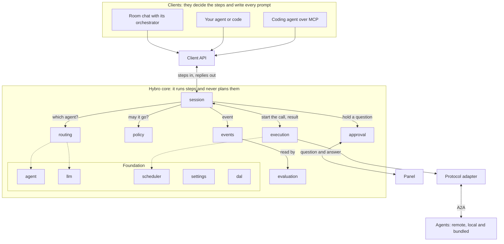
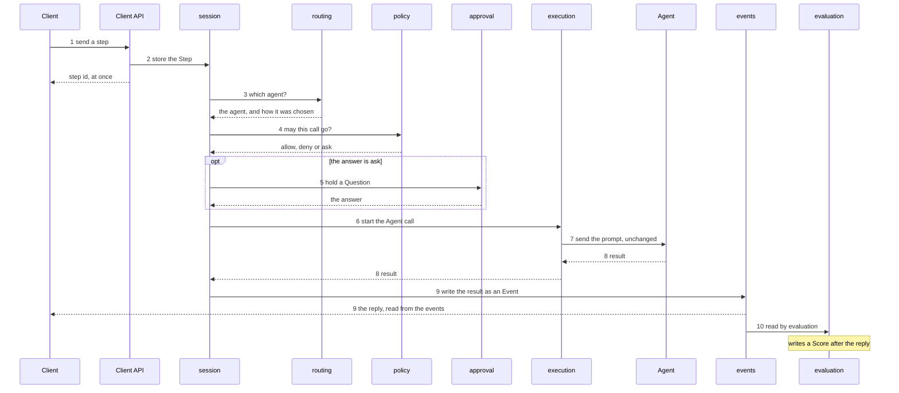
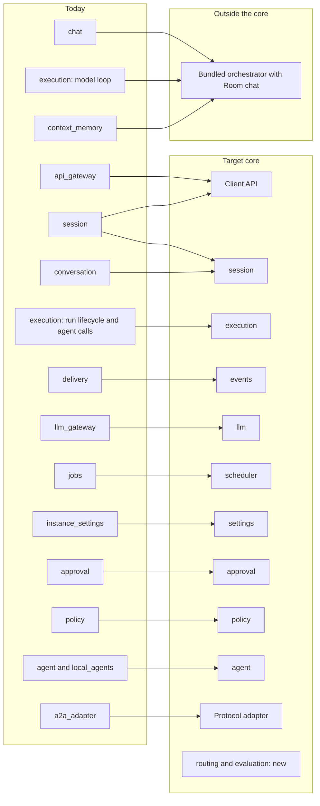

# Hybro Design

This document describes where Hybro is going: its concepts, their names, and
the target architecture. It is the target, not a description of today's code.

- How the code works today:
  [backend/docs/System-Architecture.md](../backend/docs/System-Architecture.md)
  and
  [frontend/docs/System-Architecture.md](../frontend/docs/System-Architecture.md).
- The order of work: [roadmap.md](roadmap.md).

Hybro moves toward this design in small steps. Routes and MCP tools that exist
today keep working while it does.

## Contents

- [The idea](#the-idea)
- [System map](#system-map)
- [Concepts and names](#concepts-and-names)
- [The Client API](#the-client-api)
- [One step, from request to reply](#one-step-from-request-to-reply)
- [Modules](#modules)
- [Routing, rules and labels](#routing-rules-and-labels)
- [Questions and answers](#questions-and-answers)
- [Evaluation](#evaluation)
- [How modules talk to each other](#how-modules-talk-to-each-other)
- [Design rules](#design-rules)
- [The Panel](#the-panel)
- [Community and enterprise](#community-and-enterprise)
- [Today's modules](#todays-modules)
- [Open questions](#open-questions)

## The idea

Hybro is open interoperability infrastructure for AI agents. The target is a
self-hosted control plane for A2A agents: it runs, gates and records each step
of a workflow, and it never plans them.

- **Today:** independently built agents work together.
- **The target:** Hybro is the control plane for how that collaboration is
  authorized, approved and audited. It is not a replacement planner.

Hybro complements orchestrators and coding agents. They are clients: they
plan, and Hybro runs what they send.

A **step** is one prompt from a client, sent to one agent, with its result and
its score.

| Who | What it does |
|---|---|
| A client | Decides what to do and writes every prompt. Planning happens here, outside the core. |
| The core | Runs each step: finds the agent, checks whether the call may go, sends it, records what happens, scores the result, and replies. |
| The LLM helper | Optional. It may pick an agent when routing cannot decide, and judge a result for a score. It never writes or changes a prompt, and it never adds a step. |

A client is anything that asks for work: your own agent or code over HTTP, a
coding agent over MCP, or the bundled Room chat with its orchestrator. The
orchestrator plans and then sends steps like any other client. The core treats
every client the same way.

Three things follow from keeping planning outside:

- **The prompt arrives unchanged.** The agent receives what the client wrote,
  not a version rewritten by a model inside Hybro.
- **Every step stands on its own.** It can be run, checked and scored without
  knowing the plan it came from, so a failing workflow can be traced to one
  step.
- **Any planner works.** A script, a coding agent and the bundled orchestrator
  all use the same door.

## System map



How to read it:

- A step enters at the top through the Client API and reaches `session`.
- `session` is the centre. It asks `routing` and `policy`, uses `approval` when
  something must be answered first, and starts the call in `execution`.
- Only the Protocol adapter talks to agents.
- The result returns to `session`, becomes an Event, and leaves through the
  same Client API. `evaluation` reads the Events afterwards.
- Dotted lines are lookups in the foundation.

## Concepts and names

A record is a kind of stored item with its own identity. Each record has
exactly one module that may write it. Every other module reads it or asks that
module.

| Name | What it is | Written by | Name in today's code |
|---|---|---|---|
| Session | One piece of work: its steps and everything that follows from them. | `session` | room, session (`rooms`, `sessions`) |
| Step | One prompt from a client for one agent, stored once, with its result. It can point at an earlier result or a file in the same Session. | `session` | a `/sessions` message with its `client_request_id` |
| Agent call | One attempt to send a step to an agent. A retry adds another. | `execution` | run, agent call (`orchestrator_runs`, `orchestrator_agent_calls`) |
| Question | Something that must be answered before the work continues. | `approval` | HITL (`hitl_requests`, `hitl_interactions`) |
| Event | One line in a Session's log. Every part of the path adds one, and a client reads its reply from here. | `events` | room event (`room_events`) |
| Score | The outcome of one Standard on one Step: pass or fail. | `evaluation` | new |
| Agent | An agent Hybro can reach: its card, address and protocol. | `agent` | agent (`agents`) |
| Group | A named set of agents. | `agent` | agent group (`agent_groups`) |
| Standard | A requirement a step's result must meet, such as a time limit or a required field. It attaches to a label the client sends, or to an agent. | `evaluation` | new |
| Rule | One line set by the instance owner. There are three kinds: route, access and check. | `policy` | check rule (`rules`); route and access rules are new |
| Client | One program that asks for work. The owner creates it and gives it a token, and Hybro records on every Step which client sent it. Today a client names itself, and the name is not verified. | `client` | client (`clients`); the name it gives itself is `client_label` |

How the records of one piece of work hang together:

```text
Session
  Step                one prompt, one agent
    Agent call        one attempt; a retry adds another
    Question          when the step must wait for an answer
    Score             one for each Standard that applies
  Event               every change above adds one line
```

The states of each record:

| Record | States |
|---|---|
| Session | open, waiting for an answer, ended |
| Step | accepted, waiting for an answer, running, done, failed, denied, canceled |
| Agent call | queued, running, waiting for input, done, failed, canceled |
| Question | pending, answered, canceled, expired, error |
| Event | never changes once written |
| Score | pass, fail |
| Agent | active, inactive |
| Rule, Standard | on, off |

Today a step from the Client API that a check rule refused, or that was
refused at a check rule's Question, has one of two states: `denied` when a
check rule denied the call, and `rejected` when the owner or a client with the
owner's grant refused it at the Question. These two become the one state
denied when the `session` module migrates in phase 5. A step whose Question
the owner canceled also reads `rejected` today. The step view also shows a
Question as `unanswered` when its step ended while it was still pending; that
is a view of the step, not a state of the Question.

Four more words:

- **Owner:** the person who runs the instance. The owner has the instance's
  one account and signs in to the Panel with it.
- **Panel:** the pages of the Hybro app where the owner sees what needs them
  and answers.
- **Label:** a short key and value that a client sends with a step, such as
  `team=billing`.
- **Turn:** a word for the client side, such as one round of an orchestrator's
  thinking or a chat message with its answer. The core has no turns, only steps.

Naming rules:

- New code, new routes and new documents use these names.
- Existing code keeps its names until the roadmap phase that migrates its
  module. Each module is renamed in its own change; there is no single large
  rename.

## The Client API

The Client API is the one door into the core. Every client uses it, and the
bundled orchestrator has no private path.

| Action | What it does | Closest thing today |
|---|---|---|
| Open a session | Starts one piece of work. | `POST /sessions/messages` without a `session_id` |
| Send a step | Sends one prompt. It returns a step id at once and does not wait for the agent. | `POST /sessions/messages` |
| Follow events | Reads what happened to the session's steps, live. | `GET /sessions/{session_id}`, by polling |
| Answer a question | Answers an information question that an agent asked. | None for information questions, which go to the owner in the app. `POST /sessions/{session_id}/questions/{question_id}/answer` answers a permission question, by a client with the owner's grant only. |
| Cancel | Stops a step, or closes the session. | `POST /sessions/{session_id}/close` |

What a step carries:

| Part | Required | Meaning |
|---|---|---|
| The prompt | Yes | What the agent should do. It is stored and sent as written. |
| A request id | Yes | Makes a retry safe: the same id never runs twice. |
| The agent | No | When given, it is always used. When left out, routing finds one. |
| Labels | No | Keys and values that route rules and standards can match on. |
| Pointers | No | Earlier results or files in the same Session that the agent should receive, unchanged. |

These are shapes, not final field names. The fields are fixed when the roadmap
phase that builds them starts.

### Who may use it

Two kinds of caller use Hybro from outside: the owner and a client. Agents
call back on a few routes with a credential of their own.

| Who | Proves it with | Can reach |
|---|---|---|
| The owner, in a browser | The owner account's sign-in | The Panel and every route not named below |
| A client | Its client token | The Client API only |
| The owner at the machine, through the `hybro` command | A token the entrypoint writes inside the container on each start | The machine-only routes: create the owner, issue a setup link, reset the password, create a client |
| The `hybro` command, for `hybro doctor` | A second token of the same kind | The diagnostics routes, which the owner's sign-in opens too |
| A bundled agent | The internal credential the entrypoint gives it | The model proxy, `/internal/llm` |
| An agent that reports the result of a call | The push token of that call | `/a2a/push` |
| A health probe | Nothing | `/health`, which reports only that the service is up |

Each route accepts one kind of credential, with one exception: the diagnostics
routes take the `hybro` command's token or the owner's sign-in. The owner's
sign-in does not open the agent-facing routes, and their credentials open
nothing else. The machine-only routes cannot be reached through the published
port: the image's proxy refuses them, and `hybro` calls them from inside the
container.

- **A client token.** The owner creates a client in the Panel, or with
  `hybro client create` on the machine that runs Hybro, and receives its
  token once. The client sends the token with each request. Hybro stores a
  hash of it and its last four characters, never the token itself. It finds
  the client from the hash and records that client on every Step. A token
  never opens the Panel or the settings.
- **A token is required by default,** on every install, for a program on the
  same machine as well as one on another machine. The rule does not depend on
  how the instance was started or where a request comes from.
- **The owner can turn the requirement off.** Then a request without a token is
  accepted and recorded under one built-in client, "No token". The Panel says
  so while the requirement is off. A request that carries a token is always
  recorded under its own client. One exception stays refused: a request
  without a token that a web page on another address made a browser send (see
  [Requests from other websites](#requests-from-other-websites)).
- **A bad token is always refused.** A request that carries an unknown or
  revoked token is refused, also while the requirement is off. It is never
  recorded under "No token", so revoking a token always takes effect.
- **Every Step names its client.** A CI system or a chat app is a client with
  its own token. Work that no program sends, such as a timer inside Hybro,
  arrives as a built-in client, like "No token".
- **Trust needs a token.** A feature that limits or trusts a client by
  which client it is, such as an access rule that matches on a client or the
  grant that lets a client answer permission questions, applies to clients
  with a token. It can never be given to "No token" or another built-in
  client.
- **A session belongs to the client that opened it.** Whoever holds that
  client's current token can send to the session, read it and close it;
  another client gets "not found". Rotating the token keeps the sessions,
  because they belong to the client and not to the token value. Programs that
  share one token share its sessions. The owner sees every session in the
  Panel.
- **`client_label` is a claimed name, not an identity.** It is optional when a
  token is sent and required when a session is opened without one. The label
  is the name a program gives itself; the client is the record its token
  proves. The Panel shows the label as text, apart from the client, and no
  decision uses it.
- **MCP uses the same token.** The MCP adapter is served on every install. It
  passes the client's token to the Client API, which checks it; the adapter
  decides nothing about who a client is.

### The owner account

- The instance has one account, the owner's: a name, an email and a password.
  Hybro keeps it itself and needs no outside service to sign in.
- The owner creates the account on the first visit, through a one-time setup
  link that the `hybro` command prints, or without a browser with
  `hybro owner create` on the machine that runs Hybro. Both work only while no
  account exists. Until it exists, the routes that need the owner's sign-in
  and the Client API refuse requests; the agent-facing routes and `/health`
  are not affected.
- The setup link carries a code that works once. Hybro stores only a hash of
  it, and it stops working after 24 hours or when a newer link is issued.
- Sign-in is required on every install. The owner changes the profile and the
  password in the Panel, sees the signed-in browsers, and resets a forgotten
  password with `hybro owner reset-password` on the machine that runs Hybro.
- The Panel keeps the sign-in in a cookie. Sign-in and setup limit repeated
  attempts, and a request that changes something is checked against
  cross-site request forgery.
- More people, roles and single sign-on are enterprise (see
  [Community and enterprise](#community-and-enterprise)).

### Requests from other websites

A browser sends the owner's cookie with a request that any web page starts, so
Hybro checks where a request came from:

- A request that changes something and carries the owner's cookie must come
  from Hybro's own address, and so must sign-in and setup. The browser states
  the page's address in the `Origin` header; a request whose `Origin` is
  missing or names another address is refused.
- A Client API request without a token is refused when its `Origin` names
  another address. A program sends no `Origin`, so programs are not affected.
- Hybro's own address is the host and port the browser used. Behind a reverse
  proxy the proxy keeps the browser's host, or passes it on in
  `X-Forwarded-Host` with `backend.proxy_hops` set (see
  [behind a reverse proxy](reverse-proxy.md)).
- A request without the cookie is not checked by the first rule. Scripts, the
  MCP adapter and agents are not affected.

## One step, from request to reply



1. A client sends a step through the Client API: a prompt, optional labels, and
   optionally the agent to use.
2. `session` stores the Step, with a request id so that a retry does not run it
   twice. The send returns at once with a step id.
3. `session` asks `routing` which agent gets the step.
4. `session` asks `policy` whether the call may go. The answer is allow, deny
   or ask.
5. On "ask", `approval` holds a Question and the Session waits until it is
   answered.
6. `session` starts an Agent call in `execution`, which puts it in the queue.
7. `execution` sends the prompt, unchanged, through the Protocol adapter.
8. The agent's result returns to `execution`, then to `session`. If the agent
   asks a question instead, 5 runs again.
9. `session` writes the result as an Event. The client, which follows the
   Session's events, receives it as the reply.
10. `evaluation` reads the Events and writes a Score. This happens after the
    reply and does not delay it.

A worked example. A person asks in Room chat to fix a failing test. The bundled
orchestrator plans the work and sends its first step:

| # | What happens | Record written |
|---|---|---|
| 1 | The orchestrator sends the prompt "Fix the failing login test on main and open a pull request", with the labels `workflow=fix-test` and `step=fix`. It names no agent. | none yet |
| 2 | The step is stored as sent. | Session, Step |
| 3 | No agent is named, so routing looks at the owner's route rules. One says steps with `step=fix` go to the agent "coder". No LLM pick is needed. | Step: the agent, and that a rule chose it |
| 4 | A check rule says to ask before any step goes to "coder". The answer is "ask". | Event |
| 5 | The Session waits. The owner approves in the Panel. | Question |
| 6 | One call to "coder" joins the queue. | Agent call |
| 7 | The prompt goes to "coder" as it was written. | Event |
| 8 | "coder" returns a fix and a link to its pull request. | Agent call and Step, both finished |
| 9 | The orchestrator reads the result from the events. It sends its next step, or answers the person in the chat. | Event |
| 10 | A standard says a step with `step=fix` must return a pull request link within ten minutes. This step passes. | Score |

The next step of the same work is a new Step on the same Session. The path
repeats from 2, and no new Session opens.

## Modules

| Layer | Module | Job | Owns |
|---|---|---|---|
| Door | Client API | The one API every client uses. The bundled orchestrator has no private path. | nothing |
| Door | `client` | Stores each client, the hash of its token, and whether a token is required. It tells the Client API which client sent a request. | Client |
| Door | `account` | The owner account: sign-in, the signed-in browsers, and the one-time setup link. | the owner account |
| Step path | `session` | Stores each Session and Step. A small function with no I/O decides what happens next: route, check, ask, start a call, or finish. | Session, Step |
| Step path | `routing` | Finds the agent for a step and fits the prompt to that agent's input. It never rewords the prompt. | nothing |
| Step path | `policy` | Stores the owner's rules and answers from them. | Rule |
| Step path | `approval` | Holds each Question until it is answered, by the owner in the Panel or by the client through the Client API. | Question |
| Step path | `execution` | Runs one Agent call to the end: queue, send, wait, retry, recover, cancel, and take in the result. | Agent call |
| Foundation | `events` | Keeps the log of every step, streams it live to clients and the Panel, and gives other modules publish and subscribe for work that does not finish at once. | Event |
| Foundation | `agent` | Registry, discovery, search and groups. | Agent, Group |
| Foundation | `llm` | The optional helper. It picks an agent for `routing` and judges a result for `evaluation`. | nothing |
| Foundation | `scheduler` | The queue and limits for running calls. Timers that start work come later. | nothing yet |
| Foundation | `settings` | Instance-level configuration, set by the owner. | the configuration file |
| Foundation | `dal` | Database connections and generic clients. Each module keeps its own repository on top of it. | nothing |
| Beside the path | `evaluation` | Reads Events, compares each step with the Standards a user set, and writes a Score. It shows which step of a workflow failed. | Standard, Score |

What each module may and may not do:

| Module | It does | It never does |
|---|---|---|
| `session` | Decides what happens next in a step. | Calls an agent or a model itself. |
| `routing` | Reads the registry, asks `policy` for route and access rules, and asks `llm` to pick when it cannot decide. | Changes the prompt, or waits for a person. |
| `policy` | Answers a question from the rules. | Calls another module, or waits. |
| `approval` | Holds a Question and returns its answer. | Decides what happens after the answer. |
| `execution` | Runs the call it was given. | Chooses the agent, or decides what comes after the result. |
| `events` | Stores Events and delivers them to listeners. | Decides anything. |
| `llm` | Picks from the agents it is shown, and judges a result. | Plans, adds a step, or writes a prompt. |
| `evaluation` | Reads Events and writes Scores. | Blocks or changes a step. |

## Routing, rules and labels

### How routing finds the agent

Routing goes from the most certain answer to the least certain:

1. The agent the client named. It is always used.
2. The owner's route rule, such as "all CI events go to Agent X". A rule
   matches on the client and on the labels the client sends with a step.
3. Search and match in the agent registry.
4. The LLM helper picks, only when more than one agent still fits.

Each step records how its agent was chosen: named, by rule, by match, or by the
LLM pick. When no agent fits, or the named agent is not allowed, the step fails
back to the client with a reason. It is never sent to a different agent
silently.

Routing also fits the prompt to the chosen agent's input, for example by
choosing the agent's skill and placing the prompt in its input field. It
attaches what the step points to. It never rewords the prompt.

### Rules

| Kind of rule | Question it answers | Example | Where it runs | Edition |
|---|---|---|---|---|
| Route | Where does this step go? | All CI events go to Agent X. | Inside routing, only when the client names no agent | Community |
| Access | Who may use what? | This client may not use Agent Y. | Inside routing, as a filter on the agents it may choose | Enterprise |
| Check | May this call go now? | Ask before any step goes to Agent Z. | After routing and before the call. It answers allow, deny or ask, and "ask" pauses the Session. | Community |

Check rules are an ordered list. A check rule matches one agent or any
agent, the first rule that is on and matches decides, and no match means
allow. A check rule gates a new agent call only.

Today the check sits where `execution` accepts a new agent call, so one check
covers Room chat and the `/sessions` routes. Phase 4 moves its caller up into
`session`, where the target puts it.

A check rule runs before the call. It knows the step and the chosen agent, not
what the agent will do during the call. When an agent wants to do something
that needs permission, such as pushing code, the agent asks, and that is a
permission Question (see [Questions and answers](#questions-and-answers)).

Route rules are an ordered list, and the first rule that matches wins. For
example:

```text
1. client is ci-bot          -> agent "coder"
2. label step=review         -> agent "reviewer"
3. label team=billing        -> agent "billing-helper"
```

A step from `ci-bot` with `step=review` goes to "coder", because rule 1 comes
first. A client that wants "reviewer" can name that agent, and a named agent
wins over every rule.

### Labels

A client can send labels with a step. A label is a short key and value, such
as `team=billing` or `kind=ci`. The owner chooses the labels their rules match
on, and a client sends the ones it wants a rule to match.

- There is no list of labels to define first. A label exists when a rule or a
  client uses it. A label that no rule matches is stored on the step and
  otherwise ignored.
- Three keys are predefined, because evaluation groups results by them:
  `workflow` is the name of the whole piece of work, `step` is this step's role
  in it, and `version` is the version of the workflow's prompts. Every other
  label means only what the owner's rules make it mean.
- Hybro limits only the size and the number of labels.

## Questions and answers

A step stops on a Question for one of two reasons:

- A check rule answered "ask".
- The agent itself asked, for permission or for missing information.

| Kind | Example | Who answers |
|---|---|---|
| Permission | "May the agent push to `main`?" | The owner, in the Panel. The owner can grant a client the right to answer these too, for setups where the user and the owner are the same person. |
| Information | "Which branch should I fix?" | The client that wrote the prompt. |

What happens next:

- While the Question is pending, the Step and its Session are waiting. Nothing
  is running, and the wait does not count against the call's time limit.
- An answer lets the step continue from where it stopped.
- A refusal ends the step as denied, and the client is told why.
- Every answer is recorded with who gave it: the owner or a client.

Today the permission questions are a check rule's ask and an agent's own
approval question (stored as `policy_decision`). A questionnaire, a sign-in
request (`auth_challenge`) and every other question go to the owner. A
client's answer is applied as the owner's, and the client that gave it is
recorded.

## Evaluation

Evaluation answers one question for a workflow builder: which step went wrong?

- A **Standard** is a requirement that a step's result must meet. Examples: it
  finished within ten minutes, the result contains a pull request link, or the
  LLM helper judges that the result answers the prompt.
- A Standard attaches to a label, such as every step with `step=fix`, or to an
  agent.
- When a step finishes, `evaluation` reads its Events and writes one **Score**
  for each Standard that applies: pass or fail.
- Scoring happens after the reply and never delays or changes a step.
- The Panel shows each step's input, output and timing next to its Scores, so a
  failing workflow can be traced to the step that failed.
- Checking a Standard by hand on the current run is community. Standards that
  are saved and run on every step, and results kept over time, are enterprise.

## How modules talk to each other

| Way | Used when | Example |
|---|---|---|
| Direct call | The caller needs an answer to continue. Each module offers one public interface for this. | `session` asks `routing` which agent, and tells `execution` to start the call. |
| Event | Something already happened, and the sender does not care who listens. | "Step finished" is read by `evaluation` and by the live stream to clients. |

The design waits in three places only. The client gets a step id at once and
reads the result later. An agent call waits in a queue. A question waits for an
answer. Storing, routing and checking are direct calls in order.

## Design rules

1. One writer per record.
2. Only `session` decides what happens next in a step. Other modules do one job
   and report back.
3. Every client uses the same Client API.
4. The core never plans and never rewrites a prompt. The LLM helper may only
   pick and judge.
5. Only the Protocol adapter talks to agents.
6. An event never decides what happens next in a step. If every listener were
   removed, the step would still finish.
7. The records are the truth, and a notification is only a wake-up. A module
   saves its result before it tells another module.
8. The Session and its Events are the history. Choosing and shortening what an
   agent should know is the client's job. The core only passes along,
   unchanged, what a step points to.
9. Code outside an `enterprise/` folder never imports from one. The community
   edition builds and runs with every `enterprise/` folder deleted.

## The Panel

The Panel has one page for each concept. A page's layout is decided when the
work on it starts. This list fixes which pages exist and what belongs on each.

| Page | What it shows | Today |
|---|---|---|
| Overview | What needs the owner now, what failed, and recent activity. Its Inbox is the one home for open Questions. | Exists |
| Chat | Room chat, where a person places an order with the bundled orchestrator. | Exists |
| Sessions | Every Session from every client, Room chat included. One Session shows its Steps: the prompt, the agent and how it was chosen, the result, the timing, the Questions and the Scores. | Exists under the name Inbox, for API and MCP clients; the step view is new |
| Network | Agents and Groups. | Exists |
| Rules | The ordered route rules, and the check rules. | Exists, with the check rules; route rules are new |
| Evaluation | Standards, and checking one against a run. | New |
| Connect | The owner's clients and their tokens, and how a client connects, over the API or MCP. | Exists under the name Access, without clients |
| Settings | Model provider, configuration and system. | Exists |

The owner's account is not a page. It sits in the user menu: profile, password,
signed-in browsers, and sign out.

## Community and enterprise

Hybro is open core. It has a community edition and an enterprise edition in
this one repository.

- **Community code is under Apache 2.0.** That is everything outside an
  `enterprise/` folder.
- **Enterprise code is under a commercial license.** It lives in folders named
  `enterprise/`. There is not one such folder for the whole repository: each
  part of the code that has an enterprise side keeps it in its own
  `enterprise/` folder, next to the implementation it extends. For example,
  saved standards would sit in `evaluation/enterprise/` and access rules in
  `policy/enterprise/`, and the frontend follows the same rule.
- **The dependency goes one way.** Code in an `enterprise/` folder may import
  the code around it. Code outside never imports from an `enterprise/` folder,
  and the community edition builds and runs with every `enterprise/` folder
  deleted.
- **Community code carries only small hooks,** such as "may this client use
  this agent?" or "a step finished". The enterprise logic behind a hook lives
  in an `enterprise/` folder.
- **A license key turns the enterprise features on.**

No `enterprise/` folder exists yet.

Which features are in which edition:

Running a workflow, steering it with your own rules, and seeing what happened
is community. Enterprise is what a team or a company adds: control over who may
use what, evaluation results kept over time, and audit. Where a feature is
enterprise, the community edition has a manual version of it, done by hand,
once, on the current run.

| Feature | Community | Enterprise |
|---|---|---|
| Clients and the Client API | All of it, including client tokens, remote access with a token, and the clients that send work on events, which come later. | Nothing |
| Sessions, steps, agent calls, queue | All of it. | Nothing |
| Routing | Named agent, owner route rules, match, LLM pick. | Nothing |
| Questions and approvals | The agent's own permission questions, answered by the owner in the Panel. Owner check rules. The grant that lets a client answer. | Several approvers, and approval by role. |
| Evaluation | Each step's input, output and timing. A standard checked by hand on the current run. | Saved standards that run on every step, results over time, comparison, sharing, alerts. |
| Event log | The full log of each session, and the live stream. | Audit across sessions, and export. |
| Access and people | One owner with a built-in account, everything allowed. | Access rules, roles, more users, members with fewer rights, teams, single sign-on. |

Where the enterprise side attaches: access rules and roles to `policy`, saved
standards and history to `evaluation`, an audit listener to `events`, and
users and roles as a part of their own.

## Today's modules

Each module in today's code has one of three statuses:

- **Stable:** it stays as it is. Contribute freely.
- **Changing:** the target differs from today. Open an issue before a larger
  change.
- **Frozen:** it will move out of the core. Bug fixes only.

| Today's code | Status | In the target |
|---|---|---|
| `agent`, `local_agents` | Stable | `agent` |
| `approval` | Stable | `approval`; a Question gains a kind |
| `a2a_adapter` | Stable | The Protocol adapter |
| `dal`, `common`, `models` | Stable | Foundation and shared contracts |
| `instance_settings` | Stable | `settings` |
| `diagnostics`, `room_files` | Stable | Support: logs and files |
| `account` | Stable | `account` |
| `client` | Stable | `client` |
| `policy` | Stable | `policy`; it holds the check rules, and route and access rules are new |
| `jobs` | Stable | `scheduler` |
| `MCP/server.py` | Stable | A client that uses the Client API |
| `default_agents` | Stable | The bundled agents |
| `api_gateway` | Changing | Hosts the routes of the Client API and the Panel, and the checks on who may call them |
| `session` | Changing | Its `/sessions` routes grow into the Client API |
| `conversation` | Changing | The store behind `session` |
| `chat` | Changing | Room chat, a bundled client |
| `delivery` | Changing | `events` |
| `llm_gateway` | Changing | `llm`, the helper |
| `execution`: Run lifecycle, cancellation, recovery, the `passthrough` profile | Changing | `execution`, which runs one agent call |
| `execution`: the model loop of the `fast` and `ultimate` profiles | Frozen | Moves out and becomes the bundled orchestrator, a client |
| `context_memory` | Frozen | Moves out with the orchestrator |

Where each of today's modules goes:



Nothing is deleted before its replacement has shipped.

## Open questions

None at present. How a client is identified was the open question; the answer
is in [Who may use it](#who-may-use-it).

## Changing this document

Change it by pull request. For a change to a concept, a name or a design rule,
open an issue first.
