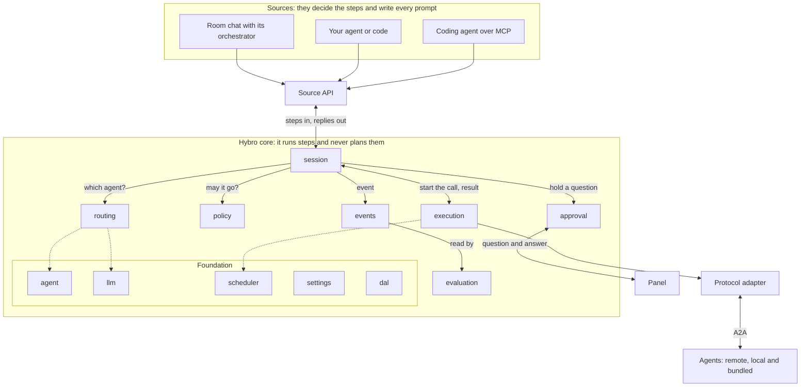
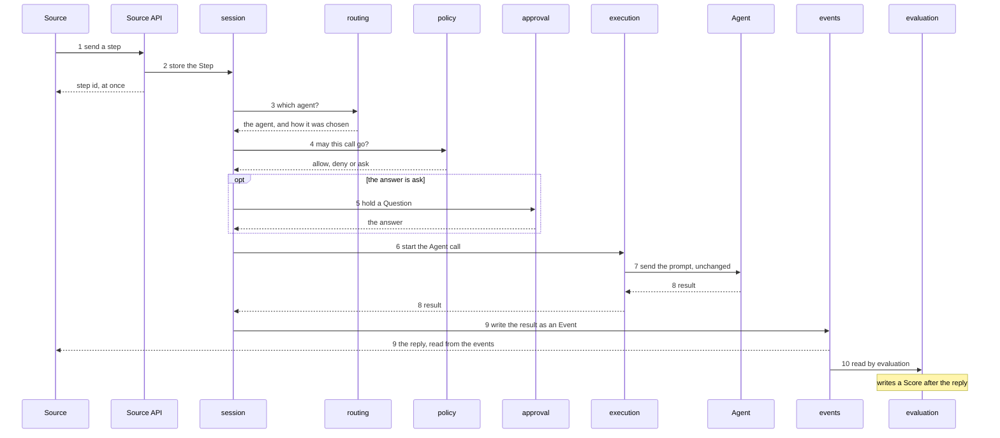
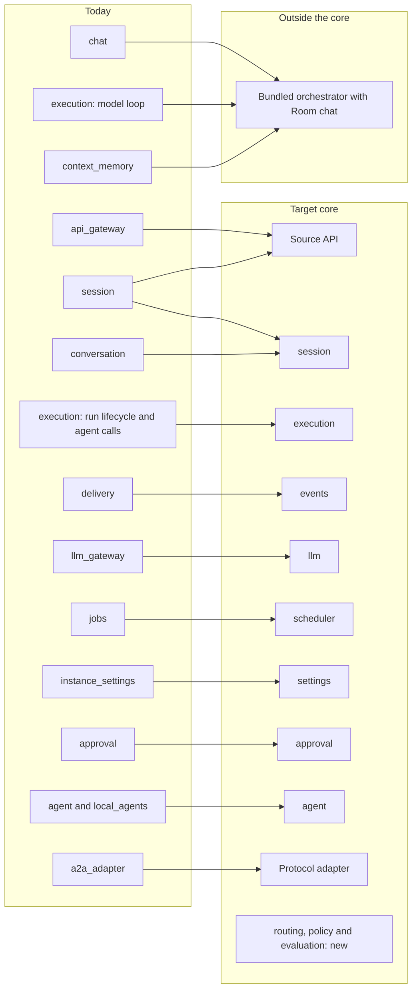

# Hybro Design

This document describes where Hybro is going: its concepts, their names, and
the target architecture. It is the target, not a description of today's code.

- How the code works today:
  [backend/docs/System-Architecture.md](../backend/docs/System-Architecture.md)
  and
  [frontend/docs/System-Architecture.md](../frontend/docs/System-Architecture.md).
- The order of work: [roadmap.md](roadmap.md).

Hybro moves toward this design in small steps. Routes and MCP tools that exist
today keep working while it does.

## Contents

- [The idea](#the-idea)
- [System map](#system-map)
- [Concepts and names](#concepts-and-names)
- [The Source API](#the-source-api)
- [One step, from request to reply](#one-step-from-request-to-reply)
- [Modules](#modules)
- [Routing, rules and labels](#routing-rules-and-labels)
- [Questions and answers](#questions-and-answers)
- [Evaluation](#evaluation)
- [How modules talk to each other](#how-modules-talk-to-each-other)
- [Design rules](#design-rules)
- [The Panel](#the-panel)
- [Today's modules](#todays-modules)
- [Open questions](#open-questions)

## The idea

Hybro is infrastructure for multi-agent workflows. It runs steps and never
plans them.

A **step** is one prompt from a source, sent to one agent, with its result and
its score.

| Who | What it does |
|---|---|
| A source | Decides what to do and writes every prompt. Planning happens here, outside the core. |
| The core | Runs each step: finds the agent, checks whether the call may go, sends it, records what happens, scores the result, and replies. |
| The LLM helper | Optional. It may pick an agent when routing cannot decide, and judge a result for a score. It never writes or changes a prompt, and it never adds a step. |

A source is anything that asks for work: your own agent or code over HTTP, a
coding agent over MCP, or the bundled Room chat with its orchestrator. The
orchestrator plans and then sends steps like any other source. The core treats
every source the same way.

Three things follow from keeping planning outside:

- **The prompt arrives unchanged.** The agent receives what the source wrote,
  not a version rewritten by a model inside Hybro.
- **Every step stands on its own.** It can be run, checked and scored without
  knowing the plan it came from, so a failing workflow can be traced to one
  step.
- **Any planner works.** A script, a coding agent and the bundled orchestrator
  all use the same door.

## System map



How to read it:

- A step enters at the top through the Source API and reaches `session`.
- `session` is the centre. It asks `routing` and `policy`, uses `approval` when
  something must be answered first, and starts the call in `execution`.
- Only the Protocol adapter talks to agents.
- The result returns to `session`, becomes an Event, and leaves through the
  same Source API. `evaluation` reads the Events afterwards.
- Dotted lines are lookups in the foundation.

## Concepts and names

A record is a kind of stored item with its own identity. Each record has
exactly one module that may write it. Every other module reads it or asks that
module.

| Name | What it is | Written by | Name in today's code |
|---|---|---|---|
| Session | One piece of work: its steps and everything that follows from them. | `session` | room, session (`rooms`, `sessions`) |
| Step | One prompt from a source for one agent, stored once, with its result. It can point at an earlier result or a file in the same Session. | `session` | a `/sessions` message with its `client_request_id` |
| Agent call | One attempt to send a step to an agent. A retry adds another. | `execution` | run, agent call (`orchestrator_runs`, `orchestrator_agent_calls`) |
| Question | Something that must be answered before the work continues. | `approval` | HITL (`hitl_requests`, `hitl_interactions`) |
| Event | One line in a Session's log. Every part of the path adds one, and a source reads its reply from here. | `events` | room event (`room_events`) |
| Score | The outcome of one Standard on one Step: pass or fail. | `evaluation` | new |
| Agent | An agent Hybro can reach: its card, address and protocol. | `agent` | agent (`agents`) |
| Group | A named set of agents. | `agent` | agent group (`agent_groups`) |
| Standard | A requirement a step's result must meet, such as a time limit or a required field. It attaches to a label the source sends, or to an agent. | `evaluation` | new |
| Rule | One line set by the instance owner. There are three kinds: route, access and check. | `policy` | new |
| Source | One thing that asks for work. It names itself, and the name is not verified. | Source API | client (`client_label`) |

How the records of one piece of work hang together:

```text
Session
  Step                one prompt, one agent
    Agent call        one attempt; a retry adds another
    Question          when the step must wait for an answer
    Score             one for each Standard that applies
  Event               every change above adds one line
```

The states of each record:

| Record | States |
|---|---|
| Session | open, waiting for an answer, ended |
| Step | accepted, waiting for an answer, running, done, failed, denied, canceled |
| Agent call | queued, running, waiting for input, done, failed, canceled |
| Question | pending, answered, canceled |
| Event | never changes once written |
| Score | pass, fail |
| Agent | active, inactive |
| Rule, Standard | on, off |

Four more words:

- **Owner:** the person who runs the instance.
- **Panel:** the pages of the Hybro app where the owner sees what needs them
  and answers.
- **Label:** a short key and value that a source sends with a step, such as
  `team=billing`.
- **Turn:** a word for the source side, such as one round of an orchestrator's
  thinking or a chat message with its answer. The core has no turns, only steps.

Naming rules:

- New code, new routes and new documents use these names.
- Existing code keeps its names until the roadmap phase that migrates its
  module. Each module is renamed in its own change; there is no single large
  rename.

## The Source API

The Source API is the one door into the core. Every source uses it, and the
bundled orchestrator has no private path.

| Action | What it does | Closest thing today |
|---|---|---|
| Open a session | Starts one piece of work. | `POST /sessions/messages` without a `session_id` |
| Send a step | Sends one prompt. It returns a step id at once and does not wait for the agent. | `POST /sessions/messages` |
| Follow events | Reads what happened to the session's steps, live. | `GET /sessions/{session_id}`, by polling |
| Answer a question | Answers an information question that an agent asked. | None. Today every question goes to the owner in the app. |
| Cancel | Stops a step, or closes the session. | `POST /sessions/{session_id}/close` |

What a step carries:

| Part | Required | Meaning |
|---|---|---|
| The prompt | Yes | What the agent should do. It is stored and sent as written. |
| A request id | Yes | Makes a retry safe: the same id never runs twice. |
| The agent | No | When given, it is always used. When left out, routing finds one. |
| Labels | No | Keys and values that route rules and standards can match on. |
| Pointers | No | Earlier results or files in the same Session that the agent should receive, unchanged. |

These are shapes, not final field names. The fields are fixed when the roadmap
phase that builds them starts.

## One step, from request to reply



1. A source sends a step through the Source API: a prompt, optional labels, and
   optionally the agent to use.
2. `session` stores the Step, with a request id so that a retry does not run it
   twice. The send returns at once with a step id.
3. `session` asks `routing` which agent gets the step.
4. `session` asks `policy` whether the call may go. The answer is allow, deny
   or ask.
5. On "ask", `approval` holds a Question and the Session waits until it is
   answered.
6. `session` starts an Agent call in `execution`, which puts it in the queue.
7. `execution` sends the prompt, unchanged, through the Protocol adapter.
8. The agent's result returns to `execution`, then to `session`. If the agent
   asks a question instead, 5 runs again.
9. `session` writes the result as an Event. The source, which follows the
   Session's events, receives it as the reply.
10. `evaluation` reads the Events and writes a Score. This happens after the
    reply and does not delay it.

A worked example. A person asks in Room chat to fix a failing test. The bundled
orchestrator plans the work and sends its first step:

| # | What happens | Record written |
|---|---|---|
| 1 | The orchestrator sends the prompt "Fix the failing login test on main and open a pull request", with the labels `workflow=fix-test` and `step=fix`. It names no agent. | none yet |
| 2 | The step is stored as sent. | Session, Step |
| 3 | No agent is named, so routing looks at the owner's route rules. One says steps with `step=fix` go to the agent "coder". No LLM pick is needed. | Step: the agent, and that a rule chose it |
| 4 | A check rule says to ask before an agent pushes code. The answer is "ask". | Event |
| 5 | The Session waits. The owner approves in the Panel. | Question |
| 6 | One call to "coder" joins the queue. | Agent call |
| 7 | The prompt goes to "coder" as it was written. | Event |
| 8 | "coder" returns a fix and a link to its pull request. | Agent call and Step, both finished |
| 9 | The orchestrator reads the result from the events. It sends its next step, or answers the person in the chat. | Event |
| 10 | A standard says a step with `step=fix` must return a pull request link within ten minutes. This step passes. | Score |

The next step of the same work is a new Step on the same Session. The path
repeats from 2, and no new Session opens.

## Modules

| Layer | Module | Job | Owns |
|---|---|---|---|
| Door | Source API | The one API every source uses. The bundled orchestrator has no private path. | Source |
| Step path | `session` | Stores each Session and Step. A small function with no I/O decides what happens next: route, check, ask, start a call, or finish. | Session, Step |
| Step path | `routing` | Finds the agent for a step and fits the prompt to that agent's input. It never rewords the prompt. | nothing |
| Step path | `policy` | Stores the owner's rules and answers from them. | Rule |
| Step path | `approval` | Holds each Question until it is answered, by the owner in the Panel or by the source through the Source API. | Question |
| Step path | `execution` | Runs one Agent call to the end: queue, send, wait, retry, recover, cancel, and take in the result. | Agent call |
| Foundation | `events` | Keeps the log of every step, streams it live to sources and the Panel, and gives other modules publish and subscribe for work that does not finish at once. | Event |
| Foundation | `agent` | Registry, discovery, search and groups. | Agent, Group |
| Foundation | `llm` | The optional helper. It picks an agent for `routing` and judges a result for `evaluation`. | nothing |
| Foundation | `scheduler` | The queue and limits for running calls. Timers that start work come later. | nothing yet |
| Foundation | `settings` | Instance-level configuration, set by the owner. | the configuration file |
| Foundation | `dal` | Database connections and generic clients. Each module keeps its own repository on top of it. | nothing |
| Beside the path | `evaluation` | Reads Events, compares each step with the Standards a user set, and writes a Score. It shows which step of a workflow failed. | Standard, Score |

What each module may and may not do:

| Module | It does | It never does |
|---|---|---|
| `session` | Decides what happens next in a step. | Calls an agent or a model itself. |
| `routing` | Reads the registry, asks `policy` for route and access rules, and asks `llm` to pick when it cannot decide. | Changes the prompt, or waits for a person. |
| `policy` | Answers a question from the rules. | Calls another module, or waits. |
| `approval` | Holds a Question and returns its answer. | Decides what happens after the answer. |
| `execution` | Runs the call it was given. | Chooses the agent, or decides what comes after the result. |
| `events` | Stores Events and delivers them to listeners. | Decides anything. |
| `llm` | Picks from the agents it is shown, and judges a result. | Plans, adds a step, or writes a prompt. |
| `evaluation` | Reads Events and writes Scores. | Blocks or changes a step. |

## Routing, rules and labels

### How routing finds the agent

Routing goes from the most certain answer to the least certain:

1. The agent the source named. It is always used.
2. The owner's route rule, such as "all CI events go to Agent X". A rule
   matches on the source and on the labels the source sends with a step.
3. Search and match in the agent registry.
4. The LLM helper picks, only when more than one agent still fits.

Each step records how its agent was chosen: named, by rule, by match, or by the
LLM pick. When no agent fits, or the named agent is not allowed, the step fails
back to the source with a reason. It is never sent to a different agent
silently.

Routing also fits the prompt to the chosen agent's input, for example by
choosing the agent's skill and placing the prompt in its input field. It
attaches what the step points to. It never rewords the prompt.

### Rules

| Kind of rule | Question it answers | Example | Where it runs |
|---|---|---|---|
| Route | Where does this step go? | All CI events go to Agent X. | Inside routing, only when the source names no agent |
| Access | Who may use what? | This source may not use Agent Y. | Inside routing, as a filter on the agents it may choose |
| Check | May this call go now? | Ask before an agent pushes code. | After routing. It answers allow, deny or ask, and "ask" pauses the Session. |

Route rules are an ordered list, and the first rule that matches wins. For
example:

```text
1. source is ci-bot          -> agent "coder"
2. label step=review         -> agent "reviewer"
3. label team=billing        -> agent "billing-helper"
```

A step from `ci-bot` with `step=review` goes to "coder", because rule 1 comes
first. A source that wants "reviewer" can name that agent, and a named agent
wins over every rule.

### Labels

A source can send labels with a step. A label is a short key and value, such
as `team=billing` or `kind=ci`. The owner chooses the labels their rules match
on, and a source sends the ones it wants a rule to match.

- There is no list of labels to define first. A label exists when a rule or a
  source uses it. A label that no rule matches is stored on the step and
  otherwise ignored.
- Three keys are predefined, because evaluation groups results by them:
  `workflow` is the name of the whole piece of work, `step` is this step's role
  in it, and `version` is the version of the workflow's prompts. Every other
  label means only what the owner's rules make it mean.
- Hybro limits only the size and the number of labels.

## Questions and answers

A step stops on a Question for one of two reasons:

- A check rule answered "ask".
- The agent itself asked, for permission or for missing information.

| Kind | Example | Who answers |
|---|---|---|
| Permission | "May the agent push to `main`?" | The owner, in the Panel. The owner can grant one source the right to answer these too, for setups where the user and the owner are the same person. |
| Information | "Which branch should I fix?" | The source that wrote the prompt. |

What happens next:

- While the Question is pending, the Step and its Session are waiting. Nothing
  is running, and the wait does not count against the call's time limit.
- An answer lets the step continue from where it stopped.
- A refusal ends the step as denied, and the source is told why.
- Every answer is recorded with who gave it: the owner or a source.

## Evaluation

Evaluation answers one question for a workflow builder: which step went wrong?

- A **Standard** is a requirement that a step's result must meet. Examples: it
  finished within ten minutes, the result contains a pull request link, or the
  LLM helper judges that the result answers the prompt.
- A Standard attaches to a label, such as every step with `step=fix`, or to an
  agent.
- When a step finishes, `evaluation` reads its Events and writes one **Score**
  for each Standard that applies: pass or fail.
- Scoring happens after the reply and never delays or changes a step.
- The Panel shows each step's input, output and timing next to its Scores, so a
  failing workflow can be traced to the step that failed.

## How modules talk to each other

| Way | Used when | Example |
|---|---|---|
| Direct call | The caller needs an answer to continue. Each module offers one public interface for this. | `session` asks `routing` which agent, and tells `execution` to start the call. |
| Event | Something already happened, and the sender does not care who listens. | "Step finished" is read by `evaluation` and by the live stream to sources. |

The design waits in three places only. The source gets a step id at once and
reads the result later. An agent call waits in a queue. A question waits for an
answer. Storing, routing and checking are direct calls in order.

## Design rules

1. One writer per record.
2. Only `session` decides what happens next in a step. Other modules do one job
   and report back.
3. Every source uses the same Source API.
4. The core never plans and never rewrites a prompt. The LLM helper may only
   pick and judge.
5. Only the Protocol adapter talks to agents.
6. An event never decides what happens next in a step. If every listener were
   removed, the step would still finish.
7. The records are the truth, and a notification is only a wake-up. A module
   saves its result before it tells another module.
8. The Session and its Events are the history. Choosing and shortening what an
   agent should know is the source's job. The core only passes along,
   unchanged, what a step points to.

## The Panel

The Panel has one page for each concept. A page's layout is decided when the
work on it starts. This list fixes which pages exist and what belongs on each.

| Page | What it shows | Today |
|---|---|---|
| Overview | What needs the owner now, what failed, and recent activity. Its Inbox is the one home for open Questions. | Exists |
| Chat | Room chat, where a person places an order with the bundled orchestrator. | Exists |
| Sessions | Every Session from every source, Room chat included. One Session shows its Steps: the prompt, the agent and how it was chosen, the result, the timing, the Questions and the Scores. | Exists under the name Inbox, for API and MCP clients; the step view is new |
| Network | Agents and Groups. | Exists |
| Rules | The ordered route rules, and the check rules. | New |
| Evaluation | Standards, and checking one against a run. | New |
| Connect | How a source connects, over the API or MCP. | Exists |
| Settings | Model provider, configuration and system. | Exists |

## Today's modules

Each module in today's code has one of three statuses:

- **Stable:** it stays as it is. Contribute freely.
- **Changing:** the target differs from today. Open an issue before a larger
  change.
- **Frozen:** it will move out of the core. Bug fixes only.

| Today's code | Status | In the target |
|---|---|---|
| `agent`, `local_agents` | Stable | `agent` |
| `approval` | Stable | `approval`; a Question gains a kind |
| `a2a_adapter` | Stable | The Protocol adapter |
| `dal`, `common`, `models` | Stable | Foundation and shared contracts |
| `instance_settings` | Stable | `settings` |
| `diagnostics`, `room_files` | Stable | Support: logs and files |
| `jobs` | Stable | `scheduler` |
| `MCP/server.py` | Stable | A source that uses the Source API |
| `default_agents` | Stable | The bundled agents |
| `api_gateway` | Changing | Hosts the routes of the Source API and the Panel |
| `session` | Changing | Its `/sessions` routes grow into the Source API |
| `conversation` | Changing | The store behind `session` |
| `chat` | Changing | Room chat, a bundled source |
| `delivery` | Changing | `events` |
| `llm_gateway` | Changing | `llm`, the helper |
| `execution`: Run lifecycle, cancellation, recovery, the `passthrough` profile | Changing | `execution`, which runs one agent call |
| `execution`: the model loop of the `fast` and `ultimate` profiles | Frozen | Moves out and becomes the bundled orchestrator, a source |
| `context_memory` | Frozen | Moves out with the orchestrator |

Where each of today's modules goes:



Nothing is deleted before its replacement has shipped.

## Open questions

- How a source is identified. For now a source names itself, as `client_label`
  does today. We will discuss this in the future.

## Changing this document

Change it by pull request. For a change to a concept, a name or a design rule,
open an issue first.
