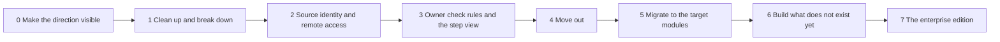
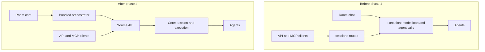

# Hybro Roadmap

This is the order in which Hybro moves toward the [design](design.md).

| # | Phase | In one line | Status |
|---|---|---|---|
| 0 | Make the direction visible | The design, this roadmap, contributor rules and a quick start. | Done |
| 1 | Clean up and break down | Remove what is dead, and split `execution` without changing behaviour. | Done |
| 2 | Source identity and remote access | Hybro verifies which source sent a step, and a source on another machine can reach the Source API with authentication. | Now |
| 3 | Owner check rules and the step view | The owner gates agent calls with rules, and sees each step of a session. | Next |
| 4 | Move out | The model loop leaves the core and becomes the bundled orchestrator, a source. | Later |
| 5 | Migrate to the target modules | The remaining modules and their stored collections take their target names, one at a time, with a data migration. | Later |
| 6 | Build what does not exist yet | Routing without a named agent, and evaluation by hand. | Later |
| 7 | The enterprise edition | The `enterprise/` folders, the license key, and the features a team or a company adds. | Later |

## How we move

- Clean up first. Then come the foundations that an outside source and an
  owner need: source identity, remote access, and the owner's check rules.
  Then the model loop moves out of the core, the remaining modules take their
  target names, and the remaining features are built.
- One small change at a time. There is no rewrite.
- Each change ships on its own, and Room chat keeps working throughout.
- A change adds the new path before it removes the old one. A route or MCP tool
  that exists today is marked as deprecated in one release and removed in a
  later one.
- Phases 2 and 3 ship features a user can see, before the larger structural
  work. Phases 1, 4 and 5 are structural and add no user features. The only
  new behaviour in phase 4 is what the orchestrator needs in order to become a
  source.

How a phase is run:

- Each phase has one tracking issue that lists its changes.
- Each change is one pull request, and its description names the phase.
- The detailed plan for a phase is written when the phase starts, not before.
- A finished change updates the System-Architecture documents, which describe
  today's code, and `design.md` if the target changed.

## Phase 0: Make the direction visible

**Goal.** A contributor can see where Hybro is going before changing anything.

**Work.**

- `design.md`: the concepts, their names, the target modules, and the status of
  each of today's modules.
- This roadmap.
- A short section in `CONTRIBUTING.md` and `AGENTS.md` that links to both.
- A quick start in the README for sending work from your own agent or code.

**Done when.** These documents are merged.

## Phase 1: Clean up and break down

**Goal.** Smaller code, in pieces that can be changed one at a time. Behaviour
does not change.

**Work.**

1. **A list of code to remove.** Done. Each candidate was checked for why it
   looks unused and what depends on it, and the list was agreed before
   anything was deleted.
2. **Removal.** Done. Dead code, stale tests, most test doubles in production
   packages, unused dependencies and legacy configuration aliases are removed.
   Following the deprecation rule, these are marked as deprecated: the redirect
   pages under `/agents` and `/manage`,
   `GET /sse/room/{conversation_id}/status`, and the three agent
   capability-issue routes. What remains is carried forward below.
3. **The split of `execution`.** Done. `execution` was about 30,000 lines,
   and `execution/orchestrator/kernel.py`, about 5,700 lines, held the Run
   lifecycle and the model loop together. The model loop is now its own
   package, `execution/model_loop/`, behind one entry point, `model_loop_for`;
   the kernel keeps the Run lifecycle and depends on the model loop only
   through `model_loop_for`.
   `execution/orchestrator/a2a_runtime/` holds the part that runs agent calls.
4. **A boundary test.** Done. `tests/test_module_boundaries.py` has a rule,
   with no exceptions, that keeps the two parts apart.

**Done when.**

- The model loop is one package with one entry point.
- The rest of `execution` imports nothing from it except that entry point.
- The existing tests pass with no change to what they check. Only import paths
  and source-file paths in tests changed.
- No route, event or stored document changed.

**What stays the same.** Everything a user or a client can see.

**Carried forward.** Each item is done at the point named.

- After the next release, in one removal change:
  - the seven deprecated redirect pages under `/agents` and `/manage`
  - the room SSE status route, `GET /sse/room/{conversation_id}/status`
  - the three agent capability-issue routes, with their service code and the
    `capability_issue_threshold` setting; nothing records a capability issue
    today. The same service backs `AgentExclusionReader`
    (`CapabilityIssueExclusionReader`) and the Room chat target-scope
    exclusion (`bind_capability_issue_reader`), through which open issues
    stored by earlier versions still exclude their agents. That change removes
    both, with the Protocol, and drops the `agent_capability_issues`
    collection, so those agents become selectable again.
  - the marketing pages `/about` and `/pricing`, with `sitemap.ts` and
    `robots.ts`. They are not deprecated first: they are not part of the
    product, and hybro.ai is a separate site
- Deprecated in the next release and removed in a later one, in its own
  change: running several backend workers, which is not a supported setup.
  This covers `gunicorn`, `Settings.is_gunicorn`, `check_multi_worker_safety`,
  the unused Redis Streams client, the Redis settings that prove unused when
  the change is written (the key-value client may stay as an optional cache),
  and the direct `sse-starlette` dependency.
- In the next major release. Open question: which version is the oldest
  supported upgrade.
  - `REMOVED_FIELDS`, `strip_removed_fields`, `RETIRED_SERVICE_KEYS` and the
    `instances` handling, with the `google_api_key` and `gemini_api_key`
    fields
  - the one-off operator scripts
  - the droppers for obsolete indexes, and the fallbacks for old stored data

Items that belong to a later phase are listed in that phase.

## Phase 2: Source identity and remote access

**Goal.** Hybro knows which source sent a step, and a source on another machine
can reach the Source API safely.

This phase comes before the larger structural work because it does not depend
on it. It builds on the `/sessions` routes that exist today, and later features
build on it.

**Work.**

1. **Source identity.** Today a source names itself with `client_label`, and
   the name is not verified. This phase gives each source an identity that
   Hybro verifies. How a source is identified is the open question in
   `design.md`, and it is decided when this phase starts.
2. **Authenticated remote access.** A source on another machine can use the
   Source API with authentication, on a server install as well as on a local
   one.
3. **MCP from another machine.** Today the MCP adapter serves clients on the
   same host and has no authentication. This phase decides between an
   authenticated remote MCP and the rule that remote sources use the HTTP
   Source API.

**Done when.**

- Each Step records a verified source.
- A source on another machine can send a step and read its result with
  authentication, and a remote request without it is refused.
- The documents say what an MCP client can do from another machine.

**Carried from phase 1.** Decided together with authentication:

- the five `clerk_*` frontend fields and `clerk_webhook_secret`
- the signed-out frontend surface: `/sign-in`, `/sign-up`, the redirect
  branches, the signed-out header and the account dialog
- `server_url` in the frontend public configuration
- `enable_waitlist`
- the direct `pyjwt` dependency

**What stays the same.** The routes and MCP tools that exist today. A change to
how a client connects follows the deprecation rule above, and so does a change
to the sign-in pages carried from phase 1.

## Phase 3: Owner check rules and the step view

**Goal.** The owner decides which agent calls need an answer first, and sees
what each step did.

**Work.**

1. **Check rules.** The `policy` module starts here. The owner writes rules
   that answer allow, deny or ask, such as "ask me before any step goes to the
   coder agent". An "ask" becomes a Question that the owner answers in the
   Panel.
2. **One place for the check.** Until phase 4, Room chat calls agents on its
   own path and not through the Source API. A check rule must still apply to
   those calls, so the check sits where both paths send an agent call. If that
   cannot be done, the rules apply to steps from the Source API only, and the
   Rules page says so until phase 4.
3. **The grant.** The owner can grant one source the right to answer permission
   questions. It relies on the verified source of phase 2. It also adds the
   first way for a source to answer a Question through the Source API, for
   permission questions only. Information questions follow in phase 4.
4. **The Rules page** in the Panel, with the check rules.
5. **The step view.** The Sessions page shows each step's input, output and
   timing. Until phase 4 it covers sessions from the Source API only, because
   Room chat's agent calls are not Steps yet.

**Done when.**

- A check rule that answers "ask" stops a call until the owner answers, and a
  rule that answers "deny" ends the step with a reason.
- The documents and the Rules page say which calls the rules cover.
- A source with the grant can answer a permission question, and a source
  without it is refused.
- The Sessions page shows the input, output and timing of each step sent
  through the Source API.
- With no rules, every call goes as it does today.

**Carried from phase 1.** Decide whether the step view reads
`orchestrator_run_events` or replaces it. Today every Run writes it, and no
product feature reads it.

**What stays the same.** Sessions and chats on an instance with no rules.

## Phase 4: Move out

**Goal.** The core only runs steps. Room chat uses the same door as every other
source.

**Work.**

1. **The Source API grows far enough to carry an orchestrator.** Today's
   `/sessions` routes take text only, run one request at a time in a session,
   and make the caller poll. The orchestrator needs four things:
   - a step can point at earlier results and files
   - information questions go back to the source
   - several steps can run in one Session
   - a source can follow events live
2. **The bundled orchestrator becomes a source.** It receives a chat message,
   plans, sends each agent call as a step through the Source API, and answers
   in the chat. `context_memory` moves with it, because its only reader is the
   orchestrator.
3. **Room chat switches over.** The new path runs beside the old one behind a
   setting until it behaves the same. Then the new path becomes the default,
   and the old one is removed in a later release.

**Done when.**

- Every agent call that Room chat makes is a Step sent through the Source API.
- `execution` has one way to run a call, which is today's `passthrough`
  profile.
- The core imports nothing from the orchestrator.
- The old Room chat path is gone.
- The check rules of phase 3 cover every call through the one path.

**Carried from phase 1.** Settled when the model loop moves out:

- the unwired context compaction, with its test-only
  `DeterministicFakeCompactor`, and the `orchestrator_fast_max_compactions`
  and `orchestrator_ultimate_max_compactions` settings
- the reserved profile dimensions `initial_routing` and `finalization`
- `room_summary` and `room_facts` on `room_memories`

**What stays the same.** The chat pages and the rooms API. The `/sessions`
routes keep working, and new fields are optional.

**The main risk.** This is the largest change in the roadmap. Running the two
paths side by side, and comparing them on the same messages, is what keeps it
safe.

## Phase 5: Migrate to the target modules

**Goal.** The code reads like the design.

**Work.** One module per change, smallest first:

| Today | Target | Note |
|---|---|---|
| `instance_settings` | `settings` | Rename only. |
| `jobs` | `scheduler` | Rename; it also takes the queue and limits for running calls. |
| `llm_gateway` | `llm` | Rename; what remains is picking and judging. |
| `delivery` | `events` | Rename; it takes the event log together with the live stream. |
| `conversation` and `session` | `session` | Merge. This is the largest one. |
| `approval`, `agent`, `dal`, `a2a_adapter` | unchanged | No rename. |

Code also takes the concept names from `design.md`: Question for HITL, Agent
call for run and agent call, Session for room.

**Stored data.** The stored collections take the concept names too. For
example, `hitl_requests` is renamed after Question and
`orchestrator_agent_calls` after Agent call. This needs a data migration:

- The mapping from each old collection to its new name is written when the
  phase starts.
- The migration follows the pattern Hybro already uses: a script that audits
  first, then migrates, and records a marker in `migration_markers`, so it is
  safe to run again.
- It is tested on data in the shape of a real install before it is released.
- An existing install upgrades without losing data, and the release notes say
  how to go back.
- One module's collections move per change.

**Carried from phase 1.**

- The guard that skips run events of retired kinds in `room_events`
  (`delivery/snapshot.py`) stays until those old rows are deleted. No change
  deletes them yet; the data migration of this phase decides it.
- The compacted full-content store, `conversation_content`: its write stops and
  the collection is dropped in the same change.
- `execution/orchestrator/__init__.py` and
  `execution/orchestrator/a2a_runtime/__init__.py` re-export only the target
  modules' public names.

**Done when.**

- Module names match `design.md`.
- Collection names match the concept names, and an upgrade from the previous
  release is tested.
- The module boundary tests and the System-Architecture documents use the new
  names.

**What stays the same.** Public routes, and everything a user has stored.

## Phase 6: Build what does not exist yet

**Goal.** The remaining features, built once on the final structure.

In this order:

1. **Routing without a named agent.**
   - The agent becomes optional on a step.
   - `routing` finds one: owner route rules first, then search and match in the
     registry, then the LLM pick. It reuses today's agent search and agent
     selection.
   - Steps carry labels, and route rules match on them.
   - Each step records how its agent was chosen.
   - The Rules page gains the ordered route rules.
2. **Evaluation by hand.**
   - A user writes a Standard and checks it against the current run.
   - The Panel gets the Evaluation page.

Later, with no fixed place yet: event sources such as CI, chat apps and
notifications, and timers that start work.

## Phase 7: The enterprise edition

**Goal.** The features a team or a company adds, without changing what the
community edition does.

**Work.**

1. **The `enterprise/` folders.** Enterprise code sits in a folder named
   `enterprise/` inside each part of the code it extends, under a commercial
   license. Everything outside those folders stays under Apache 2.0.
2. **The license key** that turns the enterprise features on.
3. **The features**, each behind a small hook in the community code:
   - access rules and roles: who may use which agent or item. An access rule
     that matches on a source relies on the verified source of phase 2.
   - several approvers, and approval by role
   - saved standards that run on every step, with results over time
   - audit across sessions, and export
   - users, teams and single sign-on

**Done when.**

- A check in CI builds and runs the community edition with every `enterprise/`
  folder deleted.
- No code outside an `enterprise/` folder imports from one.

**What stays the same.** Every community feature. See
[Community and enterprise](design.md#community-and-enterprise) for which
feature is in which edition.

## Where today's code already fits

The step path exists in a small form. `POST /sessions/messages` sends one
message to one named agent, returns a receipt without waiting, and uses
`client_request_id` so that a retry is safe. The owner approves in the app, and
the state is read from the event log.

It has five limits:

- The source names itself, and the name is not verified. Phase 2 removes this.
- A message is text only. Phase 4 removes this.
- A session runs one request at a time. Phase 4 removes this.
- The client polls for the result. Phase 4 removes this.
- The agent must be named. Phase 6 removes this.
