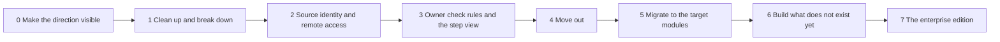
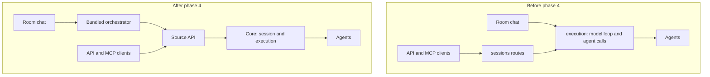

# Hybro Roadmap

This is the order in which Hybro moves toward the [design](design.md).

| # | Phase | In one line | Status |
|---|---|---|---|
| 0 | Make the direction visible | The design, this roadmap, contributor rules and a quick start. | Done |
| 1 | Clean up and break down | Remove what is dead, and split `execution` without changing behaviour. | Done |
| 2 | Source identity and remote access | Each source has a token and the owner has an account, so Hybro knows which source sent a step, and a source on another machine can reach the Source API. | Done |
| 3 | Owner check rules and the step view | The owner gates agent calls with rules, and sees each step of a session. | Next |
| 4 | Move out | The model loop leaves the core and becomes the bundled orchestrator, a source. | Later |
| 5 | Migrate to the target modules | The remaining modules and their stored collections take their target names, one at a time, with a data migration. | Later |
| 6 | Build what does not exist yet | Routing without a named agent, and evaluation by hand. | Later |
| 7 | The enterprise edition | The `enterprise/` folders, the license key, and the features a team or a company adds. | Later |

## How we move

- Clean up first. Then come the foundations that an outside source and an
  owner need: source identity, remote access, and the owner's check rules.
  Then the model loop moves out of the core, the remaining modules take their
  target names, and the remaining features are built.
- One small change at a time. There is no rewrite.
- Each change ships on its own, and Room chat keeps working throughout.
- A change adds the new path before it removes the old one. A route or MCP tool
  that exists today is marked as deprecated in one release and removed in a
  later one.
- Phases 2 and 3 ship features a user can see, before the larger structural
  work. Phases 1, 4 and 5 are structural and add no user features. The only
  new behaviour in phase 4 is what the orchestrator needs in order to become a
  source.

How a phase is run:

- Each phase has one tracking issue that lists its changes.
- Each change is one pull request, and its description names the phase.
- The detailed plan for a phase is written when the phase starts, not before.
- A finished change updates the System-Architecture documents, which describe
  today's code, and `design.md` if the target changed.

## Phase 0: Make the direction visible

**Goal.** A contributor can see where Hybro is going before changing anything.

**Work.**

- `design.md`: the concepts, their names, the target modules, and the status of
  each of today's modules.
- This roadmap.
- A short section in `CONTRIBUTING.md` and `AGENTS.md` that links to both.
- A quick start in the README for sending work from your own agent or code.

**Done when.** These documents are merged.

## Phase 1: Clean up and break down

**Goal.** Smaller code, in pieces that can be changed one at a time. Behaviour
does not change.

**Work.**

1. **A list of code to remove.** Done. Each candidate was checked for why it
   looks unused and what depends on it, and the list was agreed before
   anything was deleted.
2. **Removal.** Done. Dead code, stale tests, most test doubles in production
   packages, unused dependencies and legacy configuration aliases are removed.
   Following the deprecation rule, these are marked as deprecated: the redirect
   pages under `/agents` and `/manage`,
   `GET /sse/room/{conversation_id}/status`, and the three agent
   capability-issue routes. What remains is carried forward below.
3. **The split of `execution`.** Done. `execution` was about 30,000 lines,
   and `execution/orchestrator/kernel.py`, about 5,700 lines, held the Run
   lifecycle and the model loop together. The model loop is now its own
   package, `execution/model_loop/`, behind one entry point, `model_loop_for`;
   the kernel keeps the Run lifecycle and depends on the model loop only
   through `model_loop_for`.
   `execution/orchestrator/a2a_runtime/` holds the part that runs agent calls.
4. **A boundary test.** Done. `tests/test_module_boundaries.py` has a rule,
   with no exceptions, that keeps the two parts apart.

**Done when.**

- The model loop is one package with one entry point.
- The rest of `execution` imports nothing from it except that entry point.
- The existing tests pass with no change to what they check. Only import paths
  and source-file paths in tests changed.
- No route, event or stored document changed.

**What stays the same.** Everything a user or a client can see.

**Carried forward.** Each item is done at the point named.

- After the next release, in one removal change:
  - the seven deprecated redirect pages under `/agents` and `/manage`
  - the room SSE status route, `GET /sse/room/{conversation_id}/status`
  - the three agent capability-issue routes, with their service code and the
    `capability_issue_threshold` setting; nothing records a capability issue
    today. The same service backs `AgentExclusionReader`
    (`CapabilityIssueExclusionReader`) and the Room chat target-scope
    exclusion (`bind_capability_issue_reader`), through which open issues
    stored by earlier versions still exclude their agents. That change removes
    both, with the Protocol, and drops the `agent_capability_issues`
    collection, so those agents become selectable again.
  - the marketing pages `/about` and `/pricing`, with `sitemap.ts` and
    `robots.ts`. They are not deprecated first: they are not part of the
    product, and hybro.ai is a separate site
- Deprecated in the next release and removed in a later one, in its own
  change: running several backend workers, which is not a supported setup.
  This covers `gunicorn`, `Settings.is_gunicorn`, `check_multi_worker_safety`,
  the unused Redis Streams client, the Redis settings that prove unused when
  the change is written (the key-value client may stay as an optional cache),
  and the direct `sse-starlette` dependency.
- In the next major release. Open question: which version is the oldest
  supported upgrade.
  - `REMOVED_FIELDS`, `strip_removed_fields`, `RETIRED_SERVICE_KEYS` and the
    `instances` handling, with the `google_api_key` and `gemini_api_key`
    fields
  - the one-off operator scripts
  - the droppers for obsolete indexes, and the fallbacks for old stored data

Items that belong to a later phase are listed in that phase.

## Phase 2: Source identity and remote access

**Status.** Done. What it leaves for later is under "Carried forward" at the
end of this phase.

**Goal.** Hybro knows which source sent a step, a source on another machine can
reach the Source API safely, and only the owner can open the Panel.

This phase comes before the larger structural work because it does not depend
on it. It builds on the `/sessions` routes that exist today, and later features
build on it.

**The model.** One install and one rule, on a laptop and on a server alike:
the Panel needs the owner's sign-in, and a program needs a source token.
Nothing depends on an authentication mode or on how the instance was started.
[Who may use it](design.md#who-may-use-it) in the design has the details.

**Work.**

1. **Sources and their tokens.**
   - The owner creates a source and receives its token once. Hybro stores a
     hash, and every Step records the source that sent it.
   - `hybro source create --name` creates a source on the machine that runs
     Hybro and prints its token once, for a headless install and for tests
     that run against a started image.
   - A token reaches the Source API only.
   - `client_label` stays accepted. It is optional with a token and required
     when a session is opened without one. It is marked as deprecated for
     requests that carry a token.
   - Sessions from before this phase keep their stored label, shown as not
     verified. No stored data is rewritten.
2. **The Sources tab.** The Connect page (named Access in today's UI) gains a
   Sources tab before MCP and API.
   - It lists each source: name, how it connects, last use, creation date and
     the last four characters of its token. Hybro stores those four
     characters beside the hash of the token, so that the owner can tell
     tokens apart; the token itself is never stored.
   - A source can be renamed, its token rotated or revoked, and its sessions
     opened from there.
   - Creating a source shows the token once, with a ready-to-paste snippet that
     already contains it.
   - The Sessions page shows the source as the requester.
3. **The owner account.**
   - On the first visit the owner creates the account: name, email, password.
     The setup page opens only through a one-time link that `hybro` prints,
     with the code after the `#`.
   - `hybro` asks the backend for a new code each time it runs while no
     account exists, and prints the link itself, so the code does not pass
     through the container logs. The backend stores only a hash. The code
     works once, and stops working after 24 hours or when a newer one is
     issued.
   - `hybro owner create` creates the account without a browser, for a
     headless install and for tests that run against a started image. It takes
     the name and the email as options and reads the password from a prompt
     or from standard input, never from an option. It works only while no
     account exists.
   - Until the account exists, the routes that need the owner's sign-in and
     the Source API refuse requests.
   - Sign-in is required on every install. Every route needs it except the
     Source API, which takes a source token, and the routes that agents and
     probes call with their own credential or none: the model proxy
     (`/internal/llm`, the internal credential), `/a2a/push` (the push token
     of the call) and `/health`.
   - The sign-in is kept in a cookie. Sign-in and setup limit repeated
     attempts, and the cookie is `SameSite` with a check against cross-site
     request forgery on every route that changes something.
   - The account sits in the existing user menu: profile, password change,
     signed-in browsers, sign out.
   - `hybro owner reset-password` on the machine resets a forgotten password
     and signs out every browser.
   - There is one account. It is stored as a user record, so that the
     enterprise edition can add people later.
4. **The token requirement and its switch.**
   - A source token is required by default on every install.
   - The owner can turn the requirement off with a switch on the Sources tab,
     after a confirmation that states the consequence. A request without a
     token is then recorded under the built-in "No token" source.
   - A request with an unknown or revoked token is refused, also while the
     requirement is off. It is never recorded under "No token".
   - While it is off, the Connect page shows a banner that the owner can
     dismiss, with a dialog that explains it and holds the switch.
   - `hybro` prints a warning, and blocks nothing, when the instance listens on
     another address than this machine's while the requirement is off.
5. **MCP with tokens.** `/mcp` is served on every install. A client sends its
   source token, and the adapter passes it to the Source API, which checks it.
   On a listener that other machines can reach, the MCP server's own check of
   the `Host` and `Origin` headers is off, and the token is the control; it
   passes the caller's address on, so the backend refuses a name it does not
   answer to, as on the API. On a loopback listener that check stays.
   Which MCP clients can send a fixed token is checked against the MCP
   specification and the clients' documentation when this is built.
6. **Plain HTTP.** Hybro does not block it. The setup, sign-in and Connect
   pages warn when they are opened over plain HTTP from another machine, the
   session cookie is marked secure under HTTPS, and the documentation shows how
   to put a reverse proxy in front
   ([behind a reverse proxy](reverse-proxy.md)). `backend.proxy_hops` in
   `config.json` gives the number of reverse proxies in front of Hybro,
   default 0. With a count, Hybro believes the forwarded scheme and host and
   takes the client address that many proxies back; the secure cookie, the
   cross-site check, the address check and the attempt limits depend on it
   behind a proxy. A public listener needs no flag.
7. **What this replaces.** Each of these is marked as deprecated in the release
   that ships the owner account and removed in a later one:
   - Clerk mode, with the five `clerk_*` frontend fields,
     `clerk_webhook_secret`, `enable_waitlist`, the Clerk library and the
     direct `pyjwt` dependency. Its settings stay accepted until their
     removal, so no configuration file fails to load.
   - `mock` mode. It is treated as the built-in account, and `auth_mode`
     becomes a retired key when Clerk mode is removed. Tests provide their own
     user in the test setup, so no production path skips authentication.
   - the `--insecure-no-auth` option, in favour of the switch
   - the code that reads the `?token=` query parameter on the event stream
     routes. The Panel's cookie replaces it.
   - the rule that a listener on another address needs Clerk, and the rule that
     leaves `/mcp` out on such a listener. `--listen` stays as a networking
     option with its default, `127.0.0.1`.

   The Clerk sign-in itself, and `?token=` with it, stop working in one step,
   in the release that enforces the owner's sign-in, with no deprecation
   release. This is an exception to the deprecation rule in "How we move":
   no install is known to run in Clerk mode, and the Panel does not work with
   it today. From that release on a Clerk token opens nothing. The Clerk
   library leaves in the same release, because only that sign-in used it; the
   Clerk settings stay accepted until Clerk mode is removed.

   `POST /agents/messages` is removed in this phase with no deprecation
   release, an exception to the deprecation rule in "How we move": nothing in
   the product calls it, and it sends work to an agent around the Step path,
   with no record of which source sent it. `POST /sessions/messages` replaces
   it.

**Upgrading an existing install.**

- **From mock mode.** The first visit after the upgrade shows the setup page
  once. The new account takes over the one identity that the stored sessions,
  rooms and settings belong to, so nothing is lost and nothing is rewritten.
  The token requirement starts off, so programs that are already connected
  keep working. A one-time notice and the banner tell the owner.
- **From Clerk mode.** No install is known to run in Clerk mode: the Panel
  does not work with it today. There is no separate move path, and a
  configuration with `auth_mode: clerk` gets the same account as every other
  install. For such a configuration:
  - The new account takes over the identity listed in
    `backend.admin_user_ids`. If several are listed, the owner chooses one;
    if none is, it takes the same identity as on every other install.
  - The token requirement is on, because the install required a credential
    before. A program that sent a Clerk token needs a source token.
  - What other users stored stays in the database, unchanged and not shown.
    Nothing is deleted or rewritten.
- No upgrade leaves an install more open than it was. A fresh install starts
  with the token requirement on.

**Done when.**

- Each Step records the source that sent it: a source with a token, or
  "No token" while the owner has the requirement off.
- A source on another machine can send a step and read its result with its
  token. Without a token the request is refused, unless the owner turned the
  requirement off.
- The Panel and every route need the owner's sign-in, except the Source API
  and the agent-facing routes and `/health` named above. A source token opens
  only the Source API.
- A revoked token is refused whether the requirement is on or off.
- The owner account can be created only through the setup link or
  `hybro owner create`, and only while none exists.
- An install upgraded from mock mode keeps its data, and its connected
  programs keep working. A configuration with `auth_mode: clerk` gets an
  owner account that takes over the listed admin's data, and it requires a
  source token.
- The functional tests create the owner with `hybro owner create`.
- An MCP client can connect from another machine with a source token, and the
  documents say so.

**Carried from phase 1.** Where each item ends:

- the five `clerk_*` frontend fields, `clerk_webhook_secret`, `enable_waitlist`
  and the direct `pyjwt` dependency (the Clerk library itself is gone):
  retired with Clerk mode, in item 7
- the signed-out frontend surface: done. `/sign-in` is the owner's sign-in,
  `/sign-up` is removed and `/setup` opens from the setup link, one gate in
  the portal layout replaces the per-page check, and the account dialog calls
  the `/auth` routes
- `server_url` in the frontend public configuration: decided, it stays. In
  the image it names the address a public install answers to (the trusted
  host rule), so an install reached by a name sets it.

**What stays the same.** The `/sessions` routes and the MCP tools, with their
request and response shapes. What changes for a user: the Panel asks for
sign-in on every install, and a fresh install asks a program for a token. A
change to how a client connects follows the deprecation rule above.

**Carried forward.** Marked as deprecated in this phase and removed in a
later release, together, when Clerk mode is removed:

- the Clerk settings: the five `clerk_*` frontend fields, `enable_waitlist`,
  `clerk_secret_key` and `clerk_webhook_secret` (the Clerk library is gone)
- `mock` mode, and `auth_mode` with `admin_user_ids`, which then become
  retired keys
- `--insecure-no-auth`, which does nothing, with `HYBRO_INSECURE_NO_AUTH` and
  the `insecure_no_auth` field in `runtime.json`
- the rename of `ClerkUser`, the type every route receives
- the `pyjwt` dependency, which nothing imports

The `?token=` handling on the event stream routes is already gone.

Open items found in this phase, each a small change of its own:

- In a checkout, `owner_cli.py` does not check which process listens on port
  8000 before it sends the password there.
- Two backends that share one `HYBRO_HOME` can remove each other's
  `run/machine.json`.
- Nothing warns at startup when a public listener has no
  `frontend.server_url`, so an install reached by a name answers 421 until it
  is set.

## Phase 3: Owner check rules and the step view

**Goal.** The owner decides which agent calls need an answer first, and sees
what each step did.

**Work.**

1. **Check rules.** The `policy` module starts here. The owner writes rules
   that answer allow, deny or ask, such as "ask me before any step goes to the
   coder agent". An "ask" becomes a Question that the owner answers in the
   Panel.
2. **One place for the check.** Until phase 4, Room chat calls agents on its
   own path and not through the Source API. A check rule must still apply to
   those calls, so the check sits where both paths send an agent call. If that
   cannot be done, the rules apply to steps from the Source API only, and the
   Rules page says so until phase 4.
3. **The grant.** The owner can grant one source the right to answer permission
   questions. It relies on the source tokens of phase 2, and it can never be
   given to the "No token" source. It also adds the first way for a source to
   answer a Question through the Source API, for permission questions only.
   Information questions follow in phase 4.
4. **The Rules page** in the Panel, with the check rules.
5. **The step view.** The Sessions page shows each step's input, output and
   timing. Until phase 4 it covers sessions from the Source API only, because
   Room chat's agent calls are not Steps yet.

**Done when.**

- A check rule that answers "ask" stops a call until the owner answers, and a
  rule that answers "deny" ends the step with a reason.
- The documents and the Rules page say which calls the rules cover.
- A source with the grant can answer a permission question, and a source
  without it is refused.
- The Sessions page shows the input, output and timing of each step sent
  through the Source API.
- With no rules, every call goes as it does today.

**Carried from phase 1.** Decide whether the step view reads
`orchestrator_run_events` or replaces it. Today every Run writes it, and no
product feature reads it.

**What stays the same.** Sessions and chats on an instance with no rules.

## Phase 4: Move out

**Goal.** The core only runs steps. Room chat uses the same door as every other
source.

**Work.**

1. **The Source API grows far enough to carry an orchestrator.** Today's
   `/sessions` routes take text only, run one request at a time in a session,
   and make the caller poll. The orchestrator needs four things:
   - a step can point at earlier results and files
   - information questions go back to the source
   - several steps can run in one Session
   - a source can follow events live
2. **The bundled orchestrator becomes a source.** It receives a chat message,
   plans, sends each agent call as a step through the Source API, and answers
   in the chat. `context_memory` moves with it, because its only reader is the
   orchestrator.
3. **Room chat switches over.** The new path runs beside the old one behind a
   setting until it behaves the same. Then the new path becomes the default,
   and the old one is removed in a later release.

**Done when.**

- Every agent call that Room chat makes is a Step sent through the Source API.
- `execution` has one way to run a call, which is today's `passthrough`
  profile.
- The core imports nothing from the orchestrator.
- The old Room chat path is gone.
- The check rules of phase 3 cover every call through the one path.

**Carried from phase 1.** Settled when the model loop moves out:

- the unwired context compaction, with its test-only
  `DeterministicFakeCompactor`, and the `orchestrator_fast_max_compactions`
  and `orchestrator_ultimate_max_compactions` settings
- the reserved profile dimensions `initial_routing` and `finalization`
- `room_summary` and `room_facts` on `room_memories`

**What stays the same.** The chat pages and the rooms API. The `/sessions`
routes keep working, and new fields are optional.

**The main risk.** This is the largest change in the roadmap. Running the two
paths side by side, and comparing them on the same messages, is what keeps it
safe.

## Phase 5: Migrate to the target modules

**Goal.** The code reads like the design.

**Work.** One module per change, smallest first:

| Today | Target | Note |
|---|---|---|
| `instance_settings` | `settings` | Rename only. |
| `jobs` | `scheduler` | Rename; it also takes the queue and limits for running calls. |
| `llm_gateway` | `llm` | Rename; what remains is picking and judging. |
| `delivery` | `events` | Rename; it takes the event log together with the live stream. |
| `conversation` and `session` | `session` | Merge. This is the largest one. |
| `approval`, `agent`, `dal`, `a2a_adapter` | unchanged | No rename. |

Code also takes the concept names from `design.md`: Question for HITL, Agent
call for run and agent call, Session for room.

**Stored data.** The stored collections take the concept names too. For
example, `hitl_requests` is renamed after Question and
`orchestrator_agent_calls` after Agent call. This needs a data migration:

- The mapping from each old collection to its new name is written when the
  phase starts.
- The migration follows the pattern Hybro already uses: a script that audits
  first, then migrates, and records a marker in `migration_markers`, so it is
  safe to run again.
- It is tested on data in the shape of a real install before it is released.
- An existing install upgrades without losing data, and the release notes say
  how to go back.
- One module's collections move per change.

**Carried from phase 1.**

- The guard that skips run events of retired kinds in `room_events`
  (`delivery/snapshot.py`) stays until those old rows are deleted. No change
  deletes them yet; the data migration of this phase decides it.
- The compacted full-content store, `conversation_content`: its write stops and
  the collection is dropped in the same change.
- `execution/orchestrator/__init__.py` and
  `execution/orchestrator/a2a_runtime/__init__.py` re-export only the target
  modules' public names.

**Done when.**

- Module names match `design.md`.
- Collection names match the concept names, and an upgrade from the previous
  release is tested.
- The module boundary tests and the System-Architecture documents use the new
  names.

**What stays the same.** Public routes, and everything a user has stored.

## Phase 6: Build what does not exist yet

**Goal.** The remaining features, built once on the final structure.

In this order:

1. **Routing without a named agent.**
   - The agent becomes optional on a step.
   - `routing` finds one: owner route rules first, then search and match in the
     registry, then the LLM pick. It reuses today's agent search and agent
     selection.
   - Steps carry labels, and route rules match on them.
   - Each step records how its agent was chosen.
   - The Rules page gains the ordered route rules.
2. **Evaluation by hand.**
   - A user writes a Standard and checks it against the current run.
   - The Panel gets the Evaluation page.

Later, with no fixed place yet:

- event sources such as CI, chat apps and notifications, and timers that start
  work
- built-in HTTPS: the image's Caddy obtains and renews a certificate for a
  domain the owner names
- the MCP specification's own authorization flow, for MCP clients that cannot
  send a fixed token

## Phase 7: The enterprise edition

**Goal.** The features a team or a company adds, without changing what the
community edition does.

**Work.**

1. **The `enterprise/` folders.** Enterprise code sits in a folder named
   `enterprise/` inside each part of the code it extends, under a commercial
   license. Everything outside those folders stays under Apache 2.0.
2. **The license key** that turns the enterprise features on.
3. **The features**, each behind a small hook in the community code:
   - access rules and roles: who may use which agent or item. An access rule
     that matches on a source needs a source with a token and can never
     match "No token".
   - several approvers, and approval by role
   - saved standards that run on every step, with results over time
   - audit across sessions, and export
   - more users, members with fewer rights, teams and single sign-on. Sign-in
     for these is designed here; it does not assume the Clerk mode that phase
     2 retires.

**Done when.**

- A check in CI builds and runs the community edition with every `enterprise/`
  folder deleted.
- No code outside an `enterprise/` folder imports from one.

**What stays the same.** Every community feature. See
[Community and enterprise](design.md#community-and-enterprise) for which
feature is in which edition.

## Where today's code already fits

The step path exists in a small form. `POST /sessions/messages` sends one
message to one named agent, returns a receipt without waiting, and uses
`client_request_id` so that a retry is safe. The owner approves in the app, and
the state is read from the event log.

It has five limits:

- The source names itself, and the name is not verified. Phase 2 removes this.
- A message is text only. Phase 4 removes this.
- A session runs one request at a time. Phase 4 removes this.
- The client polls for the result. Phase 4 removes this.
- The agent must be named. Phase 6 removes this.
