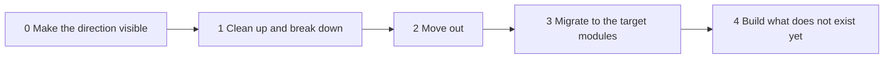
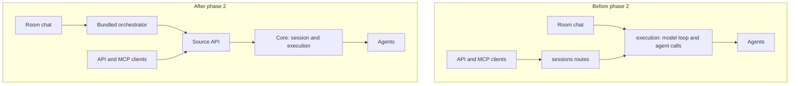

# Hybro Roadmap

This is the order in which Hybro moves toward the [design](design.md).

| # | Phase | In one line | Status |
|---|---|---|---|
| 0 | Make the direction visible | The design, this roadmap, contributor rules and a quick start. | Now |
| 1 | Clean up and break down | Remove what is dead, and split `execution` without changing behaviour. | Next |
| 2 | Move out | The model loop leaves the core and becomes the bundled orchestrator, a source. | Later |
| 3 | Migrate to the target modules | The remaining modules and their stored collections take their target names, one at a time, with a data migration. | Later |
| 4 | Build what does not exist yet | Routing without a named agent, evaluation by hand, owner check rules. | Later |

## How we move

- Structure first, features after. We make today's code smaller and cleaner,
  then move parts out of the core, then give the remaining modules their target
  names, and only then build what does not exist yet.
- One small change at a time. There is no rewrite.
- Each change ships on its own, and Room chat keeps working throughout.
- A change adds the new path before it removes the old one. A route or MCP tool
  that exists today is marked as deprecated in one release and removed in a
  later one.
- Phases 1 to 3 add no user features. The only new behaviour before phase 4 is
  what the orchestrator needs in order to become a source.

How a phase is run:

- Each phase has one tracking issue that lists its changes.
- Each change is one pull request, and its description names the phase.
- The detailed plan for a phase is written when the phase starts, not before.
- A finished change updates the System-Architecture documents, which describe
  today's code, and `design.md` if the target changed.

## Phase 0: Make the direction visible

**Goal.** A contributor can see where Hybro is going before changing anything.

**Work.**

- `design.md`: the concepts, their names, the target modules, and the status of
  each of today's modules.
- This roadmap.
- A short section in `CONTRIBUTING.md` and `AGENTS.md` that links to both.
- A quick start in the README for sending work from your own agent or code.

**Done when.** These documents are merged.

## Phase 1: Clean up and break down

**Goal.** Smaller code, in pieces that can be changed one at a time. Behaviour
does not change.

**Work.**

1. **An inventory of code to remove.** It lists each candidate, why it looks
   unused, and what depends on it. Nothing is deleted until the list is agreed.
   Candidates to check, not decisions:
   - the empty `backend/extensions/` folder
   - frontend pages that only redirect to a newer address, such as `/agents`,
     `/manage` and `/networks`
   - stored run events of retired kinds, which are skipped when read
   - compacted conversation content, which is written and not read back
2. **Removal.** Each agreed item is removed in its own change. A public route
   follows the deprecation rule above.
3. **The split of `execution`.** Today `execution` is about 30,000 lines.
   `execution/orchestrator/a2a_runtime/` already holds the part that runs agent
   calls. `execution/orchestrator/kernel.py`, about 5,700 lines, holds the Run
   lifecycle and the model loop together. The split puts the model loop behind
   one interface with one entry point, so that the rest of `execution` no
   longer depends on model code.
4. **A boundary test.** `tests/test_module_boundaries.py` gains a rule that
   keeps the two parts apart.

**Done when.**

- The model loop is one package with one entry point.
- The rest of `execution` imports nothing from it except that entry point.
- The existing tests pass without being changed.
- No route, event or stored document changed.

**What stays the same.** Everything a user or a client can see.

## Phase 2: Move out

**Goal.** The core only runs steps. Room chat uses the same door as every other
source.

**Work.**

1. **The Source API grows far enough to carry an orchestrator.** Today's
   `/sessions` routes take text only, run one request at a time in a session,
   and make the caller poll. The orchestrator needs four things:
   - a step can point at earlier results and files
   - information questions go back to the source
   - several steps can run in one Session
   - a source can follow events live
2. **The bundled orchestrator becomes a source.** It receives a chat message,
   plans, sends each agent call as a step through the Source API, and answers
   in the chat. `context_memory` moves with it, because its only reader is the
   orchestrator.
3. **Room chat switches over.** The new path runs beside the old one behind a
   setting until it behaves the same. Then the new path becomes the default,
   and the old one is removed in a later release.

**Done when.**

- Every agent call that Room chat makes is a Step sent through the Source API.
- `execution` has one way to run a call, which is today's `passthrough`
  profile.
- The core imports nothing from the orchestrator.
- The old Room chat path is gone.

**What stays the same.** The chat pages and the rooms API. The `/sessions`
routes keep working, and new fields are optional.

**The main risk.** This is the largest change in the roadmap. Running the two
paths side by side, and comparing them on the same messages, is what keeps it
safe.

## Phase 3: Migrate to the target modules

**Goal.** The code reads like the design.

**Work.** One module per change, smallest first:

| Today | Target | Note |
|---|---|---|
| `instance_settings` | `settings` | Rename only. |
| `jobs` | `scheduler` | Rename; it also takes the queue and limits for running calls. |
| `llm_gateway` | `llm` | Rename; what remains is picking and judging. |
| `delivery` | `events` | Rename; it takes the event log together with the live stream. |
| `conversation` and `session` | `session` | Merge. This is the largest one. |
| `approval`, `agent`, `dal`, `a2a_adapter` | unchanged | No rename. |

Code also takes the concept names from `design.md`: Question for HITL, Agent
call for run and agent call, Session for room.

**Stored data.** The stored collections take the concept names too. For
example, `hitl_requests` is renamed after Question and
`orchestrator_agent_calls` after Agent call. This needs a data migration:

- The mapping from each old collection to its new name is written when the
  phase starts.
- The migration follows the pattern Hybro already uses: a script that audits
  first, then migrates, and records a marker in `migration_markers`, so it is
  safe to run again.
- It is tested on data in the shape of a real install before it is released.
- An existing install upgrades without losing data, and the release notes say
  how to go back.
- One module's collections move per change.

**Done when.**

- Module names match `design.md`.
- Collection names match the concept names, and an upgrade from the previous
  release is tested.
- The module boundary tests and the System-Architecture documents use the new
  names.

**What stays the same.** Public routes, and everything a user has stored.

## Phase 4: Build what does not exist yet

**Goal.** The new features, built once on the final structure.

In this order:

1. **Routing without a named agent.**
   - The agent becomes optional on a step.
   - `routing` finds one: owner route rules first, then search and match in the
     registry, then the LLM pick. It reuses today's agent search and agent
     selection.
   - Steps carry labels, and route rules match on them.
   - Each step records how its agent was chosen.
   - The Panel gets the Rules page.
2. **Evaluation by hand.**
   - The Sessions page shows each step's input, output and timing.
   - A user writes a Standard and checks it against the current run.
   - The Panel gets the Evaluation page.
3. **Owner check rules.**
   - The owner writes rules that answer allow, deny or ask, such as "ask me
     before any agent pushes code".
   - The owner can grant one source the right to answer permission questions.

Later, with no fixed place yet: event sources such as CI, chat apps and
notifications, and timers that start work.

## Where today's code already fits

The step path exists in a small form. `POST /sessions/messages` sends one
message to one named agent, returns a receipt without waiting, and uses
`client_request_id` so that a retry is safe. The owner approves in the app, and
the state is read from the event log.

It has four limits:

- A message is text only. Phase 2 removes this.
- A session runs one request at a time. Phase 2 removes this.
- The client polls for the result. Phase 2 removes this.
- The agent must be named. Phase 4 removes this.
